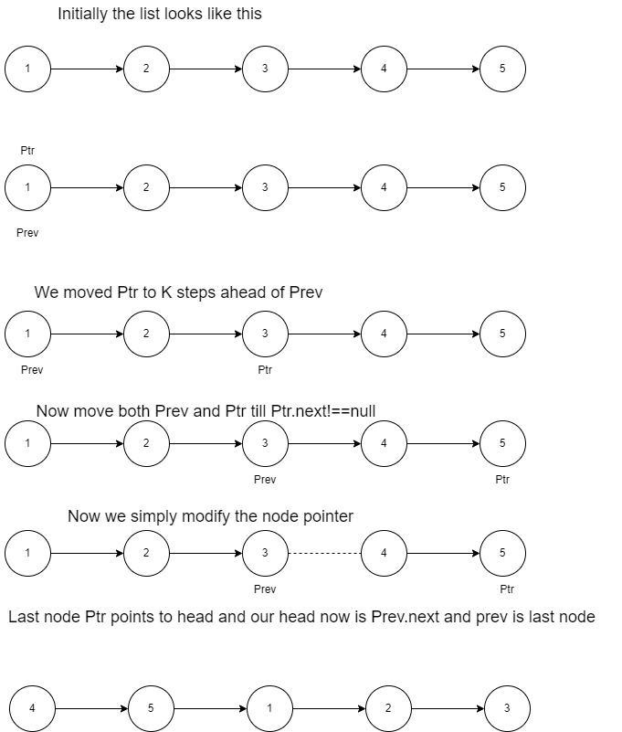

# ✔ Algo Explained | Easy | JS | 97% fast | Commented

**Author:** _kapi1
**Votes:** 29
**Link:** [https://leetcode.com/problems/rotate-list/solutions/1838161/](https://leetcode.com/problems/rotate-list/solutions/1838161/)

---

```
/* 
Algorithm Explanation: (Image attached in comments)
1.  We count the total number of nodes in the list using count variable,
2.  Now the total rotations we have to do can be restricted to k= k % count.
3.  Now we move a pointer from head equal to k positions. This is necessary 
for the next interesting logic
4. Now since our ptr is k steps ahead then it will tell us the kth position from end
i.e we iterate until ptr.next !==null and we move our prev pointer. Once ptr.next===null
i.e ptr reaches the last node, out prev pointer will be exactly at the kth position from end
Here kth position from end is nothing but the number of k rotations
5. Now simply break the list after prev node. Last node i.e ptr will now point to head
i.e ptr.next=head, next node of prev becomes our new head and finally prev becomes our 
last node so prev.next=null
*/


var rotateRight = function (head, k) {
	if (!head) return head;
	let count = 0,
		ptr = head;

	//Step 1 of the algo, count list nodes
	while (ptr) {
		count++;
		ptr = ptr.next;
	}

	//Ste 2: Number of rotations are now restricted within limit
	k = k % count;
	let prev = head;
	ptr = head;

	//Step 3: Moving one pointer k positions ahead
	while (k--) {
		ptr = ptr.next;
	}

	//Step 4: The actual magic, explained above
	while (ptr.next) {
		prev = prev.next;
		ptr = ptr.next;
	}

	//Step 5: Simply modifying the head and last node
	ptr.next = head;
	head = prev.next;
	prev.next = null;
	return head;
};
```