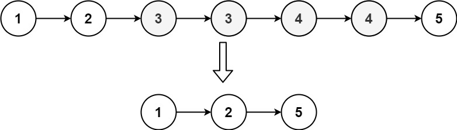
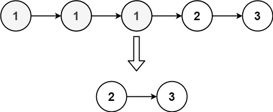

# [82. Remove Duplicates from Sorted List II](https://leetcode.com/problems/remove-duplicates-from-sorted-list-ii/)

| Category | Difficulty | Likes | Dislikes |
| :------: | :--------: | :---: | :------: |
| Algorithms | Medium | 9526 | 275 |

**Tags:** [`linked-list`](https://leetcode.com/tag/linked-list), [`two-pointers`](https://leetcode.com/tag/two-pointers)

**Companies:** `bloomberg`, `google`, `arista-networks`, `amazon`, `facebook`, `microsoft`, `oracle`, `apple`, `tiktok`

## Description

Given the `head` of a sorted linked list, *delete all nodes that have duplicate numbers, leaving only distinct numbers from the original list*. Return *the linked list **sorted** as well*.

 

**Example 1:**


```

Input: head = [1,2,3,3,4,4,5]
Output: [1,2,5]

```

**Example 2:**


```

Input: head = [1,1,1,2,3]
Output: [2,3]

```

 

**Constraints:**

	- The number of nodes in the list is in the range `[0, 300]`.

	- `-100 <= Node.val <= 100`

	- The list is guaranteed to be **sorted** in ascending order.

---

**Links:** [Submissions](https://leetcode.com/problems/remove-duplicates-from-sorted-list-ii/) | [Solutions](https://leetcode.com/problems/remove-duplicates-from-sorted-list-ii/)
