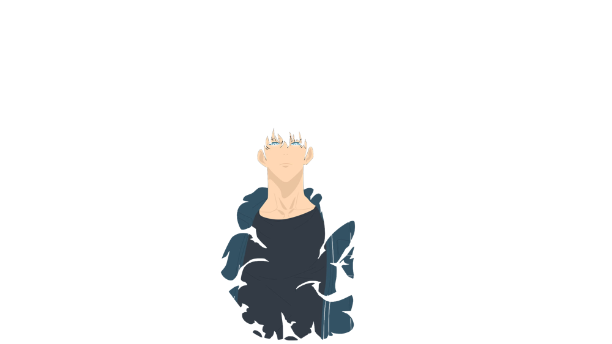

# ✔ Easy Solution In (Java & Dart) beats 💯% of Time and Space complexity (Two pointer).

**Author:** m3n99
**Votes:** 1
**Link:** [https://leetcode.com/problems/remove-duplicates-from-sorted-list-ii/solutions/5199065/](https://leetcode.com/problems/remove-duplicates-from-sorted-list-ii/solutions/5199065/)

---


# Intuition
The goal is to traverse the linked list and identify sequences of nodes with the same value. If a sequence is found (i.e., duplicates), all nodes in that sequence should be removed. If a node does not have duplicates, it should be retained in the list.


# Approach
1. Create a Dummy Node: Start with a dummy node that points to the head of the list. This helps handle edge cases where the head itself might be a part of a duplicate sequence.
2. Traversal and Detection: Use two pointers:
    - prev which tracks the last node known to be non-duplicate.
    - curr which traverses the list.
3. Check for Duplicates: For each node, check if the next node has the same value:
    - If duplicates are found, skip all nodes with the same value.
    - If no duplicates are found, move the prev pointer to the current node.
4. Skip Duplicates: Adjust the next pointer of the prev node to bypass the duplicate sequence.
5. Move to Next Node: Continue this process until the end of the list.

# Complexity
- Time complexity: **O(n)** where n is the number of nodes in the linked list. Each node is processed once.
<!-- Add your time complexity here, e.g. $$O(n)$$ -->

- Space complexity: **O(1)** since we only use a fixed amount of extra space (dummy node and pointers).

<!-- Add your space complexity here, e.g. $$O(n)$$ -->




# Code

```java []
/**
 * Definition for singly-linked list.
 * public class ListNode {
 *     int val;
 *     ListNode next;
 *     ListNode() {}
 *     ListNode(int val) { this.val = val; }
 *     ListNode(int val, ListNode next) { this.val = val; this.next = next; }
 * }
 */
class Solution {
    public ListNode deleteDuplicates(ListNode head) {
        if(head == null) return null;
        ListNode newHead = new ListNode(0);
        newHead.next = head;
        ListNode curr = head;
        ListNode prev = newHead;

        while(curr !=null){
            boolean isDuplicate = false;
            while(curr.next !=null && curr.val == curr.next.val){
                isDuplicate = true;
                curr = curr.next;
            }
            if(isDuplicate){
                prev.next = curr.next;
            } else {
                prev = prev.next;
            }

            curr = curr.next;
        }

        return newHead.next;
    }
}
```
```Dart []
/**
 * Definition for singly-linked list.
 * class ListNode {
 *   int val;
 *   ListNode? next;
 *   ListNode([this.val = 0, this.next]);
 * }
 */
class Solution {
  ListNode? deleteDuplicates(ListNode? head) {

    ListNode? newHead = ListNode(0, head);

    ListNode? curr = head;
    ListNode? prev = newHead;

    while (curr != null) {
      bool isDuplicate = false;

      while (curr?.next != null && curr!.val == curr.next!.val) {
        isDuplicate = true;
        curr = curr.next;
      }

      if (isDuplicate) {
        prev?.next = curr?.next;
      } else {
        prev = prev?.next;
      }

      curr = curr?.next;
    }

    return newHead.next;
  }
}
```

