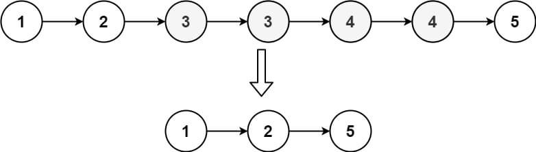

# 🔥🔥 Explicación y Resolución Del Ejercicio En Español Java | Python | PHP | C++ | JavaScript  🔥🔥

**Author:** hermescoder02
**Votes:** 6
**Link:** [https://leetcode.com/problems/remove-duplicates-from-sorted-list-ii/solutions/4094545/](https://leetcode.com/problems/remove-duplicates-from-sorted-list-ii/solutions/4094545/)

---

# Lectura

*Eliminar duplicados de la lista ordenada ll (Java, Python, PHP, C++, Javascript)*

Dado una lista enlazada ordenada, elimine todos los nodos que tengan n\xFAmeros duplicados, dejando solo n\xFAmeros distintos de la lista original. 



Para eliminar los duplicados de una lista enlazada ordenada, utilizaremos un algoritmo espec\xEDfico que nos permitir\xE1 obtener una nueva lista con valores \xFAnicos. 

El algoritmo consiste en recorrer la lista enlazada y comparar cada valor con el siguiente. Si son iguales, avanzamos el puntero hasta el \xFAltimo nodo que tenga valores repetidos y conectamos el puntero conector con la siguiente posici\xF3n del puntero head. Si son distintos, avanzamos el puntero conector a su siguiente posici\xF3n. 

# Explicaci\xF3n del ejercicio Paso por paso

https://youtu.be/-StgarM-hEw

Si te gust\xF3 el contenido \xA1visita mi canal de youtube!: 
\u2705https://www.youtube.com/@hermescoder

Si deseas profundizar m\xE1s en este tema \xA1visita mi blog!: 
\u2705https://hermescoder.com/remove-duplicates-from-sorted-list-II-leetcode-espanol.html

# C\xF3digo 

```Java []
/**
 * Definition for singly-linked list.
 * public class ListNode {
 *     int val;
 *     ListNode next;
 *     ListNode() {}
 *     ListNode(int val) { this.val = val; }
 *     ListNode(int val, ListNode next) { this.val = val; this.next = next; }
 * }
 */
class Solution {
    public static ListNode deleteDuplicates(ListNode head) {
        //paso #1
        ListNode home = new ListNode(0);
        home.next = head;

        //paso #2
        ListNode conector = home;

        //paso #3
        while (head != null && head.next != null ) {
            //paso #4
            if (head.val != head.next.val) {
                //head 4.1.1
                conector = conector.next;
            } else {
                //paso 4.1.2
                while (head.next != null && head.val == head.next.val) head.next = head.next.next;
                conector.next = head.next;
            }

            //paso 4.2
            head = head.next;
        }

        //paso 5
        return home.next;
    }

}
```
```Python []
# Definition for singly-linked list.
# class ListNode(object):
#     def __init__(self, val=0, next=None):
#         self.val = val
#         self.next = next
class Solution(object):
    def deleteDuplicates(self, head):
        home  = ListNode(0)
        home.next = head
        conector = home

        while head and head.next:
            if head.next.val == head.val:
                while head.next and head.val == head.next.val:
                    head= head.next
                conector.next = head.next
            else:
                conector = conector.next
            head= head.next

        return home.next
```
```PHP []
/**
 * Definition for a singly-linked list.
 * class ListNode {
 *     public $val = 0;
 *     public $next = null;
 *     function __construct($val = 0, $next = null) {
 *         $this->val = $val;
 *         $this->next = $next;
 *     }
 * }
 */
class Solution {

    /**
     * @param ListNode $head
     * @return ListNode
     */
    function deleteDuplicates($head) {

        //paso #1
        $home= new ListNode(null);
        $home->next=$head;

        //paso #2
        $conector=$home;


        //paso #3
        while($head ->next !=null){

            //paso #4
            if($head->val != $head->next->val){
                //paso 4.1.1
                $conector = $conector->next;
            }

            else {
                //paso 4.1.2
                while($head->next != null &&  $head->val == $head->next->val)
                    $head=$head->next;
                $conector->next= $head->next;
            }

            //paso 4.2
            $head=$head->next;
        }

        //paso 5
        return $home->next;
    }
}
```
```C++ []
/**
 * Definition for singly-linked list.
 * struct ListNode {
 *     int val;
 *     ListNode *next;
 *     ListNode() : val(0), next(nullptr) {}
 *     ListNode(int x) : val(x), next(nullptr) {}
 *     ListNode(int x, ListNode *next) : val(x), next(next) {}
 * };
 */
class Solution {
public:
    ListNode* deleteDuplicates(ListNode* head) {
       if (!head || !head->next) return head;

        ListNode* home = new ListNode(0);
        home->next = head;

        ListNode* conector = home;

        while (head && head->next != nullptr) {
            if (head->val != head->next->val) {
                conector = conector->next;
            } else {
                while (head->next != nullptr && head->val == head->next->val) {
                head = head->next;
                }
                conector->next = head->next;
            }

        head = head->next;
        }

        return home->next;
    }
};
```
```JavaScript []
/**
 * Definition for singly-linked list.
 * function ListNode(val, next) {
 *     this.val = (val===undefined ? 0 : val)
 *     this.next = (next===undefined ? null : next)
 * }
 */
/**
 * @param {ListNode} head
 * @return {ListNode}
 */
var deleteDuplicates = function(head) {
    if (!head || !head.next) return head;

    const home = new ListNode(null);
    home.next = head;

    let conector = home;

    while (head && head.next) {
      if (head.val !== head.next.val) {
        conector = conector.next;
      } else {
        while (head.next && head.val === head.next.val) {
          head = head.next;
        }
        conector.next = head.next;
      }

      head = head.next;
    }

    return home.next;

};
```


