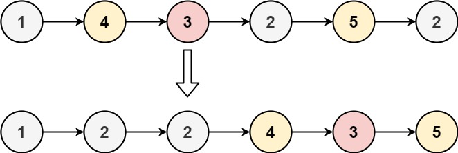

# [86. Partition List](https://leetcode.com/problems/partition-list/)

| Category | Difficulty | Likes | Dislikes |
| :------: | :--------: | :---: | :------: |
| Algorithms | Medium | 7931 | 972 |

**Tags:** [`linked-list`](https://leetcode.com/tag/linked-list), [`two-pointers`](https://leetcode.com/tag/two-pointers)

**Companies:** `google`, `microsoft`, `amazon`, `bloomberg`, `facebook`, `apple`

## Description

Given the `head` of a linked list and a value `x`, partition it such that all nodes **less than** `x` come before nodes **greater than or equal** to `x`.

You should **preserve** the original relative order of the nodes in each of the two partitions.

 

**Example 1:**


```

Input: head = [1,4,3,2,5,2], x = 3
Output: [1,2,2,4,3,5]

```

**Example 2:**

```

Input: head = [2,1], x = 2
Output: [1,2]

```

 

**Constraints:**

	- The number of nodes in the list is in the range `[0, 200]`.

	- `-100 <= Node.val <= 100`

	- `-200 <= x <= 200`

---

**Links:** [Submissions](https://leetcode.com/problems/partition-list/) | [Solutions](https://leetcode.com/problems/partition-list/)
