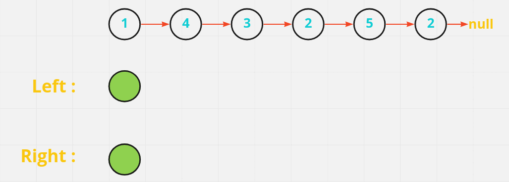
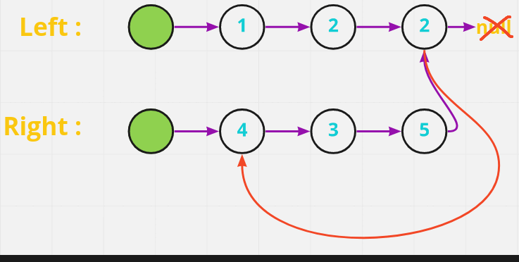
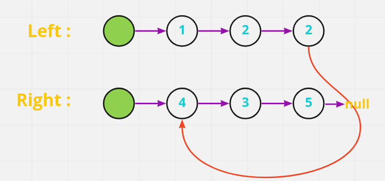

# [Java/C++] Detailed Explanation

**Author:** hi-malik
**Votes:** 282
**Link:** [https://leetcode.com/problems/partition-list/solutions/2315494/](https://leetcode.com/problems/partition-list/solutions/2315494/)

---

So, this problem is super-easy trust me. Only if you know the Basics of LinkedList. 
```
Anyways, Ladies-N-Gentlemen let's understand this problem
```

Let's understand what  the problem is saying, first of all.
> We have given a list and a value **x**, we have to partion the list in such that smaller value then **x** comes to **left** & greater or equals to **right**. 

So, to do that. One clear thing is coming up in your mind, Why don't we create **2 sublists**.
* **Left dummy linked list**
* **Right dummy linked list**

I mean yes, we are doing that. You guy's are clever. And if you all have think about this as well, **`Left will have values smaller then x`** & **`Right will have value greater or equal to x`**.

So, let's take an example and solve this problem.

```
Input: head = [1,4,3,2,5,2], x = 3
Output: [1,2,2,4,3,5]
```

**Let's understand it visually ;**




Now as you can see when we have seperated the list's as per the questions, our final job is to merge them into one list.

So, to do that what we gonna do is, tecnically **`left list`** end i.e. **2** is pointing to **`null`** and **`right list`** end i.e. **5** pointing to **`2`**. But we want **`2`** to point to the beginning of **`right list`** not null.
if we do that we will create a infine[never ending] loop. **Let's see what am talking about**




To, solve this issue what we gonna do is, we want the **`right list`** **5** to point to **null** not to **2**. If we do that then, out list will look's like this:


And by doing that we will get our final list, as shown in the question that's what we want.

Now, **ladies-n-gentlemen** let's code this solution

**Java**
```
class Solution {
    public ListNode partition(ListNode head, int x) {
        ListNode left = new ListNode(0);
        ListNode right = new ListNode(0);
        
        ListNode leftTail = left;
        ListNode rightTail = right;
        
        while(head != null){
            if(head.val < x){
                leftTail.next = head;
                leftTail = leftTail.next;
            }
            else{
                rightTail.next = head;
                rightTail = rightTail.next;
            }
            head = head.next;
        }
        
        leftTail.next = right.next;
        rightTail.next = null;
        
        return left.next;
    }
}
```
**C++**
```
class Solution {
public:
    ListNode* partition(ListNode* head, int x) {
        ListNode *left = new ListNode(0);
        ListNode *right = new ListNode(0);
        
        ListNode *leftTail = left;
        ListNode *rightTail = right;
        
        while(head != NULL){
            if(head->val < x){
                leftTail->next = head;
                leftTail = leftTail->next;
            }
            else{
                rightTail->next = head;
                rightTail = rightTail->next;
            }
            head = head->next;
        }
        
        leftTail->next = right->next;
        rightTail->next = NULL;
        
        return left->next;
    }
};
```
ANALYSIS:-
* **Time Complexity :-** **`BigO(N)`**

* **Space Complexity :-** **`BigO(1)`**