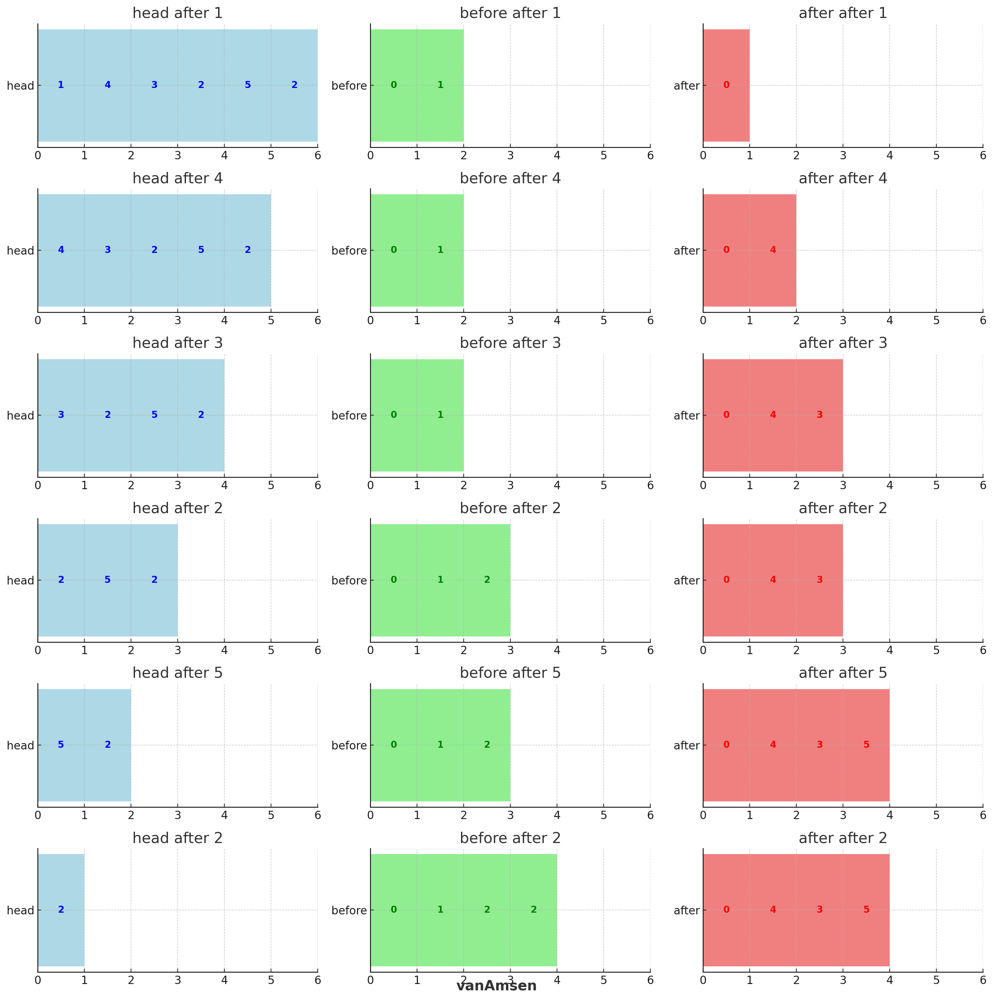
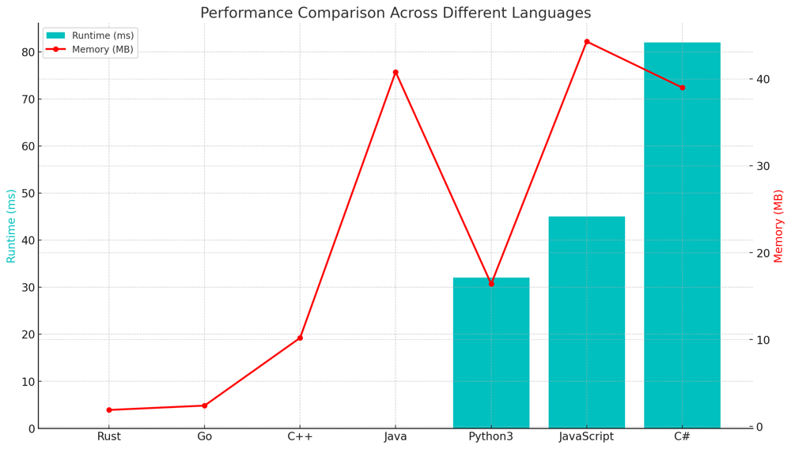

# ✅ 100% Two Pointer [VIDEO] & Linked List + Visualization - Optimal

**Author:** vanAmsen
**Votes:** 173
**Link:** [https://leetcode.com/problems/partition-list/solutions/3910837/](https://leetcode.com/problems/partition-list/solutions/3910837/)

---

# Problem Understanding

In the "Partition a Linked List Around a Value" problem, we are provided with the head of a linked list and a value `x`. The task is to rearrange the linked list such that all nodes with values less than `x` come before nodes with values greater than or equal to `x`. A key point is that the original relative order of the nodes in each of the two partitions must be preserved.

Consider the linked list `head = [1,4,3,2,5,2]` and `x = 3`. The expected output after partitioning is `[1,2,2,4,3,5]`.

---

# Live Coding & Logic in Python
https://youtu.be/q-JTT8Ole6M

## Coding in:
- [\uD83D\uDC0D Python](https://youtu.be/q-JTT8Ole6M)
- [\uD83E\uDD80 Rust](https://youtu.be/OOw-mP8T2AE)
- [\uD83D\uDC39 Go](https://youtu.be/d-1OTX26qdo)

# Approach: Two Pointer Technique with Dummy Nodes

The idea is to use two pointers (or references) to create two separate linked lists: 
1. One for nodes with values less than `x`
2. Another for nodes with values greater than or equal to `x`

At the end, we can combine the two linked lists to get the desired result.

## Key Data Structures:
- **Linked List**: We work directly with the given linked list nodes.
- **Dummy Nodes**: Two dummy nodes are used to create the starting point for the two partitions.

## Step-by-step Breakdown:

1. **Initialization**:
   - Create two dummy nodes: `before` and `after`.
   - Initialize two pointers `before_curr` and `after_curr` at the dummy nodes.
   
2. **Traversal & Partition**:
   - Traverse the linked list with the given `head`.
   - For each node, if its value is less than `x`, attach it to the `before` list. Otherwise, attach it to the `after` list.
   
3. **Merging**:
   - After traversing the entire list, append the `after` list to the `before` list to form the partitioned linked list.

4. **Result**:
   - Return the next node of the `before` dummy node as the new head of the partitioned list.

# Example - Visualization:
Based on the provided example with the linked list `head = [1,4,3,2,5,2]` and `x = 3`, here's the step-by-step evolution of the `before`, `after`, and `head` lists:



1. After processing node with value `1`:
    - `head`: [1, 4, 3, 2, 5, 2]
    - `before`: [0, 1]
    - `after`: [0]

2. After processing node with value `4`:
    - `head`: [4, 3, 2, 5, 2]
    - `before`: [0, 1]
    - `after`: [0, 4]

3. After processing node with value `3`:
    - `head`: [3, 2, 5, 2]
    - `before`: [0, 1]
    - `after`: [0, 4, 3]

4. After processing node with value `2`:
    - `head`: [2, 5, 2]
    - `before`: [0, 1, 2]
    - `after`: [0, 4, 3]

5. After processing node with value `5`:
    - `head`: [5, 2]
    - `before`: [0, 1, 2]
    - `after`: [0, 4, 3, 5]

6. After processing node with value `2`:
    - `head`: [2]
    - `before`: [0, 1, 2, 2]
    - `after`: [0, 4, 3, 5]

Finally, after merging the `before` and `after` lists, the result is: `[1,2,2,4,3,5]`

# Complexity:

**Time Complexity:** $$O(n)$$
- We traverse the linked list once, making the time complexity linear in the size of the list.

**Space Complexity:** $$O(1)$$
- We use constant extra space since we are only creating two dummy nodes and reusing the existing nodes in the linked list.

# Performance:

Given the constraints, this solution is optimal and will efficiently handle linked lists of size up to 200 nodes.

| Language   | Runtime (ms) | Runtime Beat (%) | Memory (MB) | Memory Beat (%) |
|------------|--------------|------------------|-------------|-----------------|
| **Rust**       | 0            | 100%             | 1.9         | 100%            |
| **Go**         | 0            | 100%            | 2.4         | 98.48%          |
| **C++**        | 0            | 100%             | 10.2        | 48.14%          |
| **Java**       | 0            | 100%             | 40.8        | 83.63%          |
| **Python3**    | 32           | 98.81%           | 16.4        | 55.72%          |
| **JavaScript** | 45           | 98.36%           | 44.3        | 12.30%          |
| **C#**         | 82           | 67.18%           | 39          | 64.10%          |




# Code
``` Python []
class Solution:
    def partition(self, head: Optional[ListNode], x: int) -> Optional[ListNode]:
        before, after = ListNode(0), ListNode(0)
        before_curr, after_curr = before, after
        
        while head:
            if head.val < x:
                before_curr.next, before_curr = head, head
            else:
                after_curr.next, after_curr = head, head
            head = head.next
        
        after_curr.next = None
        before_curr.next = after.next
        
        return before.next
```
``` C++ []
class Solution {
public:
    ListNode* partition(ListNode* head, int x) {
        ListNode before(0), after(0);
        ListNode* before_curr = &before;
        ListNode* after_curr = &after;
        
        while(head) {
            if(head->val < x) {
                before_curr->next = head;
                before_curr = head;
            } else {
                after_curr->next = head;
                after_curr = head;
            }
            head = head->next;
        }
        
        after_curr->next = nullptr;
        before_curr->next = after.next;
        
        return before.next;
    }
};
```
``` Rust []
impl Solution {
    pub fn partition(mut head: Option<Box<ListNode>>, x: i32) -> Option<Box<ListNode>> {
        let mut before = ListNode::new(0);
        let mut after = ListNode::new(0);
        let mut before_tail = &mut before;
        let mut after_tail = &mut after;

        while let Some(mut node) = head {
            head = node.next.take();
            if node.val < x {
                before_tail.next = Some(node);
                before_tail = before_tail.next.as_mut().unwrap();
            } else {
                after_tail.next = Some(node);
                after_tail = after_tail.next.as_mut().unwrap();
            }
        }

        before_tail.next = after.next.take();

        before.next
    }
}
```
``` Go []
func partition(head *ListNode, x int) *ListNode {
    before := &ListNode{}
    after := &ListNode{}
    before_curr := before
    after_curr := after
    
    for head != nil {
        if head.Val < x {
            before_curr.Next = head
            before_curr = before_curr.Next
        } else {
            after_curr.Next = head
            after_curr = after_curr.Next
        }
        head = head.Next
    }
    
    after_curr.Next = nil
    before_curr.Next = after.Next
    
    return before.Next
}
```
``` Java []
public class Solution {
    public ListNode partition(ListNode head, int x) {
        ListNode before = new ListNode(0);
        ListNode after = new ListNode(0);
        ListNode before_curr = before;
        ListNode after_curr = after;
        
        while(head != null) {
            if(head.val < x) {
                before_curr.next = head;
                before_curr = before_curr.next;
            } else {
                after_curr.next = head;
                after_curr = after_curr.next;
            }
            head = head.next;
        }
        
        after_curr.next = null;
        before_curr.next = after.next;
        
        return before.next;
    }
}
```
``` JavaScript []
var partition = function(head, x) {
    let before = new ListNode(0);
    let after = new ListNode(0);
    let before_curr = before;
    let after_curr = after;
    
    while(head !== null) {
        if(head.val < x) {
            before_curr.next = head;
            before_curr = before_curr.next;
        } else {
            after_curr.next = head;
            after_curr = after_curr.next;
        }
        head = head.next;
    }
    
    after_curr.next = null;
    before_curr.next = after.next;
    
    return before.next;
};
```
``` C# []
public class Solution {
    public ListNode Partition(ListNode head, int x) {
        ListNode before = new ListNode(0);
        ListNode after = new ListNode(0);
        ListNode before_curr = before;
        ListNode after_curr = after;
        
        while(head != null) {
            if(head.val < x) {
                before_curr.next = head;
                before_curr = before_curr.next;
            } else {
                after_curr.next = head;
                after_curr = after_curr.next;
            }
            head = head.next;
        }
        
        after_curr.next = null;
        before_curr.next = after.next;
        
        return before.next;
    }
}
```

# Coding in Rust & Go

https://youtu.be/OOw-mP8T2AE
https://youtu.be/d-1OTX26qdo

The "Partition a Linked List Around a Value" problem exemplifies the elegance of simplicity in coding. Remember, every coding challenge is a gateway to greater understanding and expertise. Embrace each problem, for they refine your skills and mold your coding journey. Stay curious, dive deep, and let your passion for coding guide you to new horizons. \uD83D\uDE80\uD83D\uDC69\u200D\uD83D\uDCBB\uD83D\uDC68\u200D\uD83D\uDCBB
