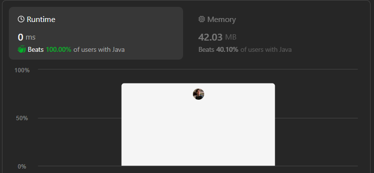

# Simple ,Beginner friendly & Dry run || Two Pointer approach || Time O(N) & Space O(1) || Gits✅✅✅😎😎

**Author:** GiteshSK_12
**Votes:** 7
**Link:** [https://leetcode.com/problems/partition-list/solutions/4698851/](https://leetcode.com/problems/partition-list/solutions/4698851/)

---



# Intuition \uD83D\uDC48

In the given question, we are provided with the head of a linked list and a number x. We must separate all the nodes whose values are strictly less than x so that they come before nodes with values greater than or equal to x.

# Approach \uD83D\uDC48

We will create two ListNode objects (`dummy` and `dummy2`) with a value of 0, and two pointer nodes (`front` and `back`). `Front` will point to `dummy`, and `back` will point to `dummy2`. We will iterate through the linked list, checking if the value of the head node is less than a specified value `x`. If it is, we will set `front.next` to `head`, and then move `front` to the next node. If the value of the head node is greater, we will set `back.next` to `head`, then move `back` to the next node and advance `head` to its next node. After completing the iteration, we will set `front.next` to `dummy2.next`, effectively connecting the two partitions. Finally, we will return `dummy.next`.

# Code Explanation \uD83D\uDC48

*   **Initialization**:
    
    *   Two dummy nodes, `dummy` and `dummy2`, are created with values set to 0. These nodes serve as placeholders to simplify the process of constructing the two partitions of the list.
    *   Two pointers, `front` and `back`, are initialized to point to `dummy` and `dummy2`, respectively. `front` is used to build the partition of nodes with values less than `x`, and `back` is for nodes with values greater than or equal to `x`.
*   **Iteration through the list**:
    
    *   The code enters a while loop that iterates through each node in the original list (`head`).
    *   Within each iteration, it checks if the current node's value (`head.val`) is less than `x`.
        *   If `head.val < x`, the node is appended to the end of the `front` list by setting `front.next = head`, and then `front` is advanced to `front.next` (the newly added node).
        *   If `head.val >= x`, the node is appended to the end of the `back` list by setting `back.next = head`, and then `back` is advanced to `back.next` (the newly added node).
    *   After handling the current node based on its value, `head` is advanced to the next node in the original list (`head = head.next`).
*   **Finalizing the partitions**:
    
    *   Once the iteration is complete (i.e., `head` is `null`, indicating the end of the original list), the code ensures that the `back` list is properly terminated by setting `back.next = null`.
    *   It then connects the two partitions by setting `front.next = dummy2.next`. This step appends the list starting from `dummy2.next` (the partition of nodes greater than or equal to `x`) to the end of the list starting from `dummy.next` (the partition of nodes less than `x`).
*   **Returning the result**:
    
    *   The method returns `dummy.next`, which is the head of the newly partitioned list. The first dummy node (`dummy`) itself is not included in the return value, ensuring that the returned list starts with the first node whose value meets the partitioning criteria (if any such node exists).
    
# Complexity \uD83D\uDC48
- Time complexity: O(n)

- Space complexity: O(1)

# Code \uD83D\uDC48

```C []
/**
 * Definition for singly-linked list.
 * struct ListNode {
 *     int val;
 *     struct ListNode *next;
 * };
 */
struct ListNode* partition(struct ListNode* head, int x) {
    struct ListNode* dummy = (struct ListNode*)malloc(sizeof(struct ListNode));
    dummy->val = 0;
    dummy->next = NULL;
    struct ListNode* prev = dummy;

    struct ListNode* greater = (struct ListNode*)malloc(sizeof(struct ListNode));
    greater->val = 0; 
    greater->next = NULL;
    struct ListNode* last = greater;

    while(head != NULL) {
        if(head->val < x) {
            prev->next = head;
            prev = prev->next;
        } else {
            last->next = head;
            last = last->next;
        }
        head = head->next;
    }
    last->next = NULL;
    prev->next = greater->next;

    struct ListNode *newHead = dummy->next;
    free(dummy);
    free(greater); 
    
    return newHead;
}
```
```C++ []
/**
 * Definition for singly-linked list.
 * struct ListNode {
 *     int val;
 *     ListNode *next;
 *     ListNode() : val(0), next(nullptr) {}
 *     ListNode(int x) : val(x), next(nullptr) {}
 *     ListNode(int x, ListNode *next) : val(x), next(next) {}
 * };
 */
class Solution {
public:
    ListNode* partition(ListNode* head, int x) {
        ListNode* dummy = new ListNode(0);
        ListNode* prev = dummy;
        ListNode* greater = new ListNode(0);
        ListNode* last = greater;
        while(head != NULL){
            if(head->val < x){
                prev->next = head;
                prev = prev->next;
            }else{
                last->next = head;
                last = last->next; 
            }
            head = head->next;
        }
        last->next = NULL;
        prev->next = greater->next;
        return dummy->next;
    }
};
```
```Java []
/**
 * Definition for singly-linked list.
 * public class ListNode {
 *     int val;
 *     ListNode next;
 *     ListNode() {}
 *     ListNode(int val) { this.val = val; }
 *     ListNode(int val, ListNode next) { this.val = val; this.next = next; }
 * }
 */
class Solution {
    public ListNode partition(ListNode head, int x) {
        ListNode dummy = new ListNode(0);
        ListNode front = dummy;
        ListNode dummy2 = new ListNode(0);
        ListNode back = dummy2;
        while(head != null){
            if(head.val < x){
                front.next = head;
                front = front.next;
            }else{
                back.next = head;
                back = back.next;
            }
            head = head.next;
        }
        back.next = null;
        front.next = dummy2.next;
        return dummy.next;
    }
}
```
```javascript []
/**
 * Definition for singly-linked list.
 * function ListNode(val, next) {
 *     this.val = (val===undefined ? 0 : val)
 *     this.next = (next===undefined ? null : next)
 * }
 */
/**
 * @param {ListNode} head
 * @param {number} x
 * @return {ListNode}
 */
var partition = function(head, x) {
    dummy = new ListNode(0);
    prev = dummy;
    greater = new ListNode(0);
    last = greater;
    while(head != null){
        if(head.val < x){
            prev.next = head;
            prev = prev.next;
        }else{
            last.next = head;
            last = last.next; 
        }
        head = head.next;
    }
    last.next = null;
    prev.next = greater.next;
    return dummy.next;
};
```
```C# []
/**
 * Definition for singly-linked list.
 * public class ListNode {
 *     public int val;
 *     public ListNode next;
 *     public ListNode(int val=0, ListNode next=null) {
 *         this.val = val;
 *         this.next = next;
 *     }
 * }
 */
public class Solution {
    public ListNode Partition(ListNode head, int x) {
        ListNode dummy = new ListNode(0);
        ListNode front = dummy;
        ListNode dummy2 = new ListNode(0);
        ListNode back = dummy2;
        while(head != null){
            if(head.val < x){
                front.next = head;
                front = front.next;
            }else{
                back.next = head;
                back = back.next;
            }
            head = head.next;
        }
        back.next = null;
        front.next = dummy2.next;
        return dummy.next;
    }
}
```
```python []
# Definition for singly-linked list.
# class ListNode(object):
#     def __init__(self, val=0, next=None):
#         self.val = val
#         self.next = next
class Solution(object):
    def partition(self, head, x):
        """
        :type head: ListNode
        :type x: int
        :rtype: ListNode
        """
        dummy = ListNode(0)
        front = dummy
        dummy2 = ListNode(0)
        back = dummy2
        while head != None :
            if head.val < x :
                front.next = head
                front = front.next
            else :
                back.next = head
                back = back.next
            
            head = head.next
        
        back.next = None
        front.next = dummy2.next
        return dummy.next
```
```ruby []
# Definition for singly-linked list.
# class ListNode
#     attr_accessor :val, :next
#     def initialize(val = 0, _next = nil)
#         @val = val
#         @next = _next
#     end
# end
# @param {ListNode} head
# @param {Integer} x
# @return {ListNode}
def partition(head, x)
    dummy = ListNode.new(0)
    front = dummy
    dummy2 = ListNode.new(0)
    back = dummy2
    while head != nil 
        if head.val < x 
            front.next = head
            front = front.next
        else 
            back.next = head
            back = back.next
        end
        head = head.next
    end
        back.next = nil
        front.next = dummy2.next
    return dummy.next
end
```

# Dry Run \uD83D\uDC48

**Initial Setup:**

*   `dummy` points to a new ListNode with value `0`.
*   `front` also points to `dummy`.
*   `dummy2` points to a new ListNode with value `0`.
*   `back` also points to `dummy2`.
*   `head` points to the first node of the input list `[1,4,3,2,5,2]`.

**Iteration 1:** `head.val = 1` which is less than `x = 3`.

*   `front.next` is set to `head` (node with value `1`).
*   `front` is updated to `front.next` (pointing now to node `1`).
*   `head` moves to the next node (node with value `4`).

**Current state:**

*   `dummy -> 1 -> null`
*   `dummy2 -> null`
*   `front` pointing to `1`.
*   `back` pointing to `dummy2`.

**Iteration 2:** `head.val = 4` which is not less than `x = 3`.

*   `back.next` is set to `head` (node with value `4`).
*   `back` is updated to `back.next` (pointing now to node `4`).
*   `head` moves to the next node (node with value `3`).

**Current state:**

*   `dummy -> 1 -> null`
*   `dummy2 -> 4 -> null`
*   `front` pointing to `1`.
*   `back` pointing to `4`.

**Iteration 3:** `head.val = 3` which is not less than `x = 3`.

*   `back.next` is set to `head` (node with value `3`).
*   `back` is updated to `back.next` (pointing now to node `3`).
*   `head` moves to the next node (node with value `2`).

**Current state:**

*   `dummy -> 1 -> null`
*   `dummy2 -> 4 -> 3 -> null`
*   `front` pointing to `1`.
*   `back` pointing to `3`.

**Iteration 4:** `head.val = 2` which is less than `x = 3`.

*   `front.next` is set to `head` (node with value `2`).
*   `front` is updated to `front.next` (pointing now to node `2`).
*   `head` moves to the next node (node with value `5`).

**Current state:**

*   `dummy -> 1 -> 2 -> null`
*   `dummy2 -> 4 -> 3 -> null`
*   `front` pointing to `2`.
*   `back` pointing to `3`.

**Iteration 5:** `head.val = 5` which is not less than `x = 3`.

*   `back.next` is set to `head` (node with value `5`).
*   `back` is updated to `back.next` (pointing now to node `5`).
*   `head` moves to the next node (node with value `2`).

**Current state:**

*   `dummy -> 1 -> 2 -> null`
*   `dummy2 -> 4 -> 3 -> 5 -> null`
*   `front` pointing to `2`.
*   `back` pointing to `5`.

**Iteration 6:** `head.val = 2` which is less than `x = 3`.

*   `front.next` is set to `head` (node with value `2`).
*   `front` is updated to `front.next` (pointing now to node `2`).
*   `head` moves to `null`.

**Final state before connecting lists:**

*   `dummy -> 1 -> 2 -> 2 -> null`
*   `dummy2 -> 4 -> 3 -> 5 -> null`
*   `front` pointing to the last `2`.
*   `back` pointing to `5`.

**Final Step:**

*   `back.next` is set to `null` to terminate the list starting from `dummy2`.
*   `front.next` is set to `dummy2.next` to connect the two lists.

**Final list structure:**

*   `dummy -> 1 -> 2 -> 2 -> 4 -> 3 -> 5 -> null`

Return `dummy.next`, which results in the list:

*   `1 -> 2 -> 2 -> 4 -> 3 -> 5`

So, the final partitioned list is `[1, 2, 2, 4, 3, 5]` with all elements less than `x = 3` moved to the front, maintaining their original relative order, followed by elements greater than or equal to `x`, also maintaining their original order.

# Guys if the explanation and the solution is helpful then up vote me.\u2764\uFE0F\u2764\uFE0F\u2764\uFE0F\u2764\uFE0F\u2764\uFE0F\u2764\uFE0F\u2764\uFE0F

