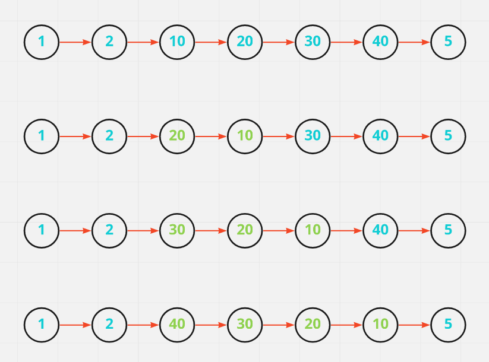
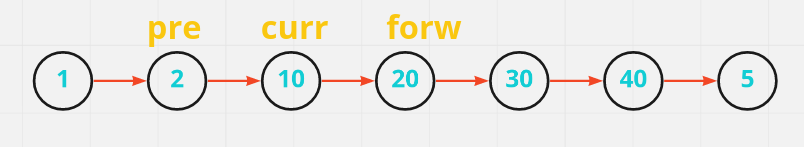
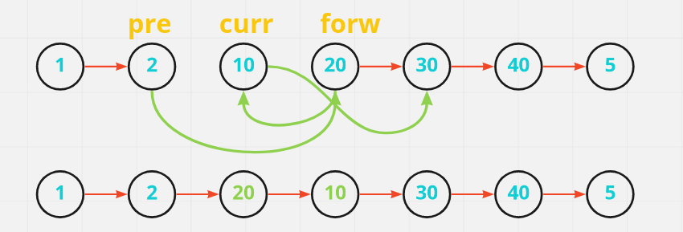
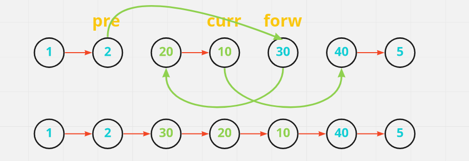
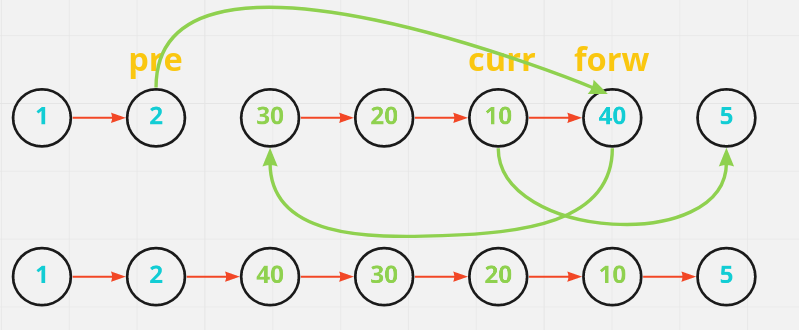

# [Java/C++] Tried to Explain every step

**Author:** hi-malik
**Votes:** 577
**Link:** [https://leetcode.com/problems/reverse-linked-list-ii/solutions/2311084/](https://leetcode.com/problems/reverse-linked-list-ii/solutions/2311084/)

---

So, this problem is not that much hard, let me made it easy for you. Be with me **Ladies-N-Gentlemen**

To understand this problem let's take an example:

```
Input: head = [1,2,10,20,30,40,5], left = 3, right = 6
Output: [1,2,40,30,20,10,5]
```


**So, first of all I would like to show you if we do reverse one-by-one then, how it'll gonna looks like**




Now, let's talk about how we gonna achieve this result,

So, for that we gonna use 3 pointers:
* **Pre**
* **Curr**
* **Forw**

```
So, the pre pointer will be assigned on just before left position
Curr pointer & forw pointer will help in reversing the linkedlist

So, we gonna perform these steps,
curr.next = forw.next
forw.next = curr.next ? prev.next ["We are not sure at this point which one forw should have to point, so we gonna find out later"]
prev.next = forw
forw = curr.next
```
* **`Step-1 :`** Assign the pointers at their positions


* **`Step-2 :`** 
* * **Curr** will point to 30 i.e. `10 --> 30`
* * **forw** will point to **curr** i.e. `20 --> 10`
* * **pre** will point to **forw** i.e. `2 --> 20`


* **`Step-3 :`** 
* * **Curr** will point to 40 i.e. `10 --> 40`
* * **forw** will point to **just after prev** i.e. `30 --> 20` ***[Now at this point it's get clear our forw will point to just after prev]***
* * **pre** will point to **forw** i.e. `2 --> 30`


* **`Step-4 :`** 
* * **Curr** will point to 5 i.e. `10 --> 5`
* * **forw** will point to **just after prev** i.e. `40 --> 30` 
* * **pre** will point to **forw** i.e. `2 --> 40`


Now, ladies-n-gentlemen everything is absolutely clear I hope so. 

Oops, one more thing I forgot to add and i.e. is we gonna use **`dummy list`**! Now you ask why?
```
Because, let's say we have given "left = 1" then where our prev pointer will be assigned then, 
to handle that case we gonna use one dummy node. So, if left = 1 then our prev will be at dummy node
```

Let's look at the code,

**Java**
```
class Solution {
    public ListNode reverseBetween(ListNode head, int left, int right) {
        ListNode dummy = new ListNode(0); // created dummy node
        dummy.next = head;
        ListNode prev = dummy; // intialising prev pointer on dummy node
        
        for(int i = 0; i < left - 1; i++)
            prev = prev.next; // adjusting the prev pointer on it's actual index
        
        ListNode curr = prev.next; // curr pointer will be just after prev
        // reversing
        for(int i = 0; i < right - left; i++){
            ListNode forw = curr.next; // forw pointer will be after curr
            curr.next = forw.next;
            forw.next = prev.next;
            prev.next = forw;
        }
        return dummy.next;
    }
}
```
**C++**
```
class Solution {
public:
    ListNode* reverseBetween(ListNode* head, int left, int right) {
        ListNode *dummy = new ListNode(0); // created dummy node
        dummy->next = head;
        ListNode *prev = dummy; // intialising prev pointer on dummy node
        
        for(int i = 0; i < left - 1; i++)
            prev = prev->next; // adjusting the prev pointer on it's actual index
        
        ListNode *curr = prev->next; // curr pointer will be just after prev
        // reversing
        for(int i = 0; i < right - left; i++){
            ListNode *forw = curr->next; // forw pointer will be after curr
            curr->next = forw->next;
            forw->next = prev->next;
            prev->next = forw;
        }
        return dummy->next;
    }
};
```
ANALYSIS :-
* **Time Complexity :-** **`BigO(N)`**

* **Space Complexity :-** **`BigO(1)`**
