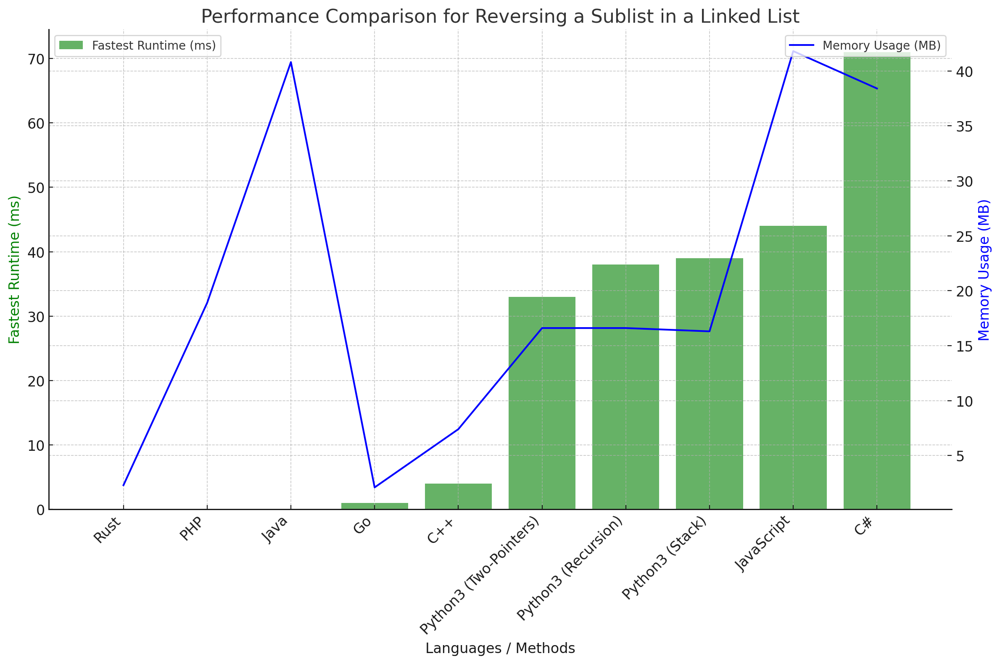

# ✅ 92.40% Two Pointers & Stack & Recursion

**Author:** vanAmsen
**Votes:** 163
**Link:** [https://leetcode.com/problems/reverse-linked-list-ii/solutions/4011862/](https://leetcode.com/problems/reverse-linked-list-ii/solutions/4011862/)

---

# Interview Guide - Reversing a Sublist of a Linked List: A Comprehensive Analysis for Programmers

## Introduction & Problem Statement

Welcome to this detailed guide, where we delve into the fascinating problem of reversing a sublist within a singly-linked list. The challenge is not just to reverse a sublist but to do it efficiently, ideally in a single pass through the list. This guide is designed to arm you with multiple approaches for tackling this problem, each with its own unique advantages and considerations. Specifically, we will explore three distinct strategies: Two Pointers, Using a Stack, and Recursion.

## Key Concepts and Constraints

1. **Node Anatomy**:  
    Let's start with the basics. In a singly-linked list, each node has an integer value and a `next` pointer that points to the subsequent node in the list.
    
2. **Sublist Reversal**:  
    The primary task is to reverse only the nodes between positions `left` and `right`, both inclusive, within the list.

3. **Order Preservation**:  
    While reversing the sublist, we must ensure that the relative order of all nodes outside this range remains unchanged.

4. **Size Constraints**:  
    The number of nodes in the list `n` can vary but will always be between 1 and 500, giving us more than enough to work with.

# Live Coding & More
https://youtu.be/RohipcSF3HM?si=9GIVdRg72_EHEMmv

- [\uD83D\uDC0D Two Pointers \uD83D\uDC49\uD83D\uDC48](https://youtu.be/RohipcSF3HM?si=9GIVdRg72_EHEMmv)
- [\uD83D\uDC0D Stack \uD83D\uDCDA](https://youtu.be/E79svvS1DB0?si=37SbMxSSJeQQHHcf)
- [\uD83D\uDC0D Recursion \uD83D\uDD01](https://youtu.be/xcKS9d1_vDg?si=rbsNpLsNa3EJSVD8)

---
# Strategies to Tackle the Problem: A Three-Pronged Approach

## 1. Using Two Pointers (One-Pass)

### Intuition and Logic Behind the Solution

In this efficient method, we employ two pointers to traverse and manipulate the linked list in one go. The clever use of a dummy node helps us elegantly handle edge cases, and tuple unpacking makes the code more Pythonic and straightforward.

### Step-by-step Explanation

1. **Initialization**: 
    - Create a `dummy` node and connect its `next` to the head of the list.
    - Initialize a `prev` pointer to the `dummy` node.

2. **Move to Start Position**:  
    - Traverse the list until the node just before the `left`-th node is reached.

3. **Execute Sublist Reversal**:  
    - Use a `current` pointer to keep track of the first node in the sublist.
    - Reverse the sublist nodes using `prev` and `current`.

4. **Link Back**:  
    - Automatically link the reversed sublist back into the original list.

### Complexity Analysis

- **Time Complexity**: `O(n)` \u2014 A single traversal does the job.
- **Space Complexity**: `O(1)` \u2014 Smart pointer manipulation eliminates the need for additional data structures.

---

## 2. Using a Stack

### Intuition and Logic Behind the Solution

This approach uses a stack data structure to temporarily store and then reverse the sublist, making the logic easier to follow.

### Step-by-step Explanation

1. **Initialization**:  
    - Like before, create a `dummy` node and set a `prev` pointer.

2. **Populate the Stack**:  
    - Traverse the list and populate the stack with the nodes falling within the `left` and `right` positions.

3. **Perform Reversal and Relink Nodes**:  
    - Pop nodes from the stack and relink them, essentially reversing the sublist.

### Complexity Analysis

- **Time Complexity**: `O(n)`
- **Space Complexity**: `O(n)` \u2014 The stack takes extra space.

---

## 3. Using Recursion

#### Intuition and Logic Behind the Solution

In this elegant method, the language's call stack is leveraged to reverse the sublist through recursive function calls.

### Step-by-step Explanation

1. **Define Recursive Function**: 
    - Create a helper function that will do the heavy lifting, taking the node and its position as parameters.

2. **Base and Recursive Cases**:  
    - Implement base and recursive cases to control the flow and reversal.

3. **Unwind and Relink**:  
    - As the recursion unwinds, the nodes get relinked in the reversed order.

### Complexity Analysis

- **Time Complexity**: `O(n)`
- **Space Complexity**: `O(n)` \u2014 The call stack consumes extra memory.

## Code Highlights and Best Practices

- The use of a `dummy` node is universal across all methods for handling edge cases gracefully.
- Tuple unpacking in the Two-Pointer approach makes the code clean and Pythonic.
- The Stack approach makes clever use of the stack data structure for sublist reversal.
- The Recursion method leverages the language's call stack for a clean and elegant solution.

---

# Performance

| Language     | Fastest Runtime (ms) | Memory Usage (MB) | Method      |
|--------------|----------------------|-------------------|-------------|
| Rust         | 0                    | 2.3               | Two-Pointers|
| PHP          | 0                    | 18.9              | Two-Pointers|
| Java         | 0                    | 40.8              | Two-Pointers|
| Go           | 1                    | 2.1               | Two-Pointers|
| C++          | 4                    | 7.4               | Two-Pointers|
| Python3      | 33                   | 16.6              | Two-Pointers|
| Python3      | 38                   | 16.6              | Recursion   |
| Python3      | 39                   | 16.3              | Stack       |
| JavaScript   | 44                   | 41.8              | Two-Pointers|
| C#           | 71                   | 38.4              | Two-Pointers|
 



# Code Two Pointers
``` Python []
class Solution:
    def reverseBetween(self, head: Optional[ListNode], left: int, right: int) -> Optional[ListNode]:
        if not head or left == right:
            return head
        
        dummy = ListNode(0, head)
        prev = dummy
        
        for _ in range(left - 1):
            prev = prev.next
        
        current = prev.next
        
        for _ in range(right - left):
            next_node = current.next
            current.next, next_node.next, prev.next = next_node.next, prev.next, next_node

        return dummy.next
```
``` Go []
func reverseBetween(head *ListNode, left int, right int) *ListNode {
    if head == nil || left == right {
        return head
    }
    
    dummy := &ListNode{0, head}
    prev := dummy
    
    for i := 0; i < left - 1; i++ {
        prev = prev.Next
    }
    
    current := prev.Next
    
    for i := 0; i < right - left; i++ {
        nextNode := current.Next
        current.Next = nextNode.Next
        nextNode.Next = prev.Next
        prev.Next = nextNode
    }
    
    return dummy.Next
}
```
``` Rust []
impl Solution {
    pub fn reverse_between(head: Option<Box<ListNode>>, left: i32, right: i32) -> Option<Box<ListNode>> {
        let mut dummy = Some(Box::new(ListNode {
            val: 0,
            next: head,
        }));
        let mut before = &mut dummy;
        for _ in 1..left {
            before = &mut before.as_mut()?.next;
        }

        let mut node = before.as_mut()?.next.take();
        let mut node2 = node.as_mut()?.next.take();
        for _ in left..right {
            let node3 = node2.as_mut()?.next.take();
            node2.as_mut()?.next = node;
            node = node2;
            node2 = node3;
        }

        let mut rev_tail = &mut node;
        for _ in left..right {
            rev_tail = &mut rev_tail.as_mut()?.next;
        }
        rev_tail.as_mut()?.next = node2;
        before.as_mut()?.next = node;

        dummy.unwrap().next
    }
}
```
``` C++ []
class Solution {
public:
    ListNode* reverseBetween(ListNode* head, int left, int right) {
        if (!head || left == right) return head;
        
        ListNode dummy(0);
        dummy.next = head;
        ListNode* prev = &dummy;
        
        for (int i = 0; i < left - 1; ++i) {
            prev = prev->next;
        }
        
        ListNode* current = prev->next;
        
        for (int i = 0; i < right - left; ++i) {
            ListNode* next_node = current->next;
            current->next = next_node->next;
            next_node->next = prev->next;
            prev->next = next_node;
        }
        
        return dummy.next;
    }
};
```
``` Java []
class Solution {
    public ListNode reverseBetween(ListNode head, int left, int right) {
        if (head == null || left == right) return head;
        
        ListNode dummy = new ListNode(0);
        dummy.next = head;
        ListNode prev = dummy;
        
        for (int i = 0; i < left - 1; ++i) {
            prev = prev.next;
        }
        
        ListNode current = prev.next;
        
        for (int i = 0; i < right - left; ++i) {
            ListNode nextNode = current.next;
            current.next = nextNode.next;
            nextNode.next = prev.next;
            prev.next = nextNode;
        }
        
        return dummy.next;
    }
}
```
``` C# []
public class Solution {
    public ListNode ReverseBetween(ListNode head, int left, int right) {
        if (head == null || left == right) return head;
        
        ListNode dummy = new ListNode(0);
        dummy.next = head;
        ListNode prev = dummy;
        
        for (int i = 0; i < left - 1; ++i) {
            prev = prev.next;
        }
        
        ListNode current = prev.next;
        
        for (int i = 0; i < right - left; ++i) {
            ListNode nextNode = current.next;
            current.next = nextNode.next;
            nextNode.next = prev.next;
            prev.next = nextNode;
        }
        
        return dummy.next;
    }
}
```
``` PHP []
class Solution {
    function reverseBetween($head, $left, $right) {
        if ($head == null || $left == $right) return $head;
        
        $dummy = new ListNode(0);
        $dummy->next = $head;
        $prev = $dummy;
        
        for ($i = 0; $i < $left - 1; ++$i) {
            $prev = $prev->next;
        }
        
        $current = $prev->next;
        
        for ($i = 0; $i < $right - $left; ++$i) {
            $nextNode = $current->next;
            $current->next = $nextNode->next;
            $nextNode->next = $prev->next;
            $prev->next = $nextNode;
        }
        
        return $dummy->next;
    }
}
```
``` JavaScript []
var reverseBetween = function(head, left, right) {
    if (!head || left === right) return head;
    
    const dummy = new ListNode(0);
    dummy.next = head;
    let prev = dummy;
    
    for (let i = 0; i < left - 1; ++i) {
        prev = prev.next;
    }
    
    let current = prev.next;
    
    for (let i = 0; i < right - left; ++i) {
        const nextNode = current.next;
        current.next = nextNode.next;
        nextNode.next = prev.next;
        prev.next = nextNode;
    }
    
    return dummy.next;
};
```
# Code Recursion
``` Python []
class Solution:
    def reverseBetween(self, head: Optional[ListNode], left: int, right: int) -> Optional[ListNode]:
        if not (head and left < right):
            return head

        def helper(node, m):
            nonlocal left, right
            if m == left:
                prev = None
                current = node
                while m <= right:
                    current.next, prev, current = prev, current, current.next
                    m += 1
                node.next = current
                return prev
            elif m < left:
                node.next = helper(node.next, m + 1)
            return node

        return helper(head, 1)
```
``` Go []
func reverseBetween(head *ListNode, left int, right int) *ListNode {
    if head == nil || left >= right {
        return head
    }

    var helper func(node *ListNode, m int) *ListNode
    helper = func(node *ListNode, m int) *ListNode {
        if m == left {
            var prev, current *ListNode = nil, node
            for m <= right {
                current.Next, prev, current = prev, current, current.Next
                m++
            }
            node.Next = current
            return prev
        } else if m < left {
            node.Next = helper(node.Next, m+1)
        }
        return node
    }

    return helper(head, 1)
}

```

# Code Stack
``` Python []
class Solution:
    def reverseBetween(self, head: Optional[ListNode], left: int, right: int) -> Optional[ListNode]:
        if not head or left == right:
            return head

        dummy = ListNode(0)
        dummy.next = head
        prev = dummy

        for _ in range(left - 1):
            prev = prev.next

        stack = []
        current = prev.next

        for _ in range(right - left + 1):
            stack.append(current)
            current = current.next

        while stack:
            prev.next = stack.pop()
            prev = prev.next

        prev.next = current

        return dummy.next
```
``` Go []
func reverseBetween(head *ListNode, left int, right int) *ListNode {
    if head == nil || left == right {
        return head
    }

    dummy := &ListNode{Val: 0, Next: head}
    prev := dummy

    for i := 0; i < left-1; i++ {
        prev = prev.Next
    }

    stack := []*ListNode{}
    current := prev.Next

    for i := 0; i < right-left+1; i++ {
        stack = append(stack, current)
        current = current.Next
    }

    for len(stack) > 0 {
        last := len(stack) - 1
        prev.Next = stack[last]
        stack = stack[:last]
        prev = prev.Next
    }

    prev.Next = current

    return dummy.Next
}

```

# Live Coding & More
## Stack
https://youtu.be/E79svvS1DB0?si=37SbMxSSJeQQHHcf
## Recursion
https://youtu.be/xcKS9d1_vDg?si=rbsNpLsNa3EJSVD8

## Final Thoughts

Each of the three methods comes with its own set of pros and cons. Your choice would depend on various factors such as readability, space complexity, and the specific constraints of the problem at hand. This guide equips you with the knowledge to make that choice wisely.

So there you have it\u2014a multifaceted guide to tackling the problem of reversing a sublist in a singly-linked list. Armed with this knowledge, you're now better prepared to face linked list challenges in interviews and beyond. Happy coding!