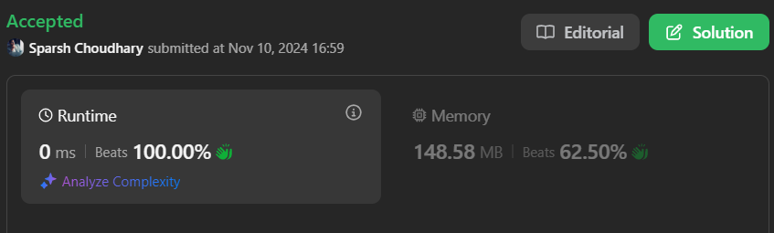

# 🔥BEATS 💯 %  with 0 Ⓜ️S 🎯 |✨SUPER EASY BEGINNERS 👏 | 🟧⬜🟩

**Author:** CodeWithSparsh
**Votes:** 2
**Link:** [https://leetcode.com/problems/reverse-linked-list-ii/solutions/6030076/](https://leetcode.com/problems/reverse-linked-list-ii/solutions/6030076/)

---



---


## Intuition
The problem requires reversing a specific segment of a linked list. By keeping track of the start and end points of this sublist, we can reverse only the specified part while keeping the rest of the list intact.

---

## Approach
1. **Locate the Sublist Start and End**:
   - Use a `dummy` node to simplify edge cases.
   - Traverse the list to reach the starting position (`left`) and maintain pointers for this segment.

2. **Reverse the Sublist**:
   - Use a simple pointer-reversal method to reverse the nodes from `left` to `right`.

3. **Reattach the Sublist**:
   - Link the reversed sublist back into the original list by updating the `next` pointers of nodes preceding and following the reversed segment.

---

## Complexity
- **Time Complexity**: \\( O(n) \\), where \\( n \\) is the length of the list.
- **Space Complexity**: \\( O(1) \\), as we use a constant amount of additional space.

---

## Implementations

```dart []
class ListNode {
  int val;
  ListNode? next;
  ListNode(this.val, [this.next]);
}

class Solution {
  ListNode? reverseBetween(ListNode? head, int left, int right) {
    if (head == null || left == right) return head;

    ListNode? dummy = ListNode(0, head);
    ListNode? begin = dummy;
    for (int i = 1; i < left; i++) begin = begin?.next;
    
    ListNode? start = begin?.next;
    ListNode? prev = null;
    for (int i = left; i <= right; i++) {
      ListNode? nextNode = start?.next;
      start?.next = prev;
      prev = start;
      start = nextNode;
    }

    begin?.next?.next = start;
    begin?.next = prev;
    return dummy.next;
  }
}
```

```java []
class ListNode {
    int val;
    ListNode next;
    ListNode(int val) { this.val = val; }
}

class Solution {
    public ListNode reverseBetween(ListNode head, int left, int right) {
        if (head == null || left == right) return head;

        ListNode dummy = new ListNode(0);
        dummy.next = head;
        ListNode begin = dummy;

        for (int i = 1; i < left; i++) begin = begin.next;

        ListNode start = begin.next;
        ListNode prev = null;
        for (int i = left; i <= right; i++) {
            ListNode nextNode = start.next;
            start.next = prev;
            prev = start;
            start = nextNode;
        }

        begin.next.next = start;
        begin.next = prev;
        return dummy.next;
    }
}
```

```python []
class ListNode:
    def __init__(self, val=0, next=None):
        self.val = val
        self.next = next

class Solution:
    def reverseBetween(self, head: ListNode, left: int, right: int) -> ListNode:
        if not head or left == right:
            return head

        dummy = ListNode(0, head)
        begin = dummy
        for _ in range(left - 1):
            begin = begin.next

        start = begin.next
        prev = None
        for _ in range(right - left + 1):
            next_node = start.next
            start.next = prev
            prev = start
            start = next_node

        begin.next.next = start
        begin.next = prev
        return dummy.next
```

```javascript []
class ListNode {
    constructor(val = 0, next = null) {
        this.val = val;
        this.next = next;
    }
}

function reverseBetween(head, left, right) {
    if (!head || left === right) return head;

    const dummy = new ListNode(0, head);
    let begin = dummy;

    for (let i = 1; i < left; i++) begin = begin.next;

    let start = begin.next;
    let prev = null;
    for (let i = left; i <= right; i++) {
        const nextNode = start.next;
        start.next = prev;
        prev = start;
        start = nextNode;
    }

    begin.next.next = start;
    begin.next = prev;
    return dummy.next;
}
```

```cpp []
#include <iostream>
using namespace std;

struct ListNode {
    int val;
    ListNode* next;
    ListNode(int x) : val(x), next(nullptr) {}
};

class Solution {
public:
    ListNode* reverseBetween(ListNode* head, int left, int right) {
        if (!head || left == right) return head;

        ListNode* dummy = new ListNode(0);
        dummy->next = head;
        ListNode* begin = dummy;
        for (int i = 1; i < left; ++i) begin = begin->next;

        ListNode* start = begin->next;
        ListNode* prev = nullptr;
        for (int i = left; i <= right; ++i) {
            ListNode* nextNode = start->next;
            start->next = prev;
            prev = start;
            start = nextNode;
        }

        begin->next->next = start;
        begin->next = prev;
        return dummy->next;
    }
};
```

```c []
#include <stdio.h>
#include <stdlib.h>

struct ListNode {
    int val;
    struct ListNode* next;
};

struct ListNode* reverseBetween(struct ListNode* head, int left, int right) {
    if (!head || left == right) return head;

    struct ListNode dummy;
    dummy.next = head;
    struct ListNode* begin = &dummy;
    for (int i = 1; i < left; i++) begin = begin->next;

    struct ListNode* start = begin->next;
    struct ListNode* prev = NULL;
    for (int i = left; i <= right; i++) {
        struct ListNode* nextNode = start->next;
        start->next = prev;
        prev = start;
        start = nextNode;
    }

    begin->next->next = start;
    begin->next = prev;
    return dummy.next;
}
```

```go []
type ListNode struct {
    Val  int
    Next *ListNode
}

func reverseBetween(head *ListNode, left int, right int) *ListNode {
    if head == nil || left == right {
        return head
    }

    dummy := &ListNode{Next: head}
    begin := dummy
    for i := 1; i < left; i++ {
        begin = begin.Next
    }

    start := begin.Next
    var prev *ListNode
    for i := left; i <= right; i++ {
        nextNode := start.Next
        start.Next = prev
        prev = start
        start = nextNode
    }

    begin.Next.Next = start
    begin.Next = prev
    return dummy.Next
}
```

---

 {:style='width:250px'}