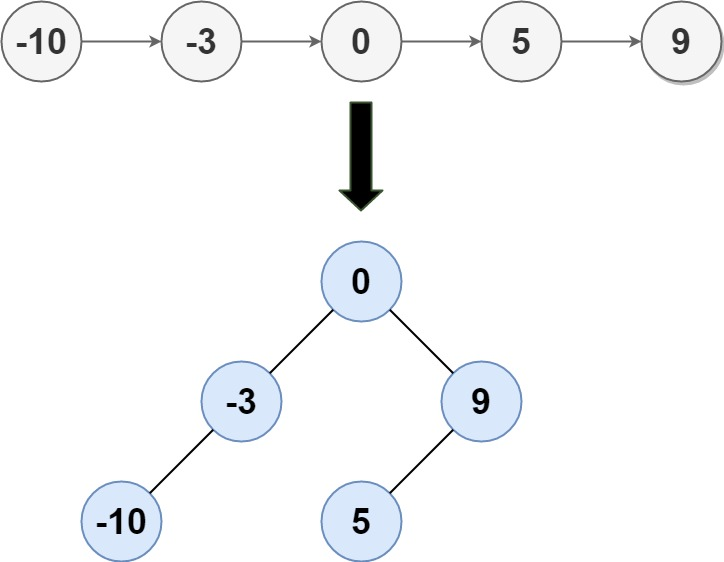

# [109. Convert Sorted List to Binary Search Tree](https://leetcode.com/problems/convert-sorted-list-to-binary-search-tree/)

| Category | Difficulty | Likes | Dislikes |
| :------: | :--------: | :---: | :------: |
| Algorithms | Medium | 7819 | 170 |

**Tags:** [`linked-list`](https://leetcode.com/tag/linked-list), [`divide-and-conquer`](https://leetcode.com/tag/divide-and-conquer), [`tree`](https://leetcode.com/tag/tree), [`binary-search-tree`](https://leetcode.com/tag/binary-search-tree), [`binary-tree`](https://leetcode.com/tag/binary-tree)

**Companies:** `google`, `facebook`, `amazon`, `bloomberg`, `microsoft`, `uber`, `apple`, `zenefits`

## Description

Given the `head` of a singly linked list where elements are sorted in **ascending order**, convert *it to a ****height-balanced*** *binary search tree*.

 

**Example 1:**


```

Input: head = [-10,-3,0,5,9]
Output: [0,-3,9,-10,null,5]
Explanation: One possible answer is [0,-3,9,-10,null,5], which represents the shown height balanced BST.

```

**Example 2:**

```

Input: head = []
Output: []

```

 

**Constraints:**

	- The number of nodes in `head` is in the range `[0, 2 * 10^4]`.

	- `-10^5 <= Node.val <= 10^5`

---

**Links:** [Submissions](https://leetcode.com/problems/convert-sorted-list-to-binary-search-tree/) | [Solutions](https://leetcode.com/problems/convert-sorted-list-to-binary-search-tree/)
