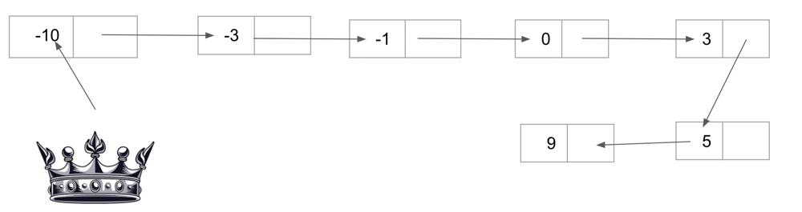
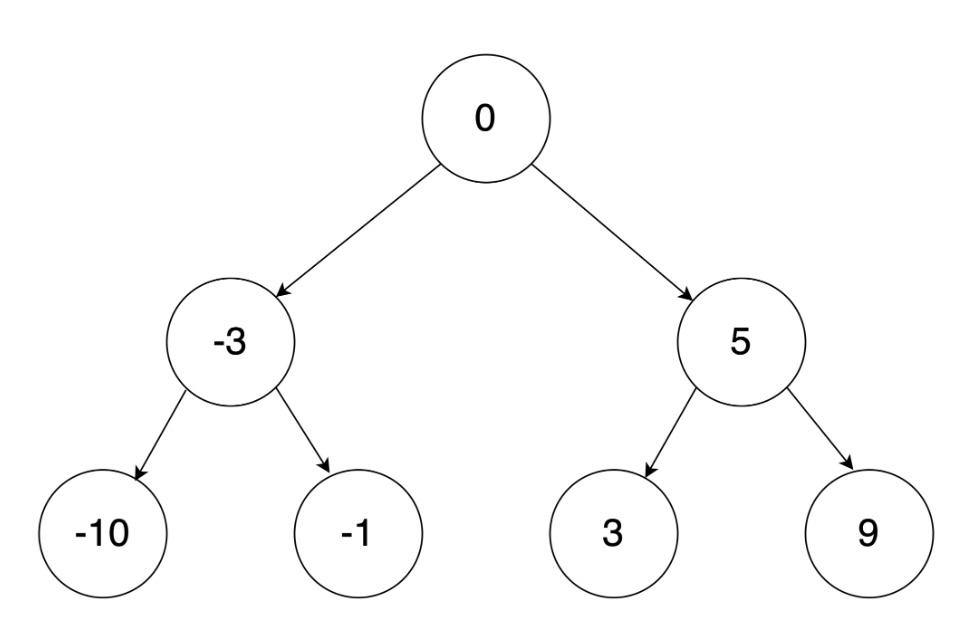

# Beats 100% +Video | Java C++ Python

**Author:** jeevankumar159
**Votes:** 65
**Link:** [https://leetcode.com/problems/convert-sorted-list-to-binary-search-tree/solutions/3281968/](https://leetcode.com/problems/convert-sorted-list-to-binary-search-tree/solutions/3281968/)

---

# Intuition 
In a balanced binary search Tree height difference b/w left and right node cannot be more than 1 or in other words they contain almost equal number of nodes. 

This can be achieved by dividing the Linked List into 2 parts first half = left Node, middle = root and right = second half. Repeat the above process recursively to generate the BST.

To find middle element use 2 pointer approach: The fast moves 2 steps  and slow 1 step at a time. Hence when fast is finished, slow will be at middle.

eg: Find the middle element below = 0 and form root. The LinkedList on left of middle will form a new BST and right will form a new BST using same function. i.e -3 will be mid and left = -10 and right = -1 . 





# Approach 
1. Find the middle element of the linked list.
2. Create a new node with the middle element as its value.
3. Set the left subtree of the new node to the result of recursively calling the function on the left half of the sorted list.
4. Set the right subtree of the new node to the result of recursively calling the function on the right half of the sorted list.
5. Return the new node.

How to find middle element:

1. Initialize two pointers, slow and fast, to head.
2. Move fast two steps ahead and slow one step ahead, until fast reaches the end of the list or goes past it.
3. The element pointed to by slow is the middle element of the list.

<iframe width="560" height="315" src="https://www.youtube.com/embed/pWjxJPY-DIo" title="YouTube video player" frameborder="0" allow="accelerometer; autoplay; clipboard-write; encrypted-media; gyroscope; picture-in-picture; web-share" allowfullscreen></iframe>


```
class Solution {
    public TreeNode sortedListToBST(ListNode head) {
        if(head == null) return null;
        if(head.next == null) return new TreeNode(head.val);
        ListNode middle = getMiddle(head);
        TreeNode root = new TreeNode(middle.val);
        root.right = sortedListToBST(middle.next);
        middle.next =null;
        root.left = sortedListToBST(head);
        return root;
    }
    
    public ListNode getMiddle(ListNode head){
        //if(head == null || head.next==null) return null;
        ListNode fast = head;
        ListNode slow = head;
        ListNode prev = null;
        while(fast!=null && fast.next!=null){
            fast = fast.next.next;
            prev = slow;
            slow = slow.next;
            
        }
        if(prev!=null)prev.next =null;
        return slow;
    }
}
```

```
class Solution {
public:
    TreeNode* sortedListToBST(ListNode* head) {
        if(head == NULL) return NULL;
        if(head->next == NULL) return new TreeNode(head->val);
        ListNode* middle = getMiddle(head);
        TreeNode* root = new TreeNode(middle->val);
        root->right = sortedListToBST(middle->next);
        middle->next = NULL;
        root->left = sortedListToBST(head);
        return root;
    }
    
    ListNode* getMiddle(ListNode* head){
        //if(head == NULL || head->next==NULL) return NULL;
        ListNode* fast = head;
        ListNode* slow = head;
        ListNode* prev = NULL;
        while(fast!=NULL && fast->next!=NULL){
            fast = fast->next->next;
            prev = slow;
            slow = slow->next;
        }
        if(prev!=NULL) prev->next = NULL;
        return slow;
    }
};
```

```
class Solution:
    def sortedListToBST(self, head: ListNode) -> TreeNode:
        if not head:
            return None
        if not head.next:
            return TreeNode(head.val)
        middle = self.getMiddle(head)
        root = TreeNode(middle.val)
        root.right = self.sortedListToBST(middle.next)
        middle.next = None
        root.left = self.sortedListToBST(head)
        return root
    
    def getMiddle(self, head: ListNode) -> ListNode:
        fast = head
        slow = head
        prev = None
        while fast and fast.next:
            fast = fast.next.next
            prev = slow
            slow = slow.next
        if prev:
            prev.next = None
        return slow
```