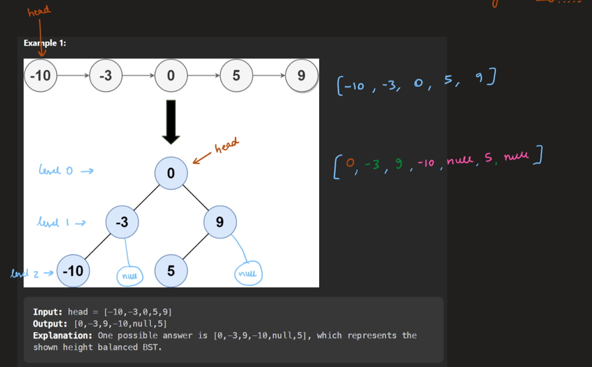
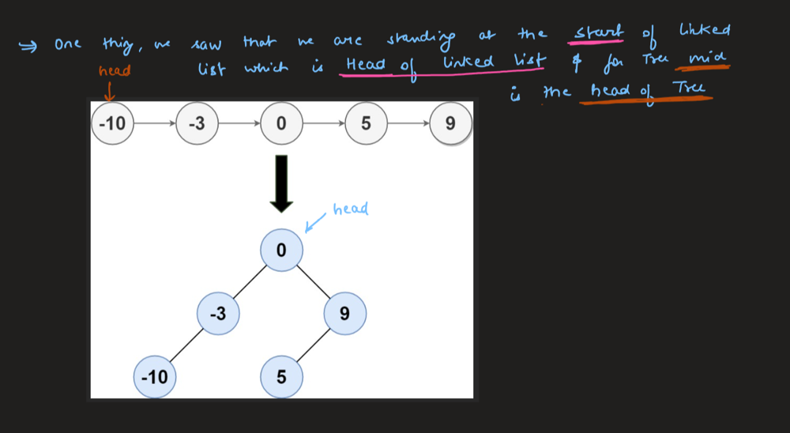
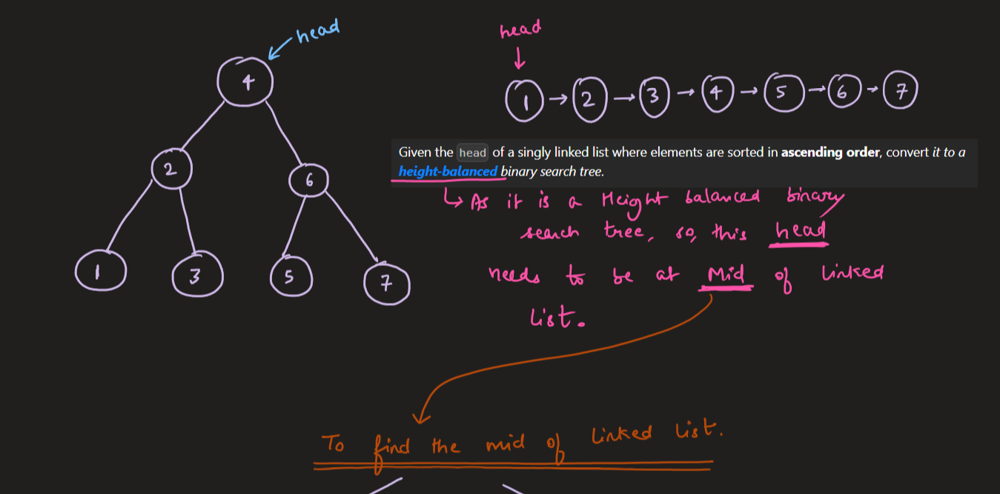
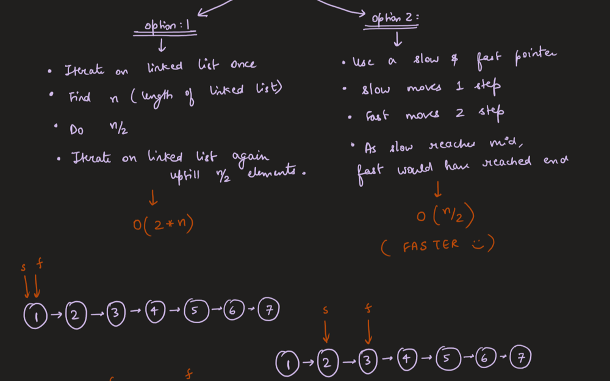
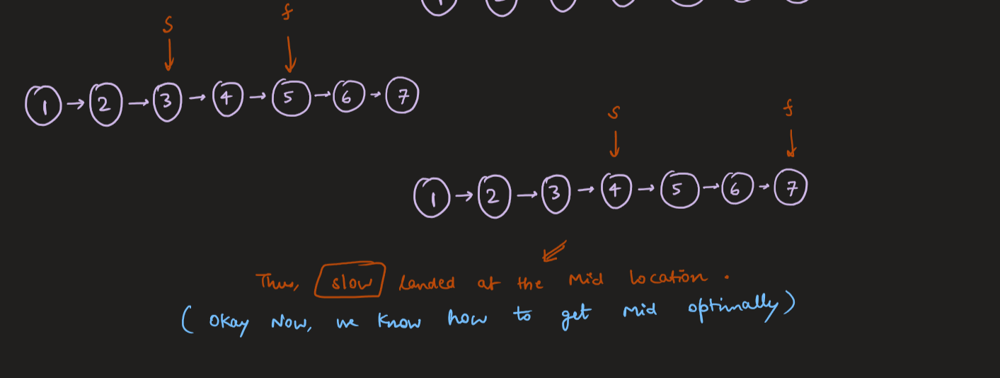
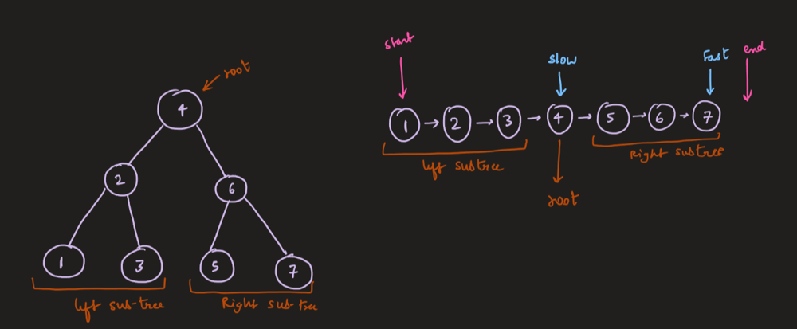
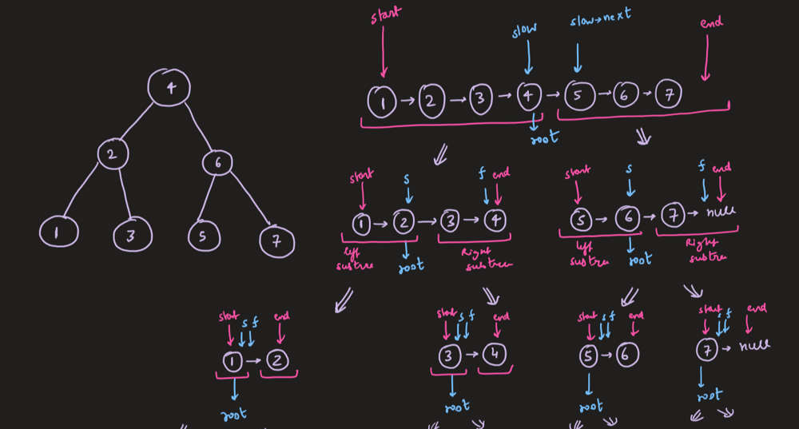
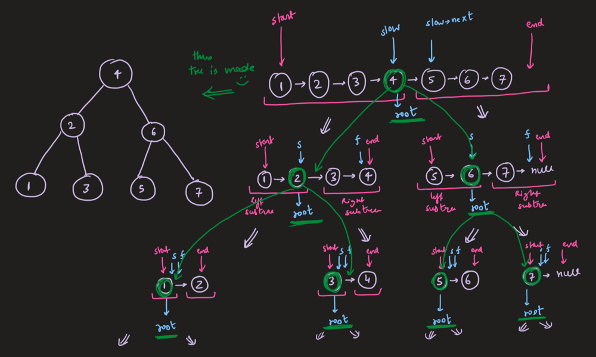
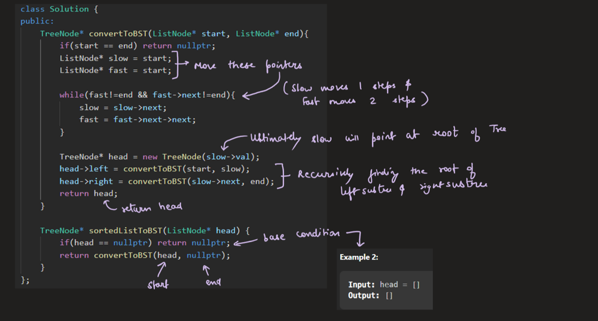
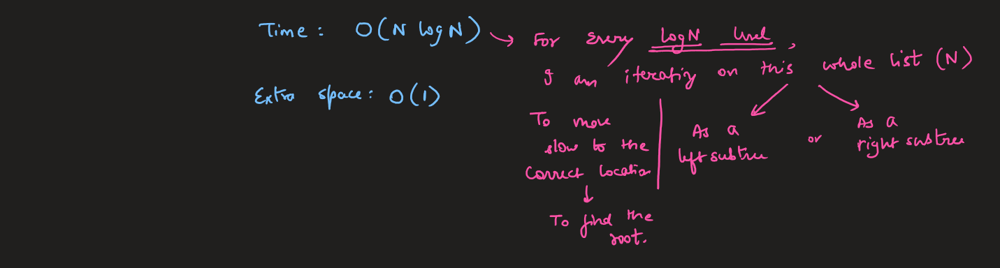

# Image Explanation🏆 - [Slow-Fast Pointer + Recursion] - Complete Intuition

**Author:** aryan_0077
**Votes:** 120
**Link:** [https://leetcode.com/problems/convert-sorted-list-to-binary-search-tree/solutions/3282118/](https://leetcode.com/problems/convert-sorted-list-to-binary-search-tree/solutions/3282118/)

---

# Video Solution
https://youtu.be/cN823mo1r4k

# Approach & Intution














# Code
```
/**
 * Definition for singly-linked list.
 * struct ListNode {
 *     int val;
 *     ListNode *next;
 *     ListNode() : val(0), next(nullptr) {}
 *     ListNode(int x) : val(x), next(nullptr) {}
 *     ListNode(int x, ListNode *next) : val(x), next(next) {}
 * };
 */
/**
 * Definition for a binary tree node.
 * struct TreeNode {
 *     int val;
 *     TreeNode *left;
 *     TreeNode *right;
 *     TreeNode() : val(0), left(nullptr), right(nullptr) {}
 *     TreeNode(int x) : val(x), left(nullptr), right(nullptr) {}
 *     TreeNode(int x, TreeNode *left, TreeNode *right) : val(x), left(left), right(right) {}
 * };
 */
class Solution {
public:
    TreeNode* convertToBST(ListNode* start, ListNode* end){
        if(start == end) return nullptr;
        ListNode* slow = start;
        ListNode* fast = start;

        while(fast!=end && fast->next!=end){
            slow = slow->next;
            fast = fast->next->next;
        }

        TreeNode* head = new TreeNode(slow->val);
        head->left = convertToBST(start, slow);
        head->right = convertToBST(slow->next, end);
        return head;
    }

    TreeNode* sortedListToBST(ListNode* head) {
        if(head == nullptr) return nullptr;
        return convertToBST(head, nullptr);
    }
};
```