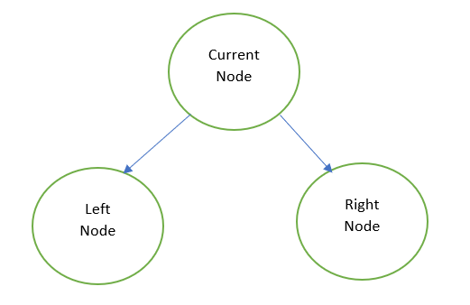
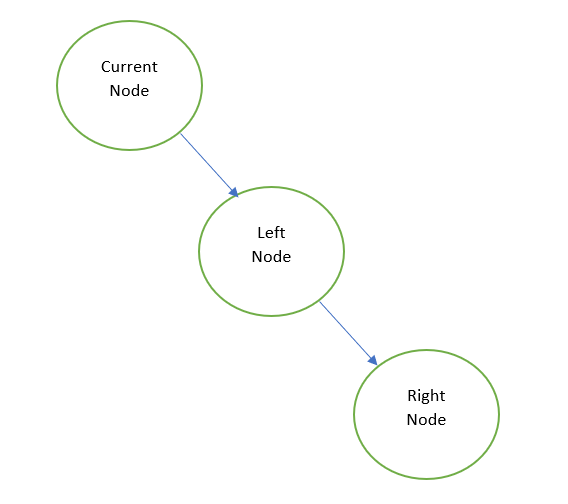

# Python/JS/Java/Go/C++ O( n ) sol. by DFS. [ w/ Visualization ]

**Author:** brianchiang_tw
**Votes:** 27
**Link:** [https://leetcode.com/problems/flatten-binary-tree-to-linked-list/solutions/502553/](https://leetcode.com/problems/flatten-binary-tree-to-linked-list/solutions/502553/)

---

Python/JS/Java/Go/C++ O( n ) sol. by DFS approach.

---

Goal: 
**Convert binary tree** into a **right-skewed linked list**.

---

Algorithm:

Maintain a global node, called **previous traversal node**, initialized to None, and update as current node on each DFS traversal.

DFS traversal with the ordering: ( Right node, Left node, Current node )

1. Change current node's **right child** as **previous traversal node**.
2. Change current node's **left child** as **None**(i.e., NULL)
3. **Update previous traversal node** as current node

Observation:
For Left node, Right node is its previous traversal node.
For Current node, Left node is its previous traversal node.

---

Abstract Model:

Before flatten operation: ( binary tree )


After flatten operation: ( right-skewed linked list )


	 
---

**Implementation**:

Python:

```
# Definition for a binary tree node.
# class TreeNode:
#     def __init__(self, x):
#         self.val = x
#         self.left = None
#         self.right = None

class Solution:
      
    def flatten(self, root: TreeNode) -> None:
        """
        Input: root node of binary tree
        Output: convert binary tree to right-skewed linked list
        """
        
        # record of node of previous traversal
        previous_traversal = None
        
        def helper( node):
        
            if node:

                # DFS travesal to next level
                
                helper( node.right )
                helper( node.left )

                # flattern binary tree to right skewed linked list
                
                nonlocal previous_traversal
                node.right = previous_traversal
                node.left = None
                previous_traversal = node
                
        # ---------------------
        
        helper(root)
```

---

Java:

```
class Solution {
    public void flatten(TreeNode root) {
        
        if( root != null ){

            // DFS travesal to next level
            flatten( root.right );
            flatten( root.left );

            // flattern binary tree to right skewed linked list
            root.right = prev;
            root.left = null;
            prev = root;
        }
        
        return;        
    }
    
    // record of node of previous traversal
    private TreeNode prev = null;
}
```

---

Javascript:

```
var flatten = function(root) {
    
    let prev = null;
    
    var helper = function( node ){
        
        if( node != null){
            
            // DFS travesal to next level
            helper(node.right);
            helper(node.left);
            
            // flattern binary tree to right skewed linked list
            node.right = prev;
            node.left = null
            prev = node
        }
        return;
    }
    // ------------------------------------
    
    helper( root );
};
```

---

Go:

```
func flatten(root *TreeNode)  {

    //  record of node of previous traversal
    var prev *TreeNode = nil
    
    var helper func( *TreeNode )
    
    helper = func( node *TreeNode){
        
        if node != nil{
            
            // DFS travesal to next level
            helper( node.Right )
            helper( node.Left )

            // flattern binary tree to right skewed linked list
            node.Right = prev
            node.Left = nil
            prev = node
        }
        return

    }
    // ------------------------------
    helper( root )
}
```

---

C++

```
class Solution {
public:
    void flatten(TreeNode* root) {
        
        // record of node of previous traversal
        TreeNode* prev = nullptr;
        
        std::function< void(TreeNode*) > helper;
        helper = [&](TreeNode* node) -> void {
            
            if( node != nullptr ){
                
                // DFS travesal to next level
                helper( node->right );
                helper( node->left );
                
                // flattern binary tree to right skewed linked list
                node->right = prev;
                node->left = nullptr;
                prev = node;
            }
            return;
        };
        
        // ----------------------
        helper( root );
        
        return;
    }
};
```