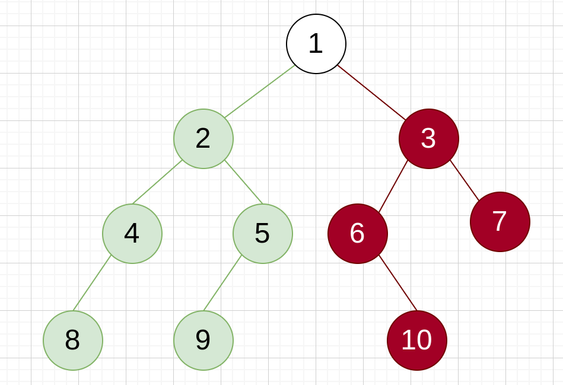
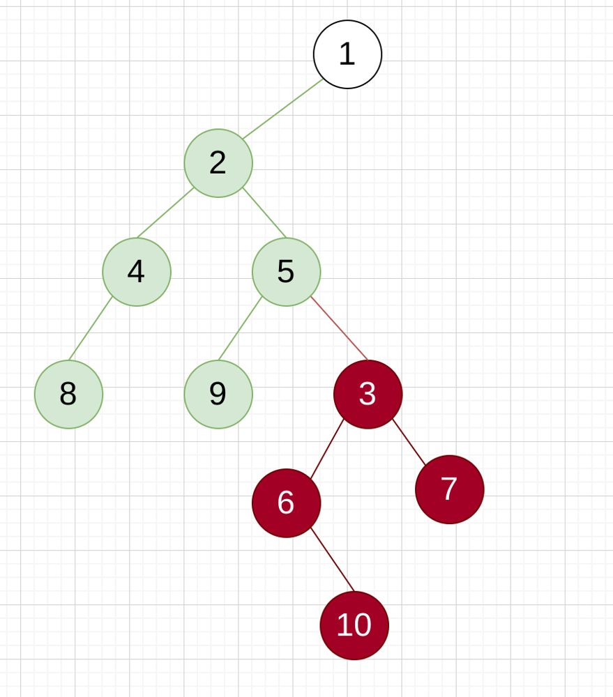

# Ruby - recursive solution

**Author:** Aetherus
**Votes:** 2
**Link:** [https://leetcode.com/problems/flatten-binary-tree-to-linked-list/solutions/2338876/](https://leetcode.com/problems/flatten-binary-tree-to-linked-list/solutions/2338876/)

---

Since the result of pre-order traversal of the following 2 trees are the same, we can just append the right subtree to the rightmost node of the left subtree and do recursive flatten.





```ruby
def flatten(root)
  return nil unless root
  
  # set the right subtree of `root` to the right child of the rightmost node of the left subtree of `root`,
  # flatten the left subtree,
  # and set the flattened subtree as the right child of `root`.
  root.right = flatten(append(root.left, root.right))
  
  # remove the left subtree of `root`.
  root.left = nil
  
  # and return `root`
  root
end

# Set `node` as the right child of the rightmost node in the tree with root `root`.
# If `root` is nil, just return `node`.
def append(root, node)
  return node unless root
  
  # minor optimization.
  # if node is nil,
  # then we don't need to do anything.
  return root unless node
  
  curr = root
  curr = curr.right while curr.right
  curr.right = node
  root
end
```