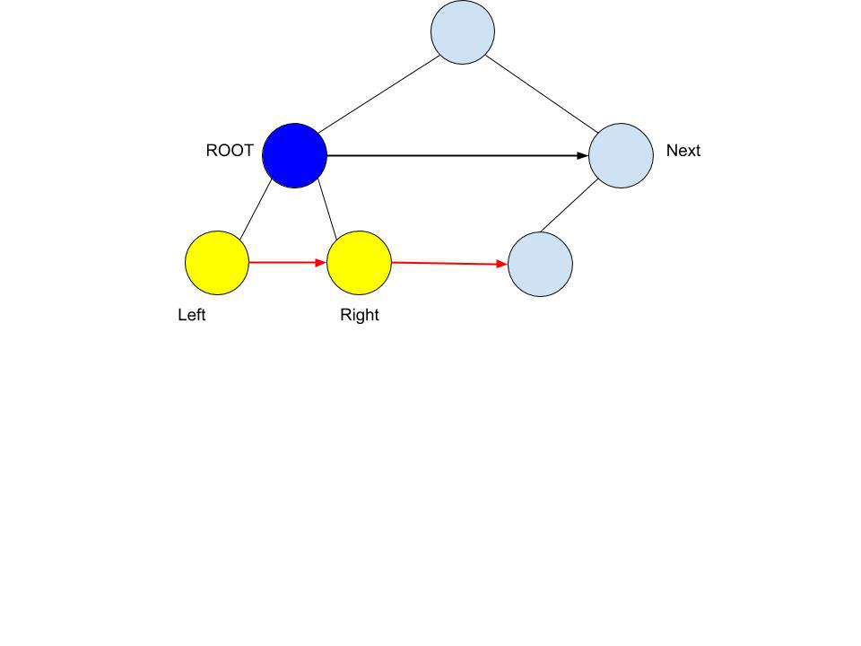

# Java 0ms with visual explanation

**Author:** wilsoncursino
**Votes:** 125
**Link:** [https://leetcode.com/problems/populating-next-right-pointers-in-each-node/solutions/962728/](https://leetcode.com/problems/populating-next-right-pointers-in-each-node/solutions/962728/)

---



```
class Solution {
    public Node connect(Node root) {
        if(root == null) return null;
        if(root.left != null) root.left.next = root.right;
        if(root.right != null && root.next != null) root.right.next = root.next.left;
        connect(root.left);
        connect(root.right);
        return root;
    }
}
```