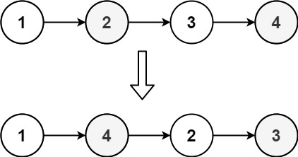
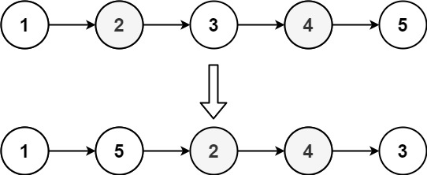

# [143. Reorder List](https://leetcode.com/problems/reorder-list/)

| Category | Difficulty | Likes | Dislikes |
| :------: | :--------: | :---: | :------: |
| Algorithms | Medium | 12237 | 498 |

**Tags:** [`linked-list`](https://leetcode.com/tag/linked-list), [`two-pointers`](https://leetcode.com/tag/two-pointers), [`stack`](https://leetcode.com/tag/stack), [`recursion`](https://leetcode.com/tag/recursion)

**Companies:** `bloomberg`, `google`, `facebook`, `amazon`, `microsoft`, `tiktok`, `apple`, `arista-networks`, `goldman-sachs`

## Description

You are given the head of a singly linked-list. The list can be represented as:

```

L0 &rarr; L1 &rarr; &hellip; &rarr; Ln - 1 &rarr; Ln

```

*Reorder the list to be on the following form:*

```

L0 &rarr; Ln &rarr; L1 &rarr; Ln - 1 &rarr; L2 &rarr; Ln - 2 &rarr; &hellip;

```

You may not modify the values in the list's nodes. Only nodes themselves may be changed.

 

**Example 1:**


```

Input: head = [1,2,3,4]
Output: [1,4,2,3]

```

**Example 2:**


```

Input: head = [1,2,3,4,5]
Output: [1,5,2,4,3]

```

 

**Constraints:**

	- The number of nodes in the list is in the range `[1, 5 * 10^4]`.

	- `1 <= Node.val <= 1000`

---

**Links:** [Submissions](https://leetcode.com/problems/reorder-list/) | [Solutions](https://leetcode.com/problems/reorder-list/)
