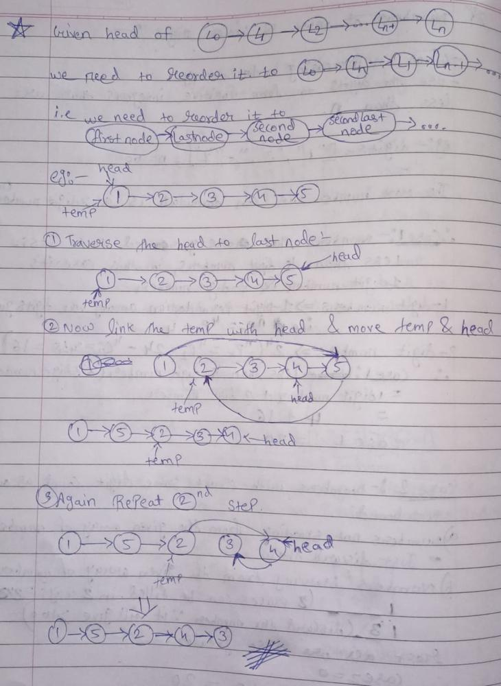

# C++ EASY TO SOLVE || Beginner Friendly with detailed explanation and dry run

**Author:** Cosmic_Phantom
**Votes:** 206
**Link:** [https://leetcode.com/problems/reorder-list/solutions/1640556/](https://leetcode.com/problems/reorder-list/solutions/1640556/)

---

**Intuition:-**
After reading the question we got the gist that we need to reform the linkedlist in the manner such as
`firstnode->lastnode->secondnode->penultimate node->third node->3rd last node ............` .
So there are two ways that comes to my mind while thinking about a approach . Those are ,

**1. Brute Force :-**
* In this we will first traverse to penultimate node and then start relinking each node .

**2.** **Two pointer approach[sometimes referred as Tortoise and hare method]:-**
* We will have two pointers 1st pointer moving at speed of 1node and 2nd pointer moving at speed of twice the node. So basically one is moving at double speed and thus when it will be finished, the other has to be midway) and possibly adjusting it with lists of even length. This creates two halfs of linkedlist
* Then we reverse the second list and Finally we merge these two lists.

**Brute-Force Algorithm:-**
1. First some base cases that we need to take care i.e if the linked list has zero,one or two elements just return it 
2. Now next we need to find the penultimate node, so after finding it we can start the relinking process
3. Now start the relinking process as 1st node with last node ,2nd node with penultimate node, 3rd node with 3rd last node ......
4. Now repeat 2nd and 3rd steps.

**Let's have a dy run before starting the code:-**



**Brute-Force code-:**
```
//Upvote  and Comment
class Solution {
public:
    void reorderList(ListNode* head) {
        //base case i.e if the linked list has zero,one or two elments just return it
        if(!head || !head->next || !head->next->next) return;
        
        //Find the penultimate node i.e second last node of the linkedlist
        ListNode* penultimate = head;
        while (penultimate->next->next) penultimate = penultimate->next;
        
        // Link the penultimate with the second element
        penultimate->next->next = head->next;
        head->next = penultimate->next;
        
        //Again set the penultimate to the the last 
        penultimate->next = NULL;
        
        // Do the above steps rcursive
        reorderList(head->next->next);
    }
};
```
.


**Two pointer Approach [Tortoise and Hare method]:-**
*This approach is much faster and efficient in terms of Time and Space Complexity the only drawback is that it looks a little bit lengthy but trust me it's easy to understand*.

**Two pointer Approach Algorithm:**
1. First let's take two pointers name it as `half` and `temp` . `temp ` is faster than `half` by 1. 
2. When `temp` reaches the end of linkedlsit `half` reaches the middle element .So this is how the linkedlist will get divided in two halfes as the center will become a dividing node .
3. Now reverse the second half . 
4. After reversing the second half, merge the first half and second half

**Let's have a dy run before starting the code:-**
Let's take the same example as above:
```
Linked list:[1,2,3,4,5]
* search for the central element, which will be three in our case
* split the list in two halfes that will be [1,2,3] and [4,5]
* Now reverse the second half that will be [5,4]
* Now merge both the halfes 
[1,2,3]
	[5,4]
=>[1,5,2,4,3]

**See told you it's easy to understand**
```


**Two pointer Approach Code:-**
```
//Upvote and Comment
class Solution {
public:
    void reorderList(ListNode* head) {
        // base case : linkedlist is empty
        if (!head) return;
        
        // finding the middle with the help of two pointer approach
        ListNode *tmp = head, *half = head, *prev = NULL;
        while (tmp->next && tmp->next->next) {
            tmp = tmp->next->next;
            half = half->next;
        }
        
        // adding one bit in case of lists with even length
        if (tmp->next) half = half->next;
        
        // Now reverse the second half
        while (half) {
            tmp = half->next;
            half->next = prev;
            prev = half;
            half = tmp;
        }
        half = prev;
        
        // After reversing the second half, let's merge both the halfes
        while (head && half) {
            tmp = head->next;
            prev = half->next;
            head->next = half;
            half->next = tmp;
            head = tmp;
            half = prev;
        }
        
        // Base case : closing when we had even length arrays
        if (head && head->next) head->next->next = NULL;
    }
};
```
**Time Complexity :** *`O(N) [ O(N) to find mid of list, O(N/2) to reverse the 2nd half and in the end O(N) for relinking purpose  ]`*
**Space Complexity :** *`O(1) [intermediate state variables are the only thing  that we used]`*

***

