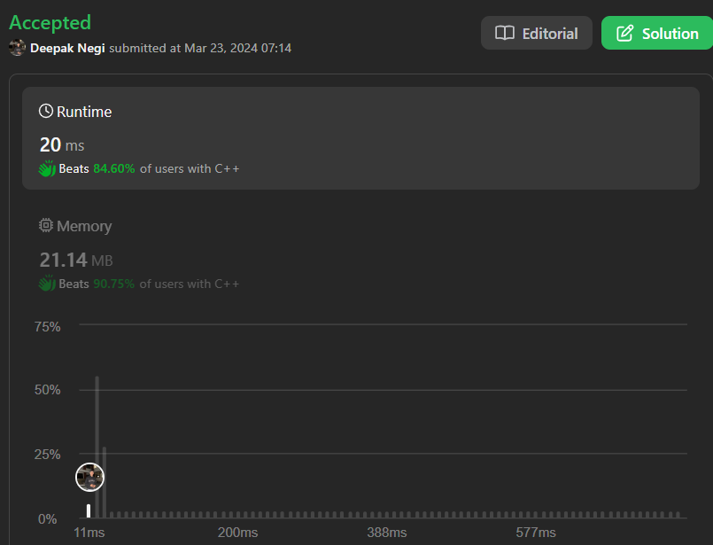

# Reverse Second Half And Merge the Lists | | Two-Pointer | | C++ | | Java | | Python3 | | ✅✅✅🔥🔥🔥

**Author:** Hunter_0718
**Votes:** 45
**Link:** [https://leetcode.com/problems/reorder-list/solutions/4912231/](https://leetcode.com/problems/reorder-list/solutions/4912231/)

---



 **Here's a response that directly uses the variables from the provided code:**

**Intuition:**

- We'll rearrange the linked list using three key steps: finding the middle node, reversing the second half, and merging the two halves in an alternating pattern.

**Approach:**

1. **Find the Middle Node:**
   - Initialize `slow` and `fast` pointers to `head`.
   - While `fast` and `fast->next` exist, move `slow` one step and `fast` two steps.
   - `slow` will now point to the middle node.

2. **Reverse the Second Half:**
   - Call `reverse(slow)` to reverse the list starting from `slow`.
   - This returns the new head of the reversed portion (`list2`).

3. **Merge the Two Halves:**
   - Keep a `prev` pointer to set `prev->next` to `NULL` later, marking the end of the first half.
   - Iterate through `list1` and `list2`:
     - Store `list1->next` as `nextNode`.
     - Connect `list1->next` to `list2`.
     - Move `list1` to `nextNode`.
     - Move `list2` to `list2->next`.

**Time Complexity:**

- Finding middle: O(n)
- Reversing: O(n/2) ~ O(n)
- Merging: O(n)
- Total: O(3n) ~ O(n)

**Space Complexity:**

- Extra pointers: O(1)
- Recursive `reverse` call stack: O(n) in worst-case (extremely long lists), but practically considered O(1).

```C++ []
/**
 * Definition for singly-linked list.
 * struct ListNode {
 *     int val;
 *     ListNode *next;
 *     ListNode() : val(0), next(nullptr) {}
 *     ListNode(int x) : val(x), next(nullptr) {}
 *     ListNode(int x, ListNode *next) : val(x), next(next) {}
 * };
 */
class Solution {
public:
    ListNode* reverse(ListNode *head){
        if(!head) return NULL;
        ListNode *prev = NULL;
        ListNode *curr = head;
        ListNode *nextNode = NULL;
        while(curr){
            nextNode = curr->next;
            curr->next = prev;
            prev = curr;
            curr = nextNode;
        }
        return prev;
    }

    void merge(ListNode *list1, ListNode *list2){
        while(list2) {
            ListNode  *nextNode = list1->next;
            list1->next = list2;
            list1 = list2;
            list2 = nextNode;

        }

    }
    void reorderList(ListNode* head) {
        if(!head || !head->next) return;
        ListNode *slow = head;
        ListNode *fast = head;
        ListNode *prev = head;
        while(fast && fast->next){
            prev = slow;
            fast = fast->next->next;
            slow = slow->next;
        }
        prev->next = NULL;
        ListNode *list1 = head;
        ListNode *list2 = reverse(slow);
        merge(list1,list2);
    }
};
```
```Java []
/*class ListNode {
    int val;
    ListNode next;
    ListNode() {}
    ListNode(int val) { this.val = val; }
    ListNode(int val, ListNode next) { this.val = val; this.next = next; }
}*/

class Solution {
    public ListNode reverse(ListNode head) {
        if (head == null) return null;
        ListNode prev = null;
        ListNode curr = head;
        ListNode nextNode = null;
        while (curr != null) {
            nextNode = curr.next;
            curr.next = prev;
            prev = curr;
            curr = nextNode;
        }
        return prev;
    }

    public void merge(ListNode list1, ListNode list2) {
        while (list2 != null) {
            ListNode nextNode = list1.next;
            list1.next = list2;
            list1 = list2;
            list2 = nextNode;
        }
    }

    public void reorderList(ListNode head) {
        if (head == null || head.next == null) return;
        ListNode slow = head;
        ListNode fast = head;
        ListNode prev = head;
        while (fast != null && fast.next != null) {
            prev = slow;
            fast = fast.next.next;
            slow = slow.next;
        }
        prev.next = null;
        ListNode list1 = head;
        ListNode list2 = reverse(slow);
        merge(list1, list2);
    }
}

```
```Python3 []
class ListNode:
    def __init__(self, val=0, next=None):
        self.val = val
        self.next = next

class Solution:
    def reverse(self, head):
        if not head:
            return None
        prev = None
        curr = head
        nextNode = None
        while curr:
            nextNode = curr.next
            curr.next = prev
            prev = curr
            curr = nextNode
        return prev

    def merge(self, list1, list2):
        while list2:
            nextNode = list1.next
            list1.next = list2
            list1 = list2
            list2 = nextNode

    def reorderList(self, head):
        if not head or not head.next:
            return
        slow = head
        fast = head
        prev = head
        while fast and fast.next:
            prev = slow
            fast = fast.next.next
            slow = slow.next
        prev.next = None
        list1 = head
        list2 = self.reverse(slow)
        self.merge(list1, list2)

```

```JavaScript []
/**
 * Definition for singly-linked list.
 * function ListNode(val, next) {
 *     this.val = (val === undefined ? 0 : val)
 *     this.next = (next === undefined ? null : next)
 * }
 */
/**
 * @param {ListNode} head
 * @return {void} Do not return anything, modify head in-place instead.
 */
var reorderList = function(head) {
    if (!head || !head.next) return;
    
    // Find the middle of the linked list
    let slow = head;
    let fast = head;
    while (fast.next && fast.next.next) {
        slow = slow.next;
        fast = fast.next.next;
    }
    
    // Reverse the second half of the linked list
    let prev = null;
    let curr = slow.next;
    while (curr) {
        let nextNode = curr.next;
        curr.next = prev;
        prev = curr;
        curr = nextNode;
    }
    slow.next = null;
    
    // Merge the two halves
    let p1 = head;
    let p2 = prev;
    while (p1 && p2) {
        let nextP1 = p1.next;
        let nextP2 = p2.next;
        p1.next = p2;
        p2.next = nextP1;
        p1 = nextP1;
        p2 = nextP2;
    }
};

```


**Dry Run:**

**Example:** `head = [1, 2, 3, 4]`

1. **Find Middle:**
   - `slow` = 1, `fast` = 4 (after loop)
   - Middle node: `slow = 2`

2. **Reverse:**
   - `list2` = `reverse(2)` = `4 -> 3 -> 2`

3. **Merge:**
   - `list1` = `1 -> 2 -> 3 -> 4`, `list2` = `4 -> 3 -> 2`
   - Iteration 1: `list1 = 1 -> 4`, `list2 = 3 -> 2`, `prev->next = NULL`
   - Iteration 2: `list1 = 4 -> 3`, `list2 = 2`
   - Final list: `1 -> 4 -> 2 -> 3`
