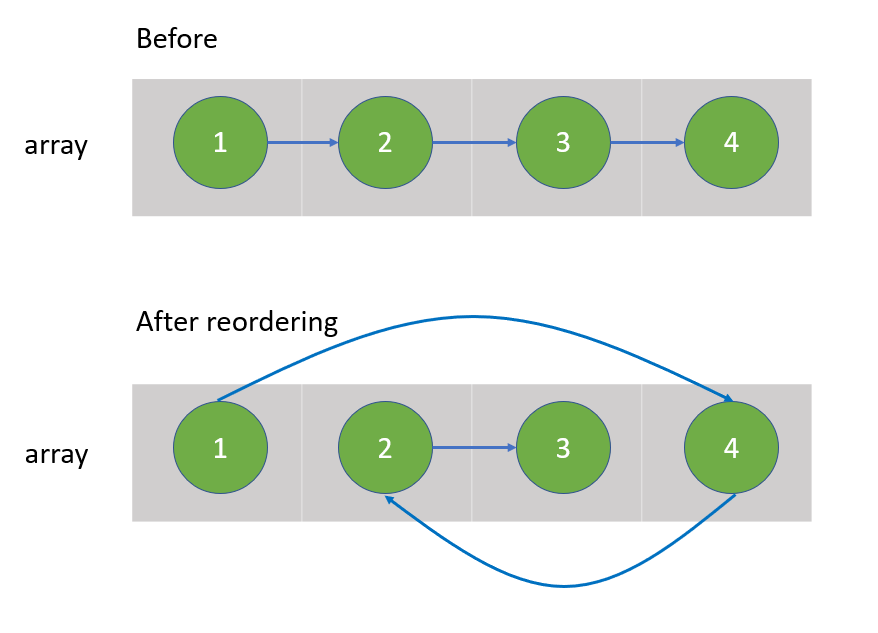
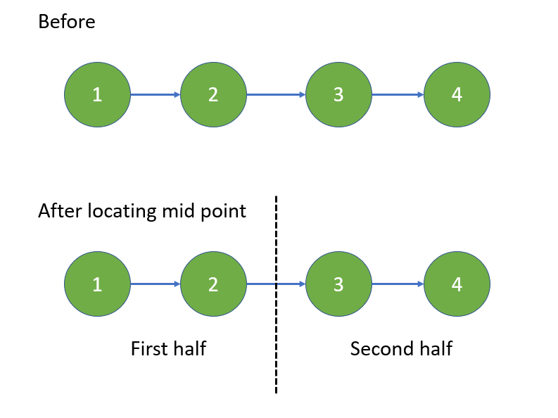
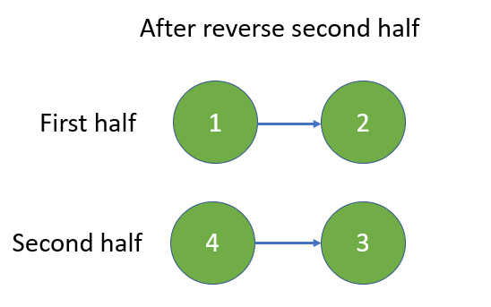
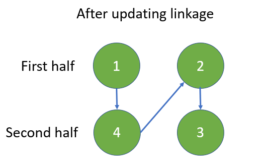

# Python O(n) by two-pointers [w/ Visualization]

**Author:** brianchiang_tw
**Votes:** 166
**Link:** [https://leetcode.com/problems/reorder-list/solutions/801971/](https://leetcode.com/problems/reorder-list/solutions/801971/)

---

The first method is to reorder by **two pointers** with the help of **aux O(n)** space **array**.

The second method is to reorder by **mid-point finding**, **linked list reverse**, and **linkage update** in O(1) aux space.

---

Method_#1

**Visualization and Diagram**



---

**Implementation**:

```
class Solution:
    def reorderList(self, head: ListNode) -> None:
        """
        Do not return anything, modify head in-place instead.
        """
		
		# ----------------------------------------------
		# Save linked list in array
		
        arr = []
        
        cur, length = head, 0
		
        while cur:
            arr.append( cur )
            cur, length = cur.next, length + 1
        
		# ----------------------------------------------
        # Reorder with two-pointers
		
        left, right = 0, length-1
        last = head
        
        while left < right:
            arr[left].next = arr[right]
            left += 1
            
            if left == right: 
                last = arr[right]
                break
                
            arr[right].next = arr[left]
            right -= 1
            
            last = arr[left]
        
        if last:
            last.next= None
```

---

Method_#2

**Visualization and Diagram**



---



---




---

**Implementation**:

```
class Solution:
    def reorderList(self, head: ListNode) -> None:
        """
        Do not return anything, modify head in-place instead.
        """
        
        if not head:
            # Quick response for empty linked list
            return None
        
        # ------------------------------------------
        # Locate the mid point of linked list
        # First half is the linked list before mid point
        # Second half is the linked list after mid point
        
        fast, slow = head, head
        
        while fast and fast.next:
            slow, fast = slow.next, fast.next.next
            
        mid = slow
        
        # ------------------------------------------
        # Reverse second half
        
        prev, cur = None, mid
        
        while cur:
            cur.next, prev, cur = prev, cur, cur.next
        
        head_of_second_rev = prev
        
        # ------------------------------------------
        # Update link between first half and reversed second half
        
        first, second = head, head_of_second_rev
        
        while second.next:
            
            next_hop = first.next
            first.next = second
            first = next_hop
            
            next_hop = second.next
            second.next = first
            second = next_hop
```

---