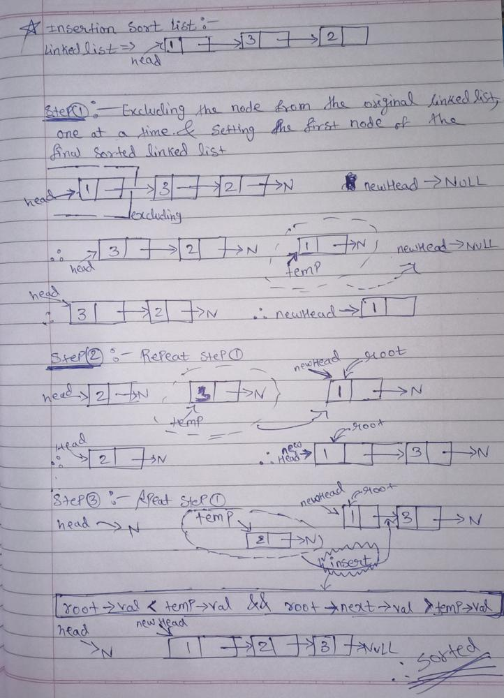

# C++ EASY TO SOLVE || Detailed Explanation with dry run

**Author:** Cosmic_Phantom
**Votes:** 35
**Link:** [https://leetcode.com/problems/insertion-sort-list/solutions/1629448/](https://leetcode.com/problems/insertion-sort-list/solutions/1629448/)

---

**Intuition:-**
Nothing for intuition this time. Since the question is loud and clear that we need to use insertion sort[Also explained in the description of the question] for sorting the linked list .
*A tip -Do not get intimidated by the length of code have faith in yourself that you can understand.*

**Algorithm:-**
1. Let's create a `newHead ` as the name suggests it will be representating our final linked list. Initialize it to NULL.
2. Now we will traverse our original linkedlist and seperate our head nodes one at a time in each iteration to insert them in the `newHead` initiated linkedlist
3. During insertion in `newHead` we need to take care of three conditions 
* Condition 1: If this is the first node that is being inserted in the `newHead` the node will get insertd at `newHead `
* Condition 2:  After the the first insertion we need to check whether the next insertion will be in between or in the end of` newHead linkedlist`
* Condition 3: To check the condition 2 we need this condition i.e we will traverse the newHead linkedlist using a temporary pointer "`root`" and find the appropriate position of the `temp` node
4. Repeat process 2 and 3 until all the nodes are inserted to newHead

[The three conditon we talked are in the form of **if** ,**elseif**, and **else** in the code given]


**Before getting inside the code let's have a dry run :**



**Code:-**
```
class Solution {
public:
    ListNode* insertionSortList(ListNode* head) {
        ListNode* newHead = NULL;//initializing the newHead for our sorted linkedlist
        while(head){
            // Exluding node from the original linked list we will do this one at a time
            ListNode* temp = head;
            head = head->next;
            temp->next=NULL;
            
            //setting the first node of our final linked list 
            if(newHead == NULL) newHead = temp;
             // if the position of element is at index 0 i.e. at the start (the temp node is the smallest of all the nodes that are currently present in the sorted linked list)
            else if(newHead->val >= temp->val){
                temp->next = newHead;
                newHead = temp;
            }
            // inserting the node anywhere in the middle or in the end depending upon the value of the temp node;
            else{
                ListNode* root = newHead;
                {
                while(root->next){
                    if(temp->val > root->val and temp->val <= root->next->val){
                        temp->next = root->next;
                        root->next = temp;
                        break;
                    }
                    root = root->next;
                }  
                    //inserting the temp node at the end
                    if(root->next==NULL) root->next = temp;
                    
                }
            }
        }
        //Our sorted linkedlist
        return newHead;
    }
};
```
