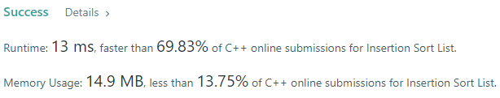
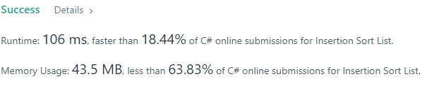
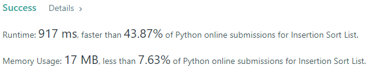
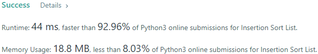
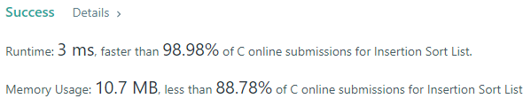
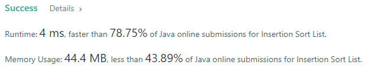
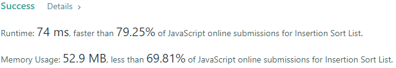

# 💢☠💫Easiest👾Faster✅💯 Lesser🧠 🎯 C++✅Python3🐍✅Java✅C✅Python🐍✅C#✅💥🔥💫Explained☠💥🔥 Beats 100

**Author:** Edwards310
**Votes:** 5
**Link:** [https://leetcode.com/problems/insertion-sort-list/solutions/5698960/](https://leetcode.com/problems/insertion-sort-list/solutions/5698960/)

---

# Intuition








```javascript []
//JavaScript Code
/**
 * Definition for singly-linked list.
 * function ListNode(val, next) {
 *     this.val = (val===undefined ? 0 : val)
 *     this.next = (next===undefined ? null : next)
 * }
 */
/**
 * @param {ListNode} head
 * @return {ListNode}
 */
var insertionSortList = function(head) {
    const arr = []
    let curr = head
    while(curr != undefined){
        arr.push(curr.val)
        curr = curr.next
    }
    
    arr.sort((a, b) =>{
        return a - b
    })
    
    //console.log(arr)
    curr = head
    while(curr != undefined){
        curr.val = arr.shift()
        curr = curr.next
    }
    return head
};
```
```C++ []
//C++ Code
/**
 * Definition for singly-linked list.
 * struct ListNode {
 *     int val;
 *     ListNode *next;
 *     ListNode() : val(0), next(nullptr) {}
 *     ListNode(int x) : val(x), next(nullptr) {}
 *     ListNode(int x, ListNode *next) : val(x), next(next) {}
 * };
 */
class Solution {
public:
    ListNode* insertionSortList(ListNode* head) {
        vector<ListNode*> vec;
        while(head){
            vec.push_back(head);
            head = head->next;
        }
        sort(vec.begin(), vec.end(), [&](ListNode* a, ListNode* b){
            return a->val > b->val;
        });
        
        ListNode* prev = nullptr;
        for(int i = 0; i < vec.size(); i++){
            head = vec[i];
            head->next = prev;
            prev = head;
        }
        return head;
    }
};
```
```Python3 []
#Python3 Code
# Definition for singly-linked list.
# class ListNode:
#     def __init__(self, val=0, next=None):
#         self.val = val
#         self.next = next
class Solution:
    def insertionSortList(self, head: Optional[ListNode]) -> Optional[ListNode]:
        res = []
        while head:
            res.append(head.val)
            head = head.next
        
        res = sorted(res, reverse = True)
        #print(res)
        dummy = None
        
        for node in res:
            head = ListNode(node)
            head.next = dummy
            dummy = head
            
        return dummy
            
```
```Java []
//Java Code
/**
 * Definition for singly-linked list.
 * public class ListNode {
 *     int val;
 *     ListNode next;
 *     ListNode() {}
 *     ListNode(int val) { this.val = val; }
 *     ListNode(int val, ListNode next) { this.val = val; this.next = next; }
 * }
 */
class Solution {
    public ListNode insertionSortList(ListNode head) {
        PriorityQueue<Integer> pq = new PriorityQueue<>();
        ListNode curr = head;
        // Get values to PQueue (insertion sort inside queue)
        while(curr != null){
            pq.add(curr.val);
            curr = curr.next;
        }
        // Fill values into list
        curr = head;
        while(curr != null){
            curr.val = pq.poll();
            curr = curr.next;
        }
        return head;
    }
}
```
```C []
//C Code
/**
 * Definition for singly-linked list.
 * struct ListNode {
 *     int val;
 *     struct ListNode *next;
 * };
 */
typedef struct ListNode ListNode;

ListNode* newNode(int val){
    ListNode* node = (ListNode*)malloc(sizeof(ListNode));
    node->val = val;
    node->next = NULL;
    return node;
}
struct ListNode* insertionSortList(struct ListNode* head) {
        ListNode* dummy = newNode(0);
        dummy -> next = head;
        ListNode *pre = dummy, *cur = head;
        while (cur) {
            if ((cur -> next) && (cur -> next -> val < cur -> val)) {
                while ((pre -> next) && (pre -> next -> val < cur -> next -> val)) {
                    pre = pre -> next;
                }
                ListNode* temp = pre -> next;
                pre -> next = cur -> next;
                cur -> next = cur -> next -> next;
                pre -> next -> next = temp;
                pre = dummy;
            }
            else
                cur = cur -> next;
        }
        return dummy -> next;
}
```
```Python []
#Python Code
# Definition for singly-linked list.
# class ListNode(object):
#     def __init__(self, val=0, next=None):
#         self.val = val
#         self.next = next
class Solution(object):
    def insertionSortList(self, head):
        """
        :type head: ListNode
        :rtype: ListNode
        """
        result = ListNode(-5000)

        def insert(partial, toplace):
            initial = partial
            partial = partial.next
            while partial != None:
                if toplace < partial.val:
                    break
                initial = partial
                partial = partial.next
            newnode = ListNode(toplace)
            initial.next = newnode
            newnode.next = partial


        while head != None:
            insert(result, head.val)
            head = head.next

        result = result.next
        return result
```
```C# []
//C# Code
/**
 * Definition for singly-linked list.
 * public class ListNode {
 *     public int val;
 *     public ListNode next;
 *     public ListNode(int val=0, ListNode next=null) {
 *         this.val = val;
 *         this.next = next;
 *     }
 * }
 */
public class Solution {
    public ListNode InsertionSortList(ListNode head) {
        for(ListNode cur = head; cur != null; cur = cur.next){
            for(ListNode j = head; j != cur; j = j.next){
                if(j.val > cur.val){
                    int x = j.val;
                    j.val = cur.val;
                    cur.val = x;
                }
            }
        }
        return head;
    }
}
```
<!-- Describe your first thoughts on how to solve this problem. -->

# Approach
<!-- Describe your approach to solving the problem. -->

# Complexity
- Time complexity:
<!-- Add your time complexity here, e.g. $$O(n)$$ -->
     O(N * logN)
- Space complexity:
<!-- Add your space complexity here, e.g. $$O(n)$$ -->
     O(N)
# Code

