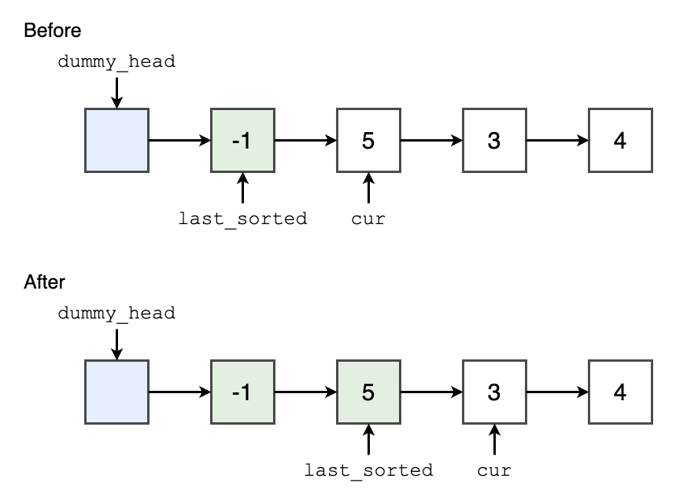
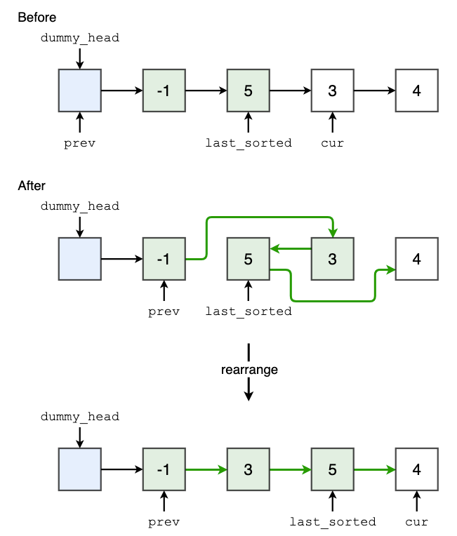

# [Python3] 188ms Solution (explanation with visualization)

**Author:** EckoTan0804
**Votes:** 55
**Link:** [https://leetcode.com/problems/insertion-sort-list/solutions/1176552/](https://leetcode.com/problems/insertion-sort-list/solutions/1176552/)

---

**Idea**
- Add `dummy_head` before `head` will help us to handle the insertion easily
- Use two pointers
	- `last_sorted`: last node of the sorted part, whose value is the largest of the sorted part
	- `cur`: next node of `last_sorted`, which is the current node to be considered

	At the beginning, `last_sorted` is `head` and `cur` is `head.next`
- When consider the `cur` node, there're 2 different cases
	- `last_sorted.val <= cur.val`: `cur` is in the correct order and can be directly move into the sorted part. In this case, we just move `last_sorted` one step forward
	

	- `last_sorted.val > cur.val`: `cur` needs to be inserted somewhere in the sorted part. In this case, we let `prev` start from `dummy_head` and iteratively compare `prev.next.val` and `cur.val`. If `prev.next.val > cur.val`, we insert `cur` between `prev` and `prev.next`
	- 


**Implementation**
```python
class Solution:
    def insertionSortList(self, head: ListNode) -> ListNode:
        
        # No need to sort for empty list or list of size 1
        if not head or not head.next:
            return head
        
        # Use dummy_head will help us to handle insertion before head easily
        dummy_head = ListNode(val=-5000, next=head)
        last_sorted = head # last node of the sorted part
        cur = head.next # cur is always the next node of last_sorted
        while cur:
            if cur.val >= last_sorted.val:
                last_sorted = last_sorted.next
            else:
                # Search for the position to insert
                prev = dummy_head
                while prev.next.val <= cur.val:
                    prev = prev.next
                    
                # Insert
                last_sorted.next = cur.next
                cur.next = prev.next
                prev.next = cur
                
            cur = last_sorted.next
            
        return dummy_head.next
```

**Complexity**
- Time: O(n^2)
- Space: O(1)