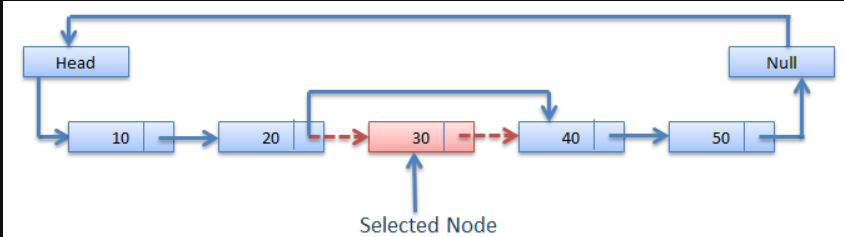

# Easy, Beginner solution, with dry run || Time complexity O(n) || Space complexity O(1) || Gits✅👈

**Author:** GiteshSK_12
**Votes:** 119
**Link:** [https://leetcode.com/problems/remove-linked-list-elements/solutions/4660724/](https://leetcode.com/problems/remove-linked-list-elements/solutions/4660724/)

---

# Guys if the solution and the explanation is helpfull then upvote me.

In a linked list, given the head of the linked list and an integer value, we have to delete the node with that integer value from the linked list.

# Approach \u2705
To solve this problem, we will iterate through the linked list and check the value of each node. If the value of a node matches the specified value, we will remove that node from the linked list.

# Explanation 
1. **Step 1 - Creating a Dummy Node**:\uD83D\uDC48
    - A new ListNode named *'temp'* is created with a value of 0. This node serves as a dummy head node to simplify edge cases, especially when the head node itself needs to be removed.
    - *'curr'* is a reference that initially points to the same dummy node.
    - The next of *'temp'* is set to head, effectively inserting the dummy node before the actual head of the list.
    `ListNode temp = new ListNode(0) , curr = temp;
        temp.next = head;`

2. **Step 2 - Iterating through the List:** \uD83D\uDC48
    - The loop continues as long as the next node after *'curr'* is not null.
    - Inside the loop, it checks if the val of the next node (curr.next.val) is equal to the target value val.
    - If it is, *'curr.next'* is updated to *'curr.next.next'*, effectively removing the current next node from the list.
    - If it is not, curr is moved to the next node in the list.
    

```
            while(curr.next != null ){
                if(curr.next.val == val) curr.next = curr.next.next;
                else curr = curr.next;
            }
```

3. **Step 3 - Returning the Modified List:** \uD83D\uDC48
    - Finally, the method returns *'temp.next'*. Since *'temp'* is the dummy head node, temp.next is the actual head of the modified list.
    - If the original head was removed, this effectively returns the new head of the list. If the original head was not removed, it still points to the original head.
    ```
    return temp.next;
    ```

# Complexity
- Time complexity: O(n)

- Space complexity: O(1)

# Code \uD83D\uDC48
```C []
/**
 * Definition for singly-linked list.
 * struct ListNode {
 *     int val;
 *     struct ListNode *next;
 * };
 */
struct ListNode* removeElements(struct ListNode* head, int val) {
    struct ListNode *temp = (struct ListNode*)malloc(sizeof(struct ListNode));
    temp->next = head;
    struct ListNode *curr = temp;
    while(curr->next != NULL ){
        if(curr->next->val == val) curr->next = curr->next->next;
        else curr = curr->next;
    }
    return temp->next;
}
```
```C++ []
/**
 * Definition for singly-linked list.
 * struct ListNode {
 *     int val;
 *     ListNode *next;
 *     ListNode() : val(0), next(nullptr) {}
 *     ListNode(int x) : val(x), next(nullptr) {}
 *     ListNode(int x, ListNode *next) : val(x), next(next) {}
 * };
 */
class Solution {
public:
    ListNode* removeElements(ListNode* head, int val) {
        ListNode *temp = new ListNode(0);
        temp->next = head;
        ListNode *curr = temp;
        while(curr->next != NULL ){
            if(curr->next->val == val) curr->next = curr->next->next;
            else curr = curr->next;
        }
        return temp->next;
    }
};
```
```Java []
/**
 * Definition for singly-linked list.
 * public class ListNode {
 *     int val;
 *     ListNode next;
 *     ListNode() {}
 *     ListNode(int val) { this.val = val; }
 *     ListNode(int val, ListNode next) { this.val = val; this.next = next; }
 * }
 */
class Solution {
    public ListNode removeElements(ListNode head, int val) {
        ListNode temp = new ListNode(0) , curr = temp;
        temp.next = head;
        while(curr.next != null ){
            if(curr.next.val == val) curr.next = curr.next.next;
            else curr = curr.next;
        }
        return temp.next;
    }
}
```
```javascript []
/**
 * Definition for singly-linked list.
 * function ListNode(val, next) {
 *     this.val = (val===undefined ? 0 : val)
 *     this.next = (next===undefined ? null : next)
 * }
 */
/**
 * @param {ListNode} head
 * @param {number} val
 * @return {ListNode}
 */
var removeElements = function(head, val) {
    temp = new ListNode(0) , curr = temp;
    temp.next = head;
    while(curr.next != null ){
        if(curr.next.val == val) curr.next = curr.next.next;
        else curr = curr.next;
    }
    return temp.next;
};
```
```Python3 []
# Definition for singly-linked list.
# class ListNode:
#     def __init__(self, val=0, next=None):
#         self.val = val
#         self.next = next
class Solution:
    def removeElements(self, head: Optional[ListNode], val: int) -> Optional[ListNode]:
        temp = ListNode(0)
        temp.next = head
        prev, curr = temp, head
        while curr:
            if curr.val == val:prev.next = curr.next
            else:prev = curr
            curr = curr.next
        return temp.next
        
```
```python []
# Definition for singly-linked list.
# class ListNode(object):
#     def __init__(self, val=0, next=None):
#         self.val = val
#         self.next = next
class Solution(object):
    def removeElements(self, head, val):
        """
        :type head: ListNode
        :type val: int
        :rtype: ListNode
        """
        temp = ListNode(0)
        temp.next = head
        prev, curr = temp, head
        while curr:
            if curr.val == val:prev.next = curr.next
            else:prev = curr
            curr = curr.next
        return temp.next
```
```ruby []
# Definition for singly-linked list.
# class ListNode
#     attr_accessor :val, :next
#     def initialize(val = 0, _next = nil)
#         @val = val
#         @next = _next
#     end
# end
# @param {ListNode} head
# @param {Integer} val
# @return {ListNode}
def remove_elements(head, val)
    temp =ListNode.new(0)
    temp.next , curr= head , temp
    while curr.next != nil
        if curr.next.val == val 
            curr.next= curr.next.next
        else curr = curr.next
        end
    end
    return temp.next
end
```

# Dry Run  

1. Entering the While Loop:

    - The condition of the while loop is curr.next != null. Since curr is initially pointing to the dummy node (0), curr.next is 1, which is not null. So we enter the loop.
2. First Iteration:

    - curr.next.val is 1, which is not equal to 6.
    - So, curr is moved to the next node. Now, curr points to 1.
3. Second Iteration:

    - curr.next.val is 2, which is not equal to 6.
    - Move curr to the next node. Now, curr points to 2.
4. Third Iteration:

    - curr.next.val is 6, which matches val.
    - We remove this node by setting curr.next to curr.next.next. The list is now 0 -> 1 -> 2 -> 3 -> 4 -> 5 -> 6.
    - curr stays at the same node (2).
5. Fourth Iteration:

    - curr.next.val is 3, which is not equal to 6.
    - Move curr to the next node. Now, curr points to 3.
6. Fifth Iteration:

    - curr.next.val is 4, which is not equal to 6.
    - Move curr to the next node. Now, curr points to 4.
7. Sixth Iteration:

    - curr.next.val is 5, which is not equal to 6.
    - Move curr to the next node. Now, curr points to 5.
8. Seventh Iteration:

    - curr.next.val is 6, which matches val.
    - We remove this node by setting curr.next to curr.next.next. Since curr.next.next is null, the last node (6) is removed. The list is now 0 -> 1 -> 2 -> 3 -> 4 -> 5.
    - curr stays at the same node (5).
9. Eighth Iteration:

    - curr.next is now null, so we exit the loop.
    
**Result:**
- The dummy node (0) points to the head of the modified list, which is 1 -> 2 -> 3 -> 4 -> 5.
- The method returns temp.next, which is the head of the modified list.
 


