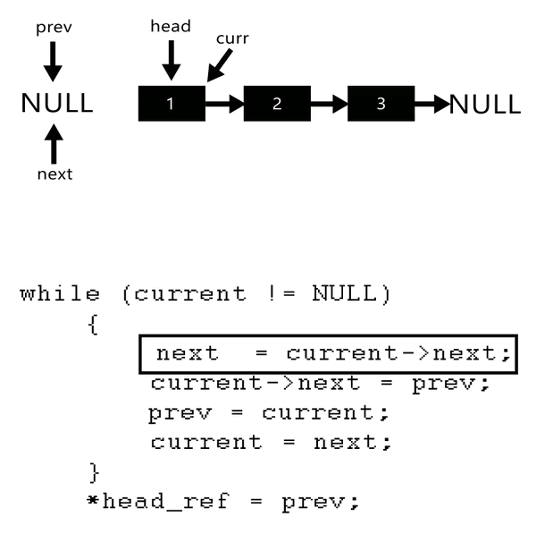

# [C++] Iterative vs. Recursive Solutions Compared and Explained, ~99% Time, ~85% Space

**Author:** Ajna
**Votes:** 1008
**Link:** [https://leetcode.com/problems/reverse-linked-list/solutions/803955/](https://leetcode.com/problems/reverse-linked-list/solutions/803955/)

---

Not sure how this problem is expecting me to use less memory than this, but here is the deal:
* we are going to use 3 variables: `prevNode`, `head` and `nextNode`, that you can easily guess what are meant to represent as we go;
* we will initialise `prevNode` to `NULL`, while `nextNode` can stay empty;
* we are then going to loop until our current main iterator (`head`) is truthy (ie: not `NULL`), which would imply we reached the end of the list;
* during the iteration, we first of all update `nextNode` so that it acquires its namesake value, the one of the next node indeed: `head->next`;
* we then proceeding "reversing" `head->next` and assigning it the value of `prevNode`, while `prevNode` will become take the current value of `head`;
* finally, we update `head` with the value we stored in `nextNode` and go on with the loop until we can. After the loop, we return `prevNode`.

I know it is complex, but I find this gif from another platform to make the whole logic much easier to understand (bear in mind we do not need `curr` and will just use `head` in its place):



The code:

```cpp
class Solution {
public:
    ListNode* reverseList(ListNode* head) {
        ListNode *nextNode, *prevNode = NULL;
        while (head) {
            nextNode = head->next;
            head->next = prevNode;
            prevNode = head;
            head = nextNode;
        }
        return prevNode;
    }
};
```

Relatively trivial refactor (the function does basically the same) with recursion and comma operator to make it one-line:

```cpp
class Solution {
public:
    ListNode* reverseList(ListNode *head, ListNode *nextNode = NULL, ListNode *prevNode = NULL) {
        return head ? reverseList(head->next, (head->next = prevNode, nextNode), head) : prevNode;
    }
};
```