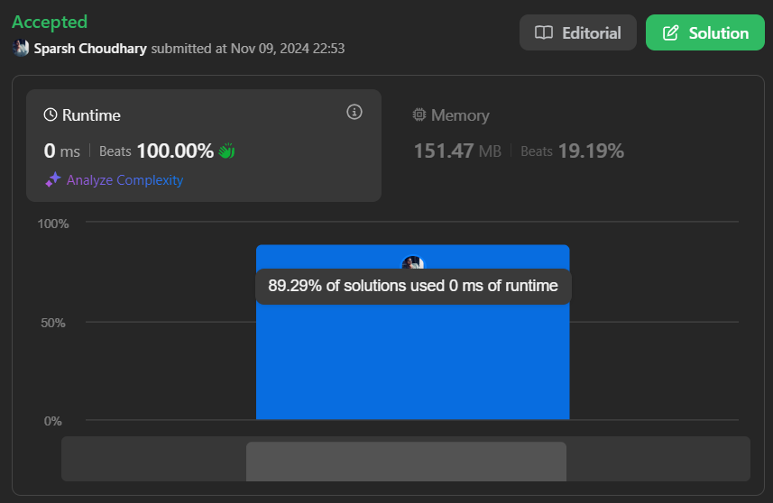

# 🔥BEATS 💯 % 🎯 |✨SUPER EASY BEGINNERS 👏

**Author:** CodeWithSparsh
**Votes:** 3
**Link:** [https://leetcode.com/problems/reverse-linked-list/solutions/6027560/](https://leetcode.com/problems/reverse-linked-list/solutions/6027560/)

---




---

## Intuition
The goal is to reverse the order of nodes in a singly linked list. Using an iterative approach, we can traverse the list, reversing each node\u2019s `next` pointer to point to the previous node, allowing us to reverse the entire list.

---

## Approach
1. **Initialize Pointers**: Use two pointers, `prev` (initially `null`) and `head` (the start of the linked list).
2. **Iterate Through the List**: For each node, store the next node in a temporary variable `nextNode`, reverse the `next` pointer to point to `prev`, then advance both `prev` and `head`.
3. **Return the New Head**: At the end of the loop, `prev` will point to the new head of the reversed list.

---

## Complexity
- **Time Complexity**: \\(O(n)\\), where \\(n\\) is the number of nodes in the linked list.
- **Space Complexity**: \\(O(1)\\), as we only use a constant amount of extra space.

---


```dart []
class ListNode {
  int val;
  ListNode? next;
  ListNode(this.val, [this.next]);
}

class Solution {
  ListNode? reverseList(ListNode? head) {
    ListNode? prev = null;
    while (head != null) {
      ListNode? nextNode = head.next;
      head.next = prev;
      prev = head;
      head = nextNode;
    }
    return prev;
  }
}
```

```java []
class ListNode {
    int val;
    ListNode next;
    ListNode(int val) { this.val = val; }
}

class Solution {
    public ListNode reverseList(ListNode head) {
        ListNode prev = null;
        while (head != null) {
            ListNode nextNode = head.next;
            head.next = prev;
            prev = head;
            head = nextNode;
        }
        return prev;
    }
}
```

```python []
class ListNode:
    def __init__(self, val=0, next=None):
        self.val = val
        self.next = next

class Solution:
    def reverseList(self, head: ListNode) -> ListNode:
        prev = None
        while head:
            next_node = head.next
            head.next = prev
            prev = head
            head = next_node
        return prev
```

```javascript []
function ListNode(val, next = null) {
    this.val = val;
    this.next = next;
}

var reverseList = function(head) {
    let prev = null;
    while (head !== null) {
        let nextNode = head.next;
        head.next = prev;
        prev = head;
        head = nextNode;
    }
    return prev;
};
```

```cpp []
struct ListNode {
    int val;
    ListNode *next;
    ListNode(int x) : val(x), next(nullptr) {}
};

class Solution {
public:
    ListNode* reverseList(ListNode* head) {
        ListNode* prev = nullptr;
        while (head != nullptr) {
            ListNode* nextNode = head->next;
            head->next = prev;
            prev = head;
            head = nextNode;
        }
        return prev;
    }
};
```

```go []
type ListNode struct {
    Val  int
    Next *ListNode
}

func reverseList(head *ListNode) *ListNode {
    var prev *ListNode = nil
    for head != nil {
        nextNode := head.Next
        head.Next = prev
        prev = head
        head = nextNode
    }
    return prev
}
```
---
## Recursive approach

``` dart
class ListNode {
  int val;
  ListNode? next;
  
  ListNode(this.val, [this.next]);
}

class Solution {
  ListNode? reverseList(ListNode? head) {
    // Base case: if head is null or it's the last node, return head
    if (head == null || head.next == null) {
      return head;
    }
    
    // Recursive call to reverse the rest of the list
    ListNode? reversedListHead = reverseList(head.next);
    
    // Set the next node's next pointer to the current node (head)
    head.next?.next = head;
    // Set the current node's next pointer to null to avoid a cycle
    head.next = null;
    
    // Return the new head of the reversed list
    return reversedListHead;
  }
}

```


---

 {:style='width:250px'}
