# Step By Step Explained with Images. Easiest to understand. Java, C++, Python, JavaScript, Go Codes

**Author:** Kunal_Tajne
**Votes:** 366
**Link:** [https://leetcode.com/problems/reverse-linked-list/solutions/5612752/](https://leetcode.com/problems/reverse-linked-list/solutions/5612752/)

---

# Intuition
This is a basic linked list reversal algorithm. Can be used in various other problems so just understand this one and memorize it.

# Approach
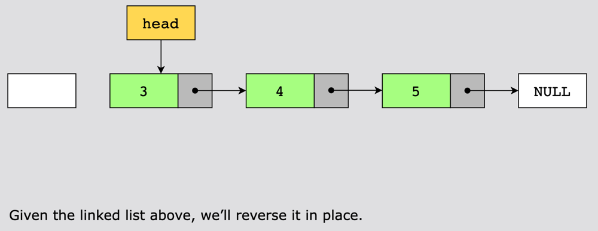
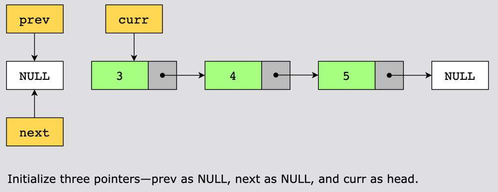
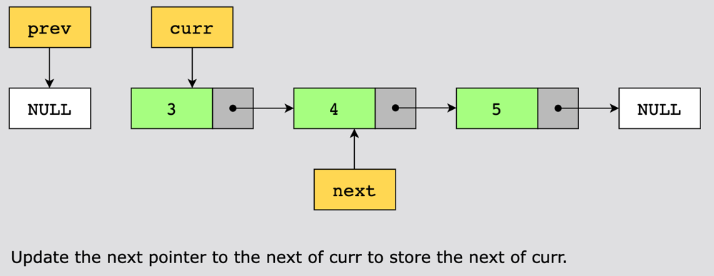
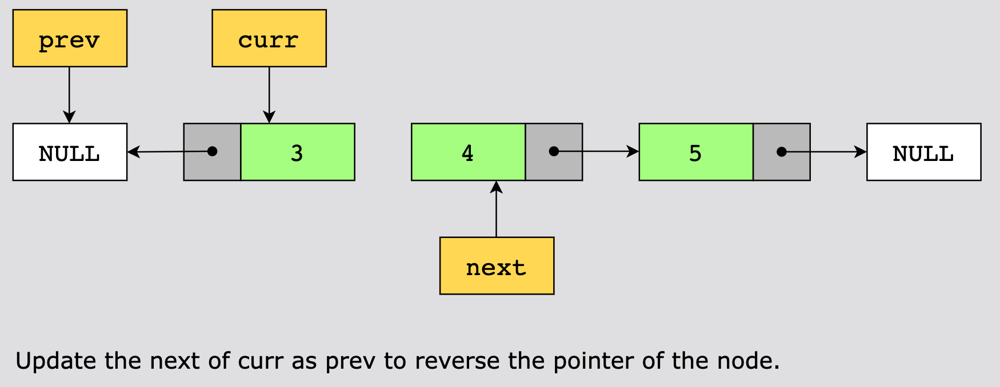
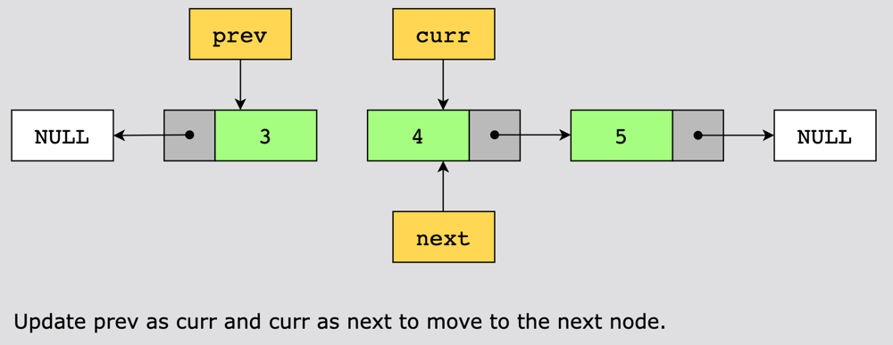
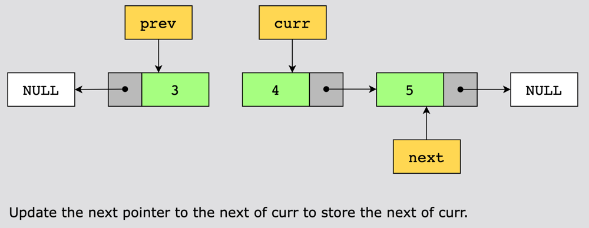
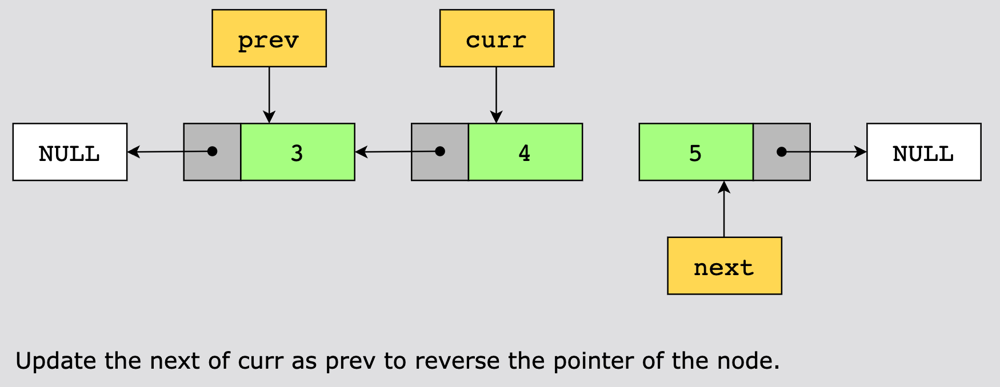
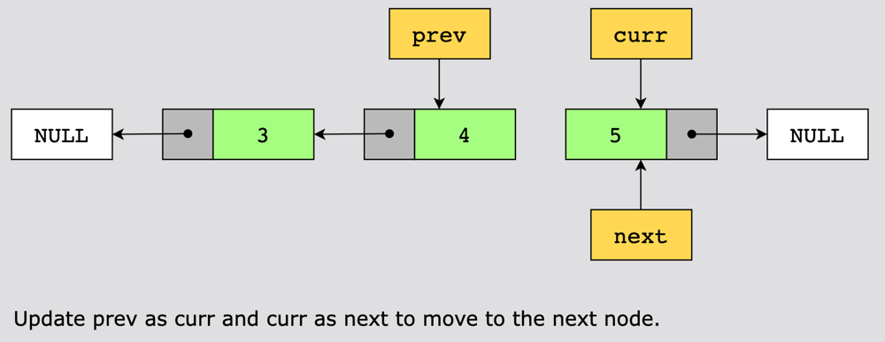
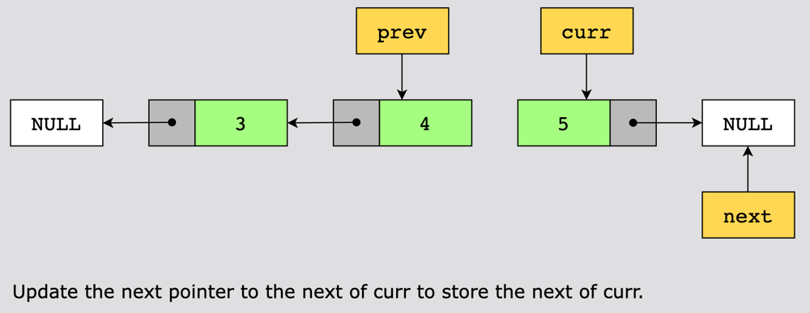
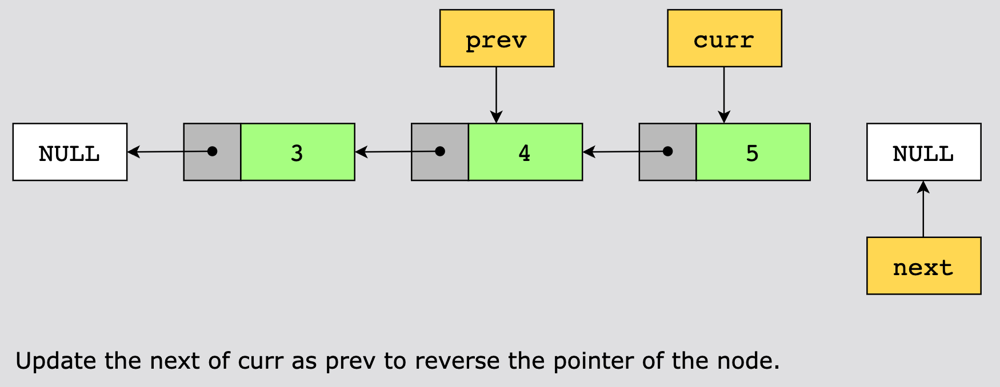
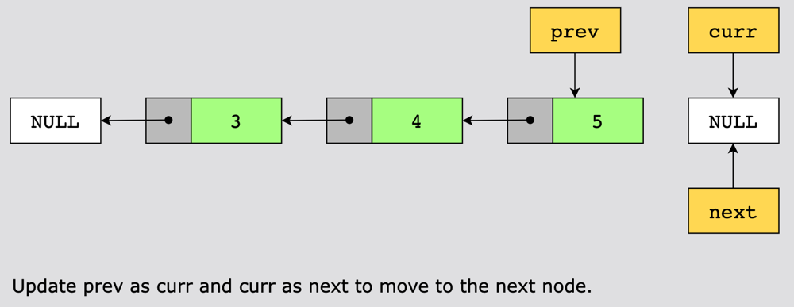
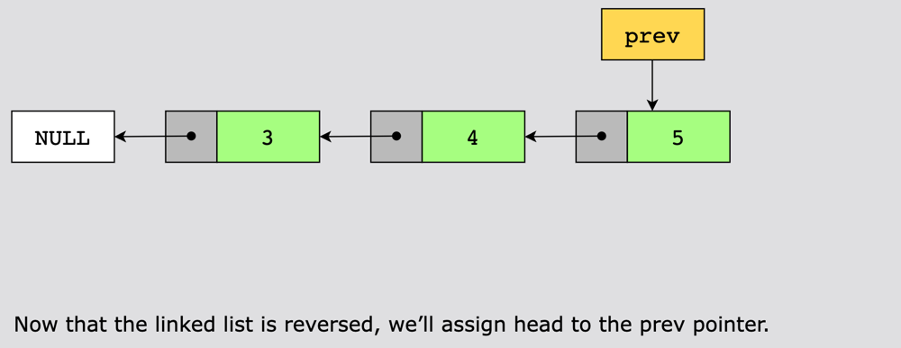


# Complexity
- Time complexity:
The time complexity of this solution is $$O(n)$$, because we reversed the linked list in a single pass, where \uD835\uDC5B n is the number of nodes in a linked list.

- Space complexity:
The space complexity of this solution is $$O(1)$$, because no extra memory is used.

# Algorithm / Pseudo Code
```
Function ReverseList(head)
    Initialize prev to NULL
    Initialize curr to head

    While curr is not NULL
        // Save the next node
        next = curr.next
        
        // Reverse the link
        curr.next = prev
        
        // Move prev and curr forward
        prev = curr
        curr = next

    // Return the new head of the reversed list
    Return prev
End Function
```

# Commented Java Code
```
class Solution {
    public ListNode reverseList(ListNode head) {
        // We start with three pointers:
        // 1. prev: This will keep track of the previous node we processed (starts as null).
        // 2. next: This will keep track of the next node to process.
        // 3. curr: This is the current node we are processing (starts as the head of the list).
        ListNode prev = null;
        ListNode next = null;
        ListNode curr = head;

        // We loop through the linked list until we reach the end (when curr is null).
        while (curr != null) {
            // Store the next node in the list. We need to do this because we will change the current node's next pointer.
            next = curr.next;

            // Reverse the link. Instead of pointing to the next node, the current node now points to the previous node.
            curr.next = prev;

            // Move the previous pointer to the current node (since the current node is now processed).
            prev = curr;

            // Move the current pointer to the next node (to continue processing the rest of the list).
            curr = next;
        }

        // When we've processed all nodes, the prev pointer will be at the new head of the reversed list.
        return prev;
    }
}

```
# Un-Commented Java Code
```
class Solution {
    public ListNode reverseList(ListNode head) {
        
        ListNode prev = null;
        ListNode next = null;
        ListNode curr = head;

        while(curr != null)
        {
            next = curr.next;

            curr.next = prev;

            prev = curr;
            curr = next;
        }

        return prev;
    }
}
```

```C++ []
class Solution {
public:
    ListNode* reverseList(ListNode* head) {
        // Initialize pointers
        ListNode* prev = nullptr; // Previous node starts as NULL
        ListNode* next = nullptr; // Next node
        ListNode* curr = head;    // Current node starts at the head

        // Traverse the list
        while (curr != nullptr) {
            // Save the next node
            next = curr->next;

            // Reverse the link
            curr->next = prev;

            // Move pointers forward
            prev = curr; // Move prev to the current node
            curr = next; // Move curr to the next node
        }

        // prev is now the new head of the reversed list
        return prev;
    }
};
```
```python []
class Solution:
    def reverseList(self, head: ListNode) -> ListNode:
        # Initialize pointers
        prev = None  # Previous node starts as None
        curr = head  # Current node starts at the head

        # Traverse the list
        while curr is not None:
            next_node = curr.next  # Save the next node
            
            curr.next = prev  # Reverse the link
            
            # Move pointers forward
            prev = curr  # Move prev to the current node
            curr = next_node  # Move curr to the next node

        # prev is now the new head of the reversed list
        return prev

```
```JavaScript []
class Solution {
    reverseList(head) {
        // Initialize pointers
        let prev = null; // Previous node starts as null
        let curr = head; // Current node starts at the head

        // Traverse the list
        while (curr !== null) {
            let next = curr.next; // Save the next node
            
            curr.next = prev; // Reverse the link
            
            // Move pointers forward
            prev = curr; // Move prev to the current node
            curr = next; // Move curr to the next node
        }

        // prev is now the new head of the reversed list
        return prev;
    }
}
```

```Go []
func reverseList(head *ListNode) *ListNode {
    var prev *ListNode // Previous node starts as nil
    curr := head       // Current node starts at the head

    // Traverse the list
    for curr != nil {
        next := curr.Next // Save the next node
        
        curr.Next = prev  // Reverse the link
        
        // Move pointers forward
        prev = curr        // Move prev to the current node
        curr = next        // Move curr to the next node
    }

    // prev is now the new head of the reversed list
    return prev
}
```

# A single upvote is all it takes :)

If found helpful, give a upvote. Keeps me motivated to post more solutions. Thanks! 

---------------------------------------------------------------------