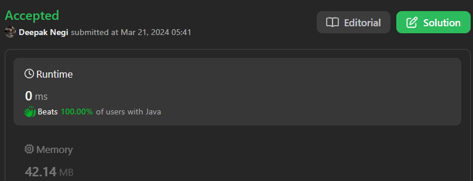

# Easy Solution | | Optimal Solution | | C++ | | Java | | Python3 | | Kotlin | | ✅✅✅🔥🔥

**Author:** Hunter_0718
**Votes:** 28
**Link:** [https://leetcode.com/problems/reverse-linked-list/solutions/4903834/](https://leetcode.com/problems/reverse-linked-list/solutions/4903834/)

---



## Intuition
To reverse a singly linked list, we can iterate through the list while maintaining pointers to the previous, current, and next nodes. During each iteration, we update the `next` pointer of the current node to point to the previous node. After updating pointers, we move forward in the list until we reach the end, effectively reversing the list.

## Approach
1. Initialize three pointers: `prev`, `curr`, and `nextNode`.
2. Iterate through the linked list.
3. Inside the loop, update `nextNode` to store the next node of `curr`.
4. Update the `next` pointer of `curr` to point to `prev`.
5. Move `prev` to `curr`, and `curr` to `nextNode`.
6. Continue iterating until `curr` becomes `NULL`.
7. Return `prev`, which is the new head of the reversed list.

## Complexity
- **Time complexity:** \\( O(n) \\), where \\( n \\) is the number of nodes in the linked list. We traverse the entire list once.
- **Space complexity:** \\( O(1) \\). We are using constant space for pointers `prev`, `curr`, and `nextNode`.


# Code : 
```C++ []
/**
 * Definition for singly-linked list.
 * struct ListNode {
 *     int val;
 *     ListNode *next;
 *     ListNode() : val(0), next(nullptr) {}
 *     ListNode(int x) : val(x), next(nullptr) {}
 *     ListNode(int x, ListNode *next) : val(x), next(next) {}
 * };
 */
class Solution {
public:
    ListNode* reverseList(ListNode* head) {
        ListNode *prev = NULL;
        ListNode *curr = head;
        ListNode *nextNode = NULL;
        while(curr != NULL){
            nextNode = curr->next;
            curr->next = prev;
            prev = curr;
            curr = nextNode;
        }
        return prev;
    }
};
```
```Java []
/*class ListNode {
    int val;
    ListNode next;
    ListNode() {}
    ListNode(int val) { this.val = val; }
    ListNode(int val, ListNode next) { this.val = val; this.next = next; }
}*/

class Solution {
    public ListNode reverseList(ListNode head) {
        ListNode prev = null;
        ListNode curr = head;
        ListNode nextNode = null;
        while (curr != null) {
            nextNode = curr.next;
            curr.next = prev;
            prev = curr;
            curr = nextNode;
        }
        return prev;
    }
}


```
```Python3 []
# Definition for singly-linked list.
# class ListNode:
#     def __init__(self, val=0, next=None):
#         self.val = val
#         self.next = next

class Solution:
    def reverseList(self, head: ListNode) -> ListNode:
        prev = None
        curr = head
        nextNode = None
        while curr:
            nextNode = curr.next
            curr.next = prev
            prev = curr
            curr = nextNode
        return prev

```
```Kotlin []
/**
 * Example:
 * var li = ListNode(5)
 * var v = li.`val`
 * Definition for singly-linked list.
 * class ListNode(var `val`: Int) {
 *     var next: ListNode? = null
 * }
 */
class Solution {
    fun reverseList(head: ListNode?): ListNode? {
        var prev: ListNode? = null
        var curr: ListNode? = head
        var nextNode: ListNode? = null
        while (curr != null) {
            nextNode = curr.next
            curr.next = prev
            prev = curr
            curr = nextNode
        }
        return prev
    }
}

```
```JavaScript []
/**
 * Definition for singly-linked list.
 * function ListNode(val) {
 *     this.val = val;
 *     this.next = null;
 * }
 */

/**
 * @param {ListNode} head
 * @return {ListNode}
 */
var reverseList = function(head) {
    let prev = null;
    let curr = head;
    let nextNode = null;
    while (curr !== null) {
        nextNode = curr.next;
        curr.next = prev;
        prev = curr;
        curr = nextNode;
    }
    return prev;
};

```


## Dry Run
Let's dry run the first example: `Input: head = [1,2,3,4,5]`

1. Initially: `prev = NULL`, `curr = head`, `nextNode = NULL`.
2. Loop 1:
   - `nextNode = 2`, `curr->next = NULL`, `prev = 1`, `curr = 2`.
3. Loop 2:
   - `nextNode = 3`, `curr->next = 1`, `prev = 2`, `curr = 3`.
4. Loop 3:
   - `nextNode = 4`, `curr->next = 2`, `prev = 3`, `curr = 4`.
5. Loop 4:
   - `nextNode = 5`, `curr->next = 3`, `prev = 4`, `curr = 5`.
6. Loop 5:
   - `nextNode = NULL`, `curr->next = 4`, `prev = 5`, `curr = NULL`.
7. Return `prev` as the new head: `[5,4,3,2,1]`.

The linked list has been successfully reversed.