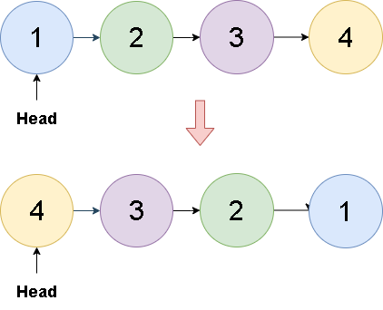

# 🔥🔥 Explicación y Resolución Del Ejercicio En Español Java | Python | PHP | C++ | JavaScript 🔥🔥

**Author:** hermescoder02
**Votes:** 5
**Link:** [https://leetcode.com/problems/reverse-linked-list/solutions/4148017/](https://leetcode.com/problems/reverse-linked-list/solutions/4148017/)

---

# Lectura

*C\xF3mo invertir una lista enlazada (Java, Python, PHP, C++, Javascript)*
                
Invertir una lista enlazada significa cambiar el orden de los nodos de la lista, de tal forma que los que estaban al final ahora est\xE1n al inicio y viceversa.

El primer nodo se vuelve el \xFAltimo, el segundo el pen\xFAltimo y el que originalmente era el \xFAltimo, ahora se vuelve el primero.



# Explicaci\xF3n del ejercicio Paso por paso

https://www.youtube.com/watch?v=RlhsdfZStmM

Si te gust\xF3 el contenido \xA1visita mi canal de youtube!: 
\u2705https://www.youtube.com/@hermescoder

Si deseas profundizar m\xE1s en este tema \xA1visita mi blog!: 
\u2705https://hermescoder.com/como-invertir-una-lista-enlazada.html


# C\xF3digo 
```Java []
/**
 * Definition for singly-linked list.
 * public class ListNode {
 *     int val;
 *     ListNode next;
 *     ListNode() {}
 *     ListNode(int val) { this.val = val; }
 *     ListNode(int val, ListNode next) { this.val = val; this.next = next; }
 * }
 */
public class Solution {

     /**
     * Reverses a linked list.
     *
     * @param head the head of the linked list
     * @return the head of the reversed linked list
     */
    public ListNode reverseList(ListNode head) {
        ListNode anterior = null;
        ListNode actual = head;
        ListNode temporal = null;
        
        while (actual != null) {
            temporal = actual.next;
            actual.next = anterior;
            anterior = actual;
            actual = temporal;
        }

        return anterior;
    }
}
```
```Python []
# Definition for singly-linked list.
# class ListNode(object):
#     def __init__(self, val=0, next=None):
#         self.val = val
#         self.next = next
class Solution(object):
    def reverseList(self, head):
        anterior = None
        actual = head
        temporal = None

        while actual is not None:
            temporal = actual.next
            actual.next = anterior
            anterior = actual
            actual = temporal

        return anterior
```
```PHP  []
/**
 * Definition for a singly-linked list.
 * class ListNode {
 *     public $val = 0;
 *     public $next = null;
 *     function __construct($val = 0, $next = null) {
 *         $this->val = $val;
 *         $this->next = $next;
 *     }
 * }
 */
class Solution {

  /**
   * @param ListNode $head
   * @return ListNode
   */
  function reverseList($head) {

    //paso#1
    $anterior = null;
    $actual = $head;
    $temporal = null;

    while ($actual !== null) { 
      //paso#2
      $temporal = $actual->next;
      //paso #3
      $actual->next = $anterior;
      
      //paso#4
      $anterior = $actual;

      //paso#5
      $actual = $temporal;
    }

    //paso#6
    return $anterior;
  }
}
```
```C++  []
/**
 * Definition for singly-linked list.
 * struct ListNode {
 *     int val;
 *     ListNode *next;
 *     ListNode() : val(0), next(nullptr) {}
 *     ListNode(int x) : val(x), next(nullptr) {}
 *     ListNode(int x, ListNode *next) : val(x), next(next) {}
 * };
 */
class Solution {
public:
    ListNode* reverseList(ListNode* head) {
        // paso #1
    ListNode* prev = nullptr;
    ListNode* curr = head;
    ListNode* next = nullptr;

    while (curr != nullptr) {
      // paso #2
      next = curr->next;
      // paso #3
      curr->next = prev;
      // paso #4
      prev = curr;
      // paso #5
      curr = next;
    }

    // paso #6
    return prev;
    }
};
```
```JavaScript   []
/**
 * Definition for singly-linked list.
 * function ListNode(val, next) {
 *     this.val = (val===undefined ? 0 : val)
 *     this.next = (next===undefined ? null : next)
 * }
 */
/**
 * @param {ListNode} head
 * @return {ListNode}
 */
var reverseList = function(head) {
    // Paso #1
    let prev = null;
    let curr = head;
    let next = null;

    // Paso #2
    while (curr !== null) {
      // Paso #3
      next = curr.next;
      // Paso #4
      curr.next = prev;
      // Paso #5
      prev = curr;
      // Paso #6
      curr = next;
    }

    // Paso #7
    return prev;
};
```


