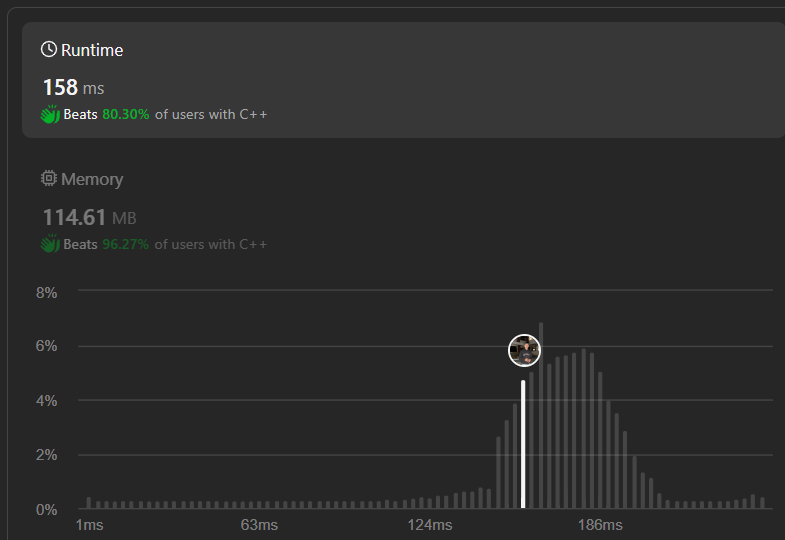

# Using Two Pointer | | Easy Explanation | | C++ | | Java | | Python3 | | Kotlin | |  ✅✅✅🔥🔥🔥

**Author:** Hunter_0718
**Votes:** 9
**Link:** [https://leetcode.com/problems/palindrome-linked-list/solutions/4908050/](https://leetcode.com/problems/palindrome-linked-list/solutions/4908050/)

---



## Intuition
To determine if a linked list is a palindrome, we can reverse the second half of the linked list and then compare it with the first half. If they match, the linked list is a palindrome.

## Approach
1. We'll use a slow and fast pointer technique to find the middle of the linked list.
2. Reverse the second half of the linked list starting from the middle node.
3. Compare each node of the first half with the corresponding node of the reversed second half. If all nodes match, return true; otherwise, return false.

## Complexity
- Time complexity: \\( O(n) \\), where \\( n \\) is the number of nodes in the linked list. We traverse the list twice, once to find the middle and once to compare nodes.
- Space complexity: \\( O(1) \\) since we only use a constant amount of extra space.
```C++ []
/**
 * Definition for singly-linked list.
 * struct ListNode {
 *     int val;
 *     ListNode *next;
 *     ListNode() : val(0), next(nullptr) {}
 *     ListNode(int x) : val(x), next(nullptr) {}
 *     ListNode(int x, ListNode *next) : val(x), next(next) {}
 * };
 */
class Solution {
public:
    ListNode *reverse(ListNode * head){
        if(!head) return head;
        ListNode * prev = NULL;
        ListNode *curr = head;
        ListNode *nextnode = NULL;
        while(curr!=NULL){
            nextnode = curr->next;
            curr->next = prev;
            prev = curr;
            curr = nextnode;
        }
        return prev;
    }
    bool isPalindrome(ListNode* head) {
        if(head == NULL || head->next == NULL) return true;
        ListNode* slow = head;
        ListNode* fast = head;
        while(fast !=NULL && fast->next !=NULL){
            fast = fast->next->next;
            slow = slow->next;
            }
        ListNode *ReverseHead = reverse(slow);
        ListNode *temp1 = head;
        ListNode *temp2 = ReverseHead;
        while(temp2!=NULL){
            if(temp1->val != temp2->val)
            return false;
            else{
                temp1 = temp1->next;
                temp2 = temp2->next;
            }
        }
        return true;
    }
};
```
```Java []
class Solution {
    public ListNode reverse(ListNode head) {
        if (head == null) return null;
        ListNode prev = null;
        ListNode curr = head;
        ListNode nextNode = null;
        while (curr != null) {
            nextNode = curr.next;
            curr.next = prev;
            prev = curr;
            curr = nextNode;
        }
        return prev;
    }
    
    public boolean isPalindrome(ListNode head) {
        if (head == null || head.next == null) return true;
        
        ListNode slow = head;
        ListNode fast = head;
        
        while (fast != null && fast.next != null) {
            fast = fast.next.next;
            slow = slow.next;
        }
        
        ListNode reverseHead = reverse(slow);
        ListNode temp1 = head;
        ListNode temp2 = reverseHead;
        
        while (temp2 != null) {
            if (temp1.val != temp2.val) return false;
            temp1 = temp1.next;
            temp2 = temp2.next;
        }
        
        return true;
    }
}

```
```Python3 []
class Solution:
    def reverse(self, head):
        if not head:
            return None
        prev = None
        curr = head
        while curr:
            next_node = curr.next
            curr.next = prev
            prev = curr
            curr = next_node
        return prev
    
    def isPalindrome(self, head):
        if not head or not head.next:
            return True
        
        slow = head
        fast = head
        
        while fast and fast.next:
            fast = fast.next.next
            slow = slow.next
        
        reverse_head = self.reverse(slow)
        temp1 = head
        temp2 = reverse_head
        
        while temp2:
            if temp1.val != temp2.val:
                return False
            temp1 = temp1.next
            temp2 = temp2.next
        
        return True

```
```Kotlin []
class Solution {
    fun reverse(head: ListNode?): ListNode? {
        var prev: ListNode? = null
        var curr: ListNode? = head
        var nextNode: ListNode?
        while (curr != null) {
            nextNode = curr.next
            curr.next = prev
            prev = curr
            curr = nextNode
        }
        return prev
    }
    
    fun isPalindrome(head: ListNode?): Boolean {
        if (head == null || head.next == null) return true
        
        var slow: ListNode? = head
        var fast: ListNode? = head
        
        while (fast != null && fast.next != null) {
            fast = fast.next?.next
            slow = slow?.next
        }
        
        val reverseHead = reverse(slow)
        var temp1: ListNode? = head
        var temp2: ListNode? = reverseHead
        
        while (temp2 != null) {
            if (temp1?.`val` != temp2.`val`) return false
            temp1 = temp1.next
            temp2 = temp2.next
        }
        
        return true
    }
}

```
```JavaScript []
/**
 * Definition for singly-linked list.
 * function ListNode(val, next) {
 *     this.val = (val===undefined ? 0 : val)
 *     this.next = (next===undefined ? null : next)
 * }
 */
/**
 * @param {ListNode} head
 * @return {boolean}
 */
var isPalindrome = function(head) {
    // Helper function to reverse a linked list
    const reverseLinkedList = function(node) {
        let prev = null;
        let curr = node;
        while (curr) {
            const nextNode = curr.next;
            curr.next = prev;
            prev = curr;
            curr = nextNode;
        }
        return prev;
    };
    
    if (!head || !head.next) return true; // Empty or single-node list is palindrome
    
    let slow = head;
    let fast = head;
    
    // Finding the middle of the linked list using slow and fast pointers
    while (fast && fast.next) {
        slow = slow.next;
        fast = fast.next.next;
    }
    
    // Reverse the second half of the linked list
    let reversedSecondHalf = reverseLinkedList(slow);
    
    // Compare the first half with the reversed second half
    while (reversedSecondHalf) {
        if (head.val !== reversedSecondHalf.val) {
            return false;
        }
        head = head.next;
        reversedSecondHalf = reversedSecondHalf.next;
    }
    
    return true;
};

```


## Dry Run
Let's dry run the code with an example:

```
Input: head = [1,2,2,1]

1 -> 2 -> 2 -> 1 -> NULL
```

1. Initialize slow and fast pointers at the head: slow = 1, fast = 1.
2. Move fast two steps ahead and slow one step ahead in each iteration until fast reaches the end.
   - Iteration 1: slow = 1, fast = 2
   - Iteration 2: slow = 2, fast = 1 (reached end)
3. Reverse the second half starting from the slow pointer:
   - After reversal: 1 -> 2 <- 2 <- 1 (ReverseHead points to the new head)
4. Compare each node of the first half with the corresponding node of the reversed second half:
   - Node 1 (from the first half) matches with Node 2 (from the reversed second half)
   - Node 2 (from the first half) matches with Node 2 (from the reversed second half)
5. All nodes match, so return true.

Therefore, the output is true.