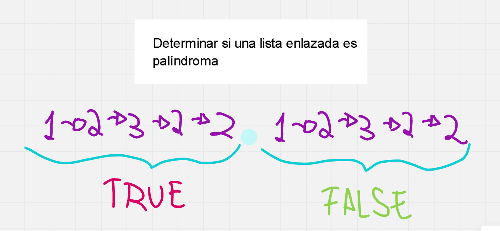

# 🔥🔥 Explicación y Resolución Del Ejercicio En Español Java | Python | PHP | C++ | JavaScript 🔥🔥

**Author:** hermescoder02
**Votes:** 4
**Link:** [https://leetcode.com/problems/palindrome-linked-list/solutions/5993793/](https://leetcode.com/problems/palindrome-linked-list/solutions/5993793/)

---

# Lectura

*Determinar si una lista enlazada es pal\xEDndroma (Java, Python, PHP, C++, Javascript)*

Desarrolle una funci\xF3n que determine si una lista enlazada es pal\xEDndroma.



Una soluci\xF3n simple a este problema consiste en utilizar una pila auxiliar para guardar los elementos en el orden buscado.

# Explicaci\xF3n del ejercicio Paso por paso

https://youtu.be/CwGhSTVrRvw

\u2705 Informaci\xF3n sobre clases particulares de algoritmos y programaci\xF3n:
https://hermescoder.com/clases-particulares-de-algoritmos-y-programacion

Si deseas profundizar m\xE1s en este tema \xA1visita mi blog!: 
\u2705https://hermescoder.com/categoria/listas-enlazadas/determinar-si-una-lista-enlazada-es-palindroma

# C\xF3digo 

```Java []
class Solution {
    public boolean isPalindrome(ListNode head) {
        Stack<Integer> pila = new Stack<>();
        ListNode aux = head;
        ListNode medio = head;

        // Paso #2 (Step #2)
        while (aux != null && aux.next != null) {
            pila.push(medio.val);
            medio = medio.next;
            aux = aux.next.next;
        }

        // Paso #3 (Step #3)
        if (aux != null) medio = medio.next;

        // Paso #4 (Step #4)
        while (!pila.isEmpty()) {
            int tope = pila.pop();
            if (medio.val != tope) return false;
            medio = medio.next;
        }
        return true;

    }
}
```
```Python []
class Solution(object):
    def isPalindrome(self, head):
        pila = []  # Use a list as a stack in Python
        aux = head
        medio = head

        while aux and aux.next:
            pila.append(medio.val)
            medio = medio.next
            aux = aux.next.next

        if aux:
            medio = medio.next

        while pila:
            tope = pila.pop()
            if medio.val != tope:
                return False
            medio = medio.next

        return True
```
```PHP []
class Solution {
    function isPalindrome($head) {
        $pila = []; 
        $aux = $head;
        $medio = $head;

        // Paso#2
        while ($aux && $aux->next) {
            $pila[] = $medio->val; 
            $medio = $medio->next;
            $aux = $aux->next->next;
        }

        if ($aux) {
            $medio = $medio->next;
        }

        while (count($pila) > 0) {
            $tope = array_pop($pila); 
            if ($medio->val != $tope) {
                return false;
            }
            $medio = $medio->next;
        }

        return true;

    }
}
```
```C++ []
class Solution {
public:
    bool isPalindrome(ListNode* head) {
        //Paso#1
        stack<int> pila;
        ListNode *aux = head;
        ListNode *medio = head;

        //Paso#2
        while(aux && aux->next){
            pila.push(medio->val);
            medio = medio->next;
            aux = aux->next->next;
        }

        //Paso#3
        if(aux) medio = medio->next;

        //Paso#4
        while(!pila.empty()) {
            int tope = pila.top();
            if(medio->val!=tope) return false;

            pila.pop();
            medio = medio->next;
        }
		return true;
    }
};
```
```JavaScript []
 var isPalindrome = function(head) {
    // Paso #1: Create a stack and pointers
    const stack = [];
    let aux = head;
    let medio = head;

    // Paso #2: Push values to stack and find middle node
    while (aux && aux.next) {
      stack.push(medio.val);
      medio = medio.next;
      aux = aux.next.next;
    }

    // Paso #3: Handle odd-length lists
    if (aux) medio = medio.next;

    // Paso #4: Compare values from stack and linked list
    while (stack.length > 0) {
      const tope = stack.pop();
      if (medio.val !== tope) return false;
      medio = medio.next;
    }

    return true;
};
```


