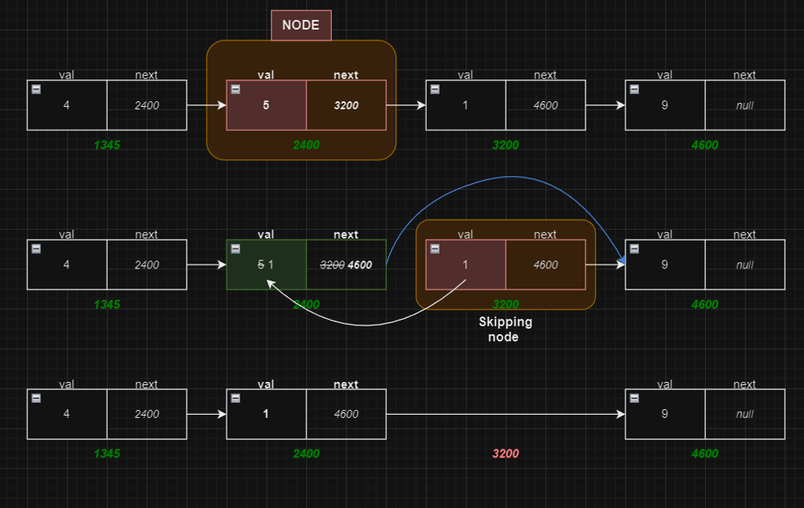

# ✅ Detailed Explanation🔥🔥Extremely Simple🔥1&2-liner🔥O(1) Time and Space Complexity🔥🔥🔥

**Author:** Saketh3011
**Votes:** 578
**Link:** [https://leetcode.com/problems/delete-node-in-a-linked-list/solutions/5113147/](https://leetcode.com/problems/delete-node-in-a-linked-list/solutions/5113147/)

---

# \uD83C\uDFAFProblem Explaination:
We have to delete the given node's val and delete a node from a singly-linked list without knowing its head or previous node. Not actual given node.
Given node is not tail node, so it will always have next node.
> Only question is hard to understand.
This is the easiest "Leetcode-Medium" I have seen so far.
Why is this Medium, not Easy?

# \uD83E\uDD14 Intuition
We know that previous node pointer to given node. What if we change given node value to next nodes and point `next` to `next.next`. It's essentially changing current node to next and deleting next. 

# \uD83E\uDDE0 Approach
To delete the given `node`, we copy the value of the next node to the current node and adjust the next pointer to skip the next node.
- Copy the value of the next node to the current node.
- Adjust the next pointer to skip the next node.



**Note:** We are not actually removing/deleting given node, as question might imply. To actually delete the `node`, we need to change the reference of the previous node's next pointer to skip over the given node. However, we do not have access to the previous node. 

# \uD83D\uDCD2 Complexity
- \u23F0 Time complexity: $$O(1)$$, as we're only modifying the current node
- \uD83E\uDDFASpace complexity: $$O(1)$$, no extra space is used.

# \uD83E\uDDD1\u200D\uD83D\uDCBB Code
``` python []
# Definition for singly-linked list.
# class ListNode:
#     def __init__(self, x):
#         self.val = x
#         self.next = None

class Solution:
    def deleteNode(self, node: ListNode) -> None:
        node.val = node.next.val
        node.next = node.next.next

        ## alternative, one liner
        # node.val, node.next = node.next.val, node.next.next
```
``` java []
class Solution {
    public void deleteNode(ListNode node) {
        node.val = node.next.val;
        node.next = node.next.next;
    }
}
```
``` cpp []
class Solution {
public:
    void deleteNode(ListNode* node) {
        node->val = node->next->val;
        node->next = node->next->next;

    // Alternative, we can copy next node's properties directly with
        // *node = *node->next;
    }
};
```
```javascript []
var deleteNode = function(node) {
    node.val = node.next.val;
    node.next = node.next.next;

// alternative 
    // Object.assign(node, node.next);
};
```
``` kotlin []
class Solution {
    fun deleteNode(node: ListNode?){
         if (node != null) {
            node.`val` = node.next.`val`
            node.next = node.next.next
        }
    }
}
```

---
## Unused Memory Deletion
In Python, Java, JavaScript and Kotlin garbage collector will then handle the deallocation of memory / deleting next node. 
But in _C++_ we have to manually delete next node from memory.

``` cpp []
class Solution {
public:
    void deleteNode(ListNode* node) {
        ListNode* nextNode = node -> next;
        node->val = node->next->val;
        node->next = node->next->next;
        delete nextNode;
    }
};
```
``` cpp []
class Solution {
public:
    void deleteNode(ListNode* node) {
        ListNode* temp = node->next;
        *node = *node->next;
        delete temp;
    }
};
```

---
# Please consider giving an Upvote!
