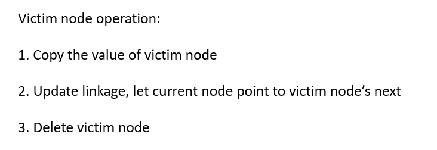
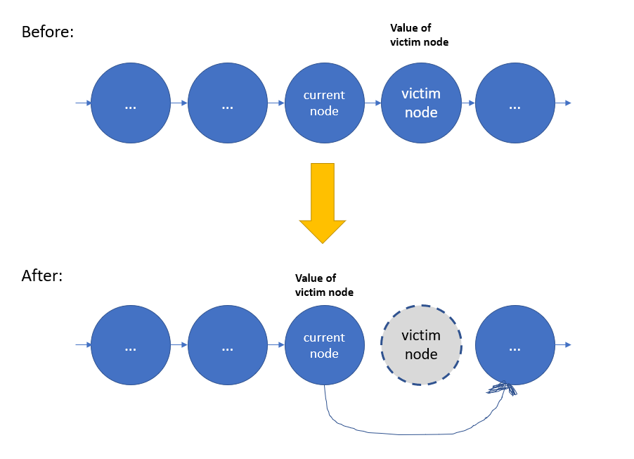

# Python/Java/JS/Go/C++ by victim node operation [w/ Visualization] 有中文解題文章

**Author:** brianchiang_tw
**Votes:** 16
**Link:** [https://leetcode.com/problems/delete-node-in-a-linked-list/solutions/469072/](https://leetcode.com/problems/delete-node-in-a-linked-list/solutions/469072/)

---

[\u4E2D\u6587\u89E3\u984C\u6587\u7AE0](https://vocus.cc/article/6638d37dfd89780001552260)

Solution based on victim node operation

---

**Visualization & Diagram**:





---

**Implementation** in Python:

```
# Definition for singly-linked list.
# class ListNode:
#     def __init__(self, x):
#         self.val = x
#         self.next = None


class Solution:
    def deleteNode(self, node):
        """
        :type node: ListNode
        :rtype: void Do not return anything, modify node in-place instead.
        """
        
        # locate victim node
        victim_node = node.next
        
        # overwrite node's value by victim node's value
        node.val = victim_node.val
        
        # break the linkage of victim node
        node.next = victim_node.next
        
        # release victim node
        del victim_node
        
        return
```

---

**Implementation** by Java:

```
class Solution {
    public void deleteNode(ListNode node) {
        
        // Locate victim node
        ListNode victimNode = node.next;
        
        // Copy value of victim node
        node.val = victimNode.val;
        
        // Make node.next pointes to next node of victim node
        node.next = victimNode.next;
        
        // Let Java GC automaticlly release victimNode in the background
        victimNode = null;
        
        return;
    }
}
```

---

**Implementation** in Javascript:

```
var deleteNode = function(node) {
    
    // copy object from victim node
    node = Object.assign(node, node.next);
    
	// Let JS GC automaticlly release victimNode in the background
    node = null;
	
	return;
};
```

or

```
var deleteNode = function(node) {
    
    // copy data from victim node
    node.val = node.next.val;
    
    // update linkage
    node.next = node.next.next;
    
	// Let JS GC automaticlly release victimNode in the background
    node = null;
	
    return;
};
```

---

**Implementation** in Golang:

```
func deleteNode(node *ListNode) {
    
    // locate victim node
    victimNode := node.Next
    
    // overwrite node's value by victim node's value
    node.Val = victimNode.Val
    
    // break the linkage of victim node
    node.Next = victimNode.Next
    
    // release victim node
    victimNode = nil
    
    
}
```

---

**Implementation** in C++

```
class Solution {
public:
    void deleteNode(ListNode* node) {
        
        // locate victim node
        ListNode *victimNode = node->next;
        
        // copy data from victim node
        *node = *(node->next);
        
        // release memory of victim node
        delete victimNode;
        
        return;
    }
};
```

---

**Implementation** by concise victim node operation in Python:

```
# Definition for singly-linked list.
# class ListNode:
#     def __init__(self, x):
#         self.val = x
#         self.next = None

class Solution:
    def deleteNode(self, node):
        """
        :type node: ListNode
        :rtype: void Do not return anything, modify node in-place instead.
        """
        
        # concise version of victim node operation
        
        node.val, node.next = node.next.val, node.next.next
```

---

**Implementation** by concise victim node operation in Golang:

```
func deleteNode(node *ListNode) {
    
    node.Val = node.Next.Val
    node.Next = node.Next.Next
    
}
```

or


```

func deleteNode(node *ListNode) {
    
    // direct update linkage to next node
    *node = *(node.Next)
    return
}

```
---