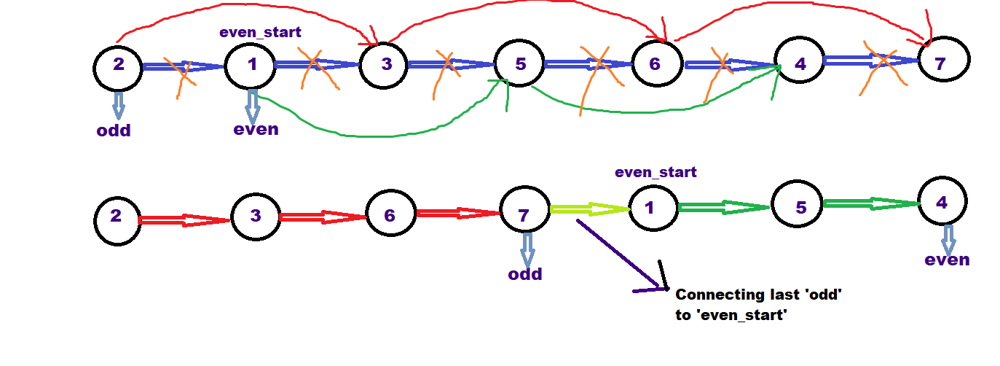

# [C++] Simplest Solution (W/ Explanation) |  One Pass

**Author:** Mythri_Kaulwar
**Votes:** 411
**Link:** [https://leetcode.com/problems/odd-even-linked-list/solutions/1606963/](https://leetcode.com/problems/odd-even-linked-list/solutions/1606963/)

---

**Firstly, thanks for refering to my solution :)**

**APPROACH :**
* The idea is to split the linked list into 2 : one containing all odd nodes and other containing all even nodes. And finally, attach the even node linked list at the end of the odd node linked list. 
* To split the linked list into even nodes & odd nodes, we traverse the linked list and keep connecting the consecutive odd nodes and even nodes (to maintain the order of nodes) and save the pointer to the first even node.
* Finally, we  insert all the even nodes at the end of the odd node list.




**Time Complexity :** O(n) - We traverse the linked list only once.

**Auxiliary Space :** O(1) - No extra space required

**Code :**
```
class Solution {
public:
    ListNode* oddEvenList(ListNode* head) {
        if(!head || !head->next || !head->next->next) return head;
        
        ListNode *odd = head;
        ListNode *even = head->next;
        ListNode *even_start = head->next;
        
        while(odd->next && even->next){
            odd->next = even->next; //Connect all odds
            even->next = odd->next->next;  //Connect all evens
            odd = odd->next;
            even = even->next;
        }
        odd->next = even_start;   //Place the first even node after the last odd node.
        return head; 
    }
};
```

**If you like my solution & explanation, PLEASE UPVOTE!!** \uD83D\uDD3C
