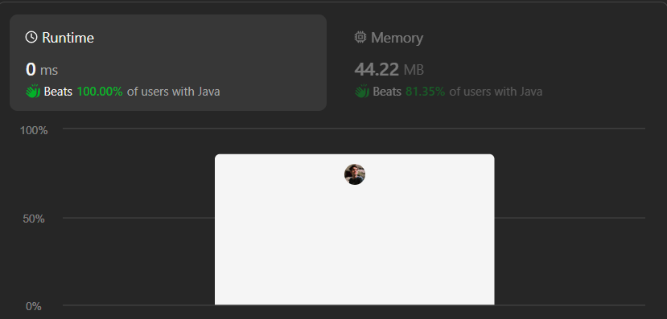
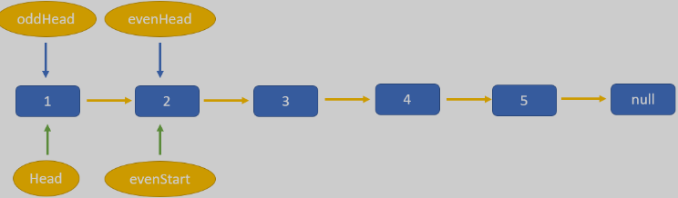
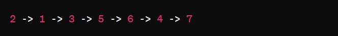
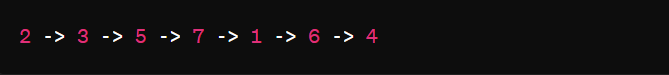
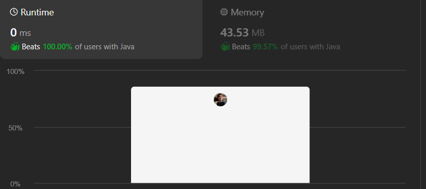
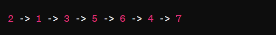
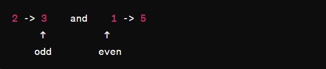
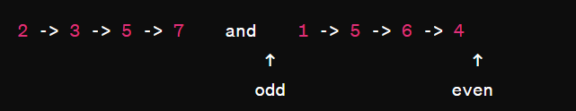
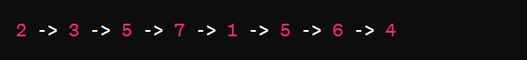

# Simple ,Beginner friendly & Dry Run||Two Approach & Full Explanation||Time O(N) & Space O(1) ||Gits✅

**Author:** GiteshSK_12
**Votes:** 74
**Link:** [https://leetcode.com/problems/odd-even-linked-list/solutions/4761304/](https://leetcode.com/problems/odd-even-linked-list/solutions/4761304/)

---




# Intuition \uD83D\uDC48

In the given question, we are provided with the head of a linked list, and our task is to separate all the nodes at odd and even indices, then return a linked list in which all the odd indices come first, followed by all the even indices.

This question can be solved using two approaches:


# Approach 1 \uD83D\uDC48



 
The approch of this method is to group all odd-positioned nodes followed by all even-positioned nodes, while preserving their original relative order, involves several key steps executed within a single pass through the list. This method ensures O(n) time complexity, where nnn is the number of nodes in the list, and O(1) space complexity, as it manipulates the list in place using a constant amount of additional storage.

# Code Explanation \uD83D\uDC48

*   **Base Case Handling**: The code first checks if the input list is either empty (`head == null`) or contains only one node (`head.next == null`). In either case, the list doesn't need rearranging, so the original head of the list is returned immediately.
    
*   **Dummy Head Initialization**: Two dummy head nodes, `odd` and `even`, are created. These nodes serve as the starting points for two separate lists: one to collect all nodes from odd positions and the other for nodes from even positions. This is a common technique used to simplify list manipulation by avoiding dealing with special cases for the head node.
    
*   **Pointer Initialization**: Two pointers, `odd_ptr` and `even_ptr`, are initialized to point to the respective dummy heads. These pointers will traverse the lists, allowing new nodes to be appended to the respective odd and even lists.
    
*   **List Traversal and Node Classification**: The code enters a loop that continues until all nodes from the original list (`head`) have been processed. Within the loop, an `index` variable is used to determine whether the current node is at an odd or even position:
    
    *   If `index` is odd, the current node belongs to the odd list, so it's appended to the list that `odd_ptr` is building. `odd_ptr` is then advanced to this newly added node.
    *   If `index` is even, a similar process is followed for the even list using `even_ptr`.
*   **Linking Odd and Even Lists**: After all nodes have been classified and the original list has been fully traversed, the code performs two crucial steps to finalize the rearrangement:
    
    *   The end of the even list is marked by setting `even_ptr.next` to `null`. This ensures the even list is properly terminated and doesn't inadvertently link back to any nodes that might follow it in memory.
    *   The odd and even lists are concatenated. This is done by setting the `next` pointer of the last node in the odd list (`odd_ptr.next`) to point to the first real node in the even list (`even.next`), effectively skipping the even dummy head.
*   **Returning the Result**: Finally, the method returns `odd.next`, which points to the first real node in the odd list, effectively skipping the odd dummy head. This is the new head of the rearranged list where all odd-positioned nodes are followed by all even-positioned nodes.

# Complexity \uD83D\uDC48
- Time complexity: O(n)

- Space complexity: O(1)

# Code \uD83D\uDC48
```C []
/**
 * Definition for singly-linked list.
 * struct ListNode {
 *     int val;
 *     struct ListNode *next;
 * };
 */
struct ListNode* oddEvenList(struct ListNode* head) {
    if (head == NULL || head->next == NULL) {
        return head;
    }
    struct ListNode* odd = (struct ListNode*)malloc(sizeof(struct ListNode));
    odd->val = 0;
    odd->next = NULL;
    struct ListNode* odd_ptr = odd;
    struct ListNode* even = (struct ListNode*)malloc(sizeof(struct ListNode));
    even->val = 0;
    even->next = NULL;
    struct ListNode* even_ptr = even;
    int idx = 1;
    
    while (head != NULL) {
        if (idx % 2 == 0) {
            even_ptr->next = head;
            even_ptr = even_ptr->next;
        } else {
            odd_ptr->next = head;
            odd_ptr = odd_ptr->next;
        }
        head = head->next;
        idx++;
    }
    even_ptr->next = NULL; 
    odd_ptr->next = even->next;
    struct ListNode* newHead = odd->next; 
    free(odd);
    free(even);
    
    return newHead;
}
```
```C++ []
/**
 * Definition for singly-linked list.
 * struct ListNode {
 *     int val;
 *     ListNode *next;
 *     ListNode() : val(0), next(nullptr) {}
 *     ListNode(int x) : val(x), next(nullptr) {}
 *     ListNode(int x, ListNode *next) : val(x), next(next) {}
 * };
 */
class Solution {
public:
    ListNode* oddEvenList(ListNode* head) {
        if(head == NULL || head->next == NULL)return head;
        ListNode* odd = new ListNode(0);
        ListNode* odd_ptr = odd;
        ListNode* even = new ListNode(0);
        ListNode* even_ptr = even;
        int idx = 1;
        while(head != NULL){
            if(idx % 2 == 0){
                even_ptr->next = head;
                even_ptr = even_ptr->next;
            }else{
                odd_ptr->next = head;
                odd_ptr = odd_ptr->next;
            }
            head = head->next;
            idx++;
        }
        even_ptr->next = NULL;
        odd_ptr->next = even->next; 
        return odd->next;
    }
};
```
```Java []
/**
 * Definition for singly-linked list.
 * public class ListNode {
 *     int val;
 *     ListNode next;
 *     ListNode() {}
 *     ListNode(int val) { this.val = val; }
 *     ListNode(int val, ListNode next) { this.val = val; this.next = next; }
 * }
 */
class Solution {
    public ListNode oddEvenList(ListNode head) {
        if(head == null || head.next == null)return head;
        ListNode odd = new ListNode(0);
        ListNode odd_ptr = odd;
        ListNode even = new ListNode(0);
        ListNode even_ptr = even;
        int idx = 1;
        while(head != null){
            if(idx % 2 == 0){
                even_ptr.next = head;
                even_ptr = even_ptr.next;
            }else{
                odd_ptr.next = head;
                odd_ptr = odd_ptr.next;
            }
            head = head.next;
            idx++;
        }
        even_ptr.next = null;
        odd_ptr.next = even.next; 
        return odd.next;
    }
}
```
```javascript []
/**
 * Definition for singly-linked list.
 * function ListNode(val, next) {
 *     this.val = (val===undefined ? 0 : val)
 *     this.next = (next===undefined ? null : next)
 * }
 */
/**
 * @param {ListNode} head
 * @return {ListNode}
 */
var oddEvenList = function(head) {
    if (head === null || head.next === null) return head;
    
    let odd = new ListNode(0);
    let odd_ptr = odd;
    let even = new ListNode(0);
    let even_ptr = even;
    let idx = 1;
    
    while (head !== null) {
        if (idx % 2 === 0) {
            even_ptr.next = head;
            even_ptr = even_ptr.next;
        } else {
            odd_ptr.next = head;
            odd_ptr = odd_ptr.next;
        }
        head = head.next;
        idx++;
    }
    
    even_ptr.next = null;
    odd_ptr.next = even.next;
    
    return odd.next;
};
```
```C# []
/**
 * Definition for singly-linked list.
 * public class ListNode {
 *     public int val;
 *     public ListNode next;
 *     public ListNode(int val=0, ListNode next=null) {
 *         this.val = val;
 *         this.next = next;
 *     }
 * }
 */
public class Solution {
    public ListNode OddEvenList(ListNode head) {
        if(head == null || head.next == null)return head;
        ListNode odd = new ListNode(0);
        ListNode odd_ptr = odd;
        ListNode even = new ListNode(0);
        ListNode even_ptr = even;
        int idx = 1;
        while(head != null){
            if(idx % 2 == 0){
                even_ptr.next = head;
                even_ptr = even_ptr.next;
            }else{
                odd_ptr.next = head;
                odd_ptr = odd_ptr.next;
            }
            head = head.next;
            idx++;
        }
        even_ptr.next = null;
        odd_ptr.next = even.next; 
        return odd.next;
    }
}
```
```python []
# Definition for singly-linked list.
# class ListNode(object):
#     def __init__(self, val=0, next=None):
#         self.val = val
#         self.next = next
class Solution(object):
    def oddEvenList(self, head):
        """
        :type head: ListNode
        :rtype: ListNode
        """
        if head == None or head.next == None : return head 
        odd = ListNode(0) 
        odd_ptr = odd
        even = ListNode(0)
        even_ptr = even 
        idx = 1 
        while head != None :
            if idx % 2 == 0:
                even_ptr.next = head
                even_ptr = even_ptr.next
            else:
                odd_ptr.next = head
                odd_ptr = odd_ptr.next
            head = head.next
            idx+=1
        even_ptr.next = None
        odd_ptr.next = even.next
        return odd.next
```
```ruby []
# Definition for singly-linked list.
# class ListNode
#     attr_accessor :val, :next
#     def initialize(val = 0, _next = nil)
#         @val = val
#         @next = _next
#     end
# end
# @param {ListNode} head
# @return {ListNode}
def odd_even_list(head)
    return head if head == nil || head.next == nil
    odd = ListNode.new(0) 
    odd_ptr = odd
    even = ListNode.new(0)
    even_ptr = even 
    idx = 1 
    while head != nil
        if idx % 2 == 0
            even_ptr.next = head
            even_ptr = even_ptr.next
        else
            odd_ptr.next = head
            odd_ptr = odd_ptr.next
        end
    head = head.next
    idx+=1
    end
    even_ptr.next = nil
    odd_ptr.next = even.next
    return odd.next
end
```

# Dry Run of approach 1 \uD83D\uDC48

### Initial List:

*   The initial list is `2 -> 1 -> 3 -> 5 -> 6 -> 4 -> 7`.
* 



### Step 1: Initialization

*   `odd` is a dummy node for the odd list.
*   `odd_ptr` points to `odd`.
*   `even` is a dummy node for the even list.
*   `even_ptr` points to `even`.
*   `idx` is initialized to 1.

### Step 2: Iterating through the List

We iterate through the list, appending nodes to either the odd list or the even list based on their original positions.

#### Iteration 1 (idx = 1, head = 2):

*   `2` is at an odd position, so `odd_ptr.next = head`.
*   Advance `odd_ptr` to `2`.
*   Increment `idx` to 2.
*   Move `head` to `1`.

#### Iteration 2 (idx = 2, head = 1):

*   `1` is at an even position, so `even_ptr.next = head`.
*   Advance `even_ptr` to `1`.
*   Increment `idx` to 3.
*   Move `head` to `3`.

#### Iteration 3 (idx = 3, head = 3):

*   `3` is at an odd position, so `odd_ptr.next = head`.
*   Advance `odd_ptr` to `3`.
*   Increment `idx` to 4.
*   Move `head` to `5`.

#### Iteration 4 (idx = 4, head = 5):

*   `5` is at an even position, so `even_ptr.next = head`.
*   Advance `even_ptr` to `5`.
*   Increment `idx` to 5.
*   Move `head` to `6`.

#### Iteration 5 (idx = 5, head = 6):

*   `6` is at an odd position, so `odd_ptr.next = head`.
*   Advance `odd_ptr` to `6`.
*   Increment `idx` to 6.
*   Move `head` to `4`.

#### Iteration 6 (idx = 6, head = 4):

*   `4` is at an even position, so `even_ptr.next = head`.
*   Advance `even_ptr` to `4`.
*   Increment `idx` to 7.
*   Move `head` to `7`.

#### Iteration 7 (idx = 7, head = 7):

*   `7` is at an odd position, so `odd_ptr.next = head`.
*   Advance `odd_ptr` to `7`.
*   Increment `idx` to 8.
*   Move `head` to `null`.

### Step 3: Finalizing the Lists

*   Terminate the even list by setting `even_ptr.next = null`.
*   Concatenate the odd and even lists by setting `odd_ptr.next = even.next`.

### Final List:

*   Removing the dummy nodes, the rearranged list is `2 -> 3 -> 6 -> 7 -> 1 -> 5 -> 4`.




### Explanation:

*   Odd-indexed nodes in the original list: `2, 3, 6, 7`.
*   Even-indexed nodes in the original list: `1, 5, 4`.
*   The final list starts with all the odd-indexed nodes followed by all the even-indexed nodes, maintaining their original relative order within each subgroup.

---




# Approach 2 \uD83D\uDC48

The given problem by rearranging a singly-linked list so that all nodes at odd indices are positioned before all nodes at even indices, while preserving their original relative order within each subgroup (odd and even). The approach is elegant and efficient, with a time complexity of O(n) and space complexity of O(1).

# Code Expalnation \uD83D\uDC48

*   **Base Case Check**: The code starts by checking if the list is empty (`head == null`) or contains only one element (`head.next == null`). In either case, the list does not need to be rearranged, and the `head` of the list is returned immediately.
    
*   **Initialization**:
    
    *   `odd` is initialized to the first node of the list (`head`), which will be used to iterate through and link all odd-indexed nodes.
    *   `even` is initialized to the second node of the list (`head.next`), which will be used to iterate through and link all even-indexed nodes.
    *   `ehead` is a pointer to the head of the even-indexed sublist (`even` at initialization). This pointer is crucial for later reconnecting the even-indexed sublist back to the tail of the odd-indexed sublist.
*   **Rearranging Nodes**: The `while` loop continues as long as there are more nodes to process in the even list (`even != null && even.next != null`). Inside the loop:
    
    *   `odd.next` is updated to point to the node after the next, effectively skipping an even-indexed node and linking the next odd-indexed node. This rearrangement moves all odd-indexed nodes into a continuous sequence.
    *   Similarly, `even.next` is updated to point to the node after the next, skipping an odd-indexed node and linking the next even-indexed node. This action sequences all even-indexed nodes.
    *   The `odd` and `even` pointers are advanced to their next respective nodes, preparing for the next iteration of rearrangement.
*   **Concatenating Odd and Even Sublists**: After exiting the loop (when there are no more even-indexed nodes to process or the end of the list is reached), the last node in the odd-indexed sublist (`odd`) is linked to the head of the even-indexed sublist (`ehead`). This step is crucial for merging the two sublists into a single list that starts with all odd-indexed nodes followed by all even-indexed nodes.
    
*   **Returning the Rearranged List**: The function returns `head`, which still points to the first node of the list (now the head of the rearranged odd-indexed sublist), effectively returning the newly rearranged list.

# Complexity \uD83D\uDC48
- Time complexity: O(n)

- Space complexity: O(1)

# Code \uD83D\uDC48
```C []
/**
 * Definition for singly-linked list.
 * struct ListNode {
 *     int val;
 *     struct ListNode *next;
 * };
 */
struct ListNode* oddEvenList(struct ListNode* head) {
    if(head == NULL || head->next == NULL)return head;
    struct ListNode* odd = head;
    struct ListNode* even = head->next;
    struct ListNode* ehead = even;
    while(even != NULL && even->next != NULL){
        odd->next = odd->next->next;
        even->next = even->next->next;
        odd=odd->next;
        even= even->next;
    }
    odd->next = ehead;
    return head;
}
```
```C++ []
/**
 * Definition for singly-linked list.
 * struct ListNode {
 *     int val;
 *     ListNode *next;
 *     ListNode() : val(0), next(nullptr) {}
 *     ListNode(int x) : val(x), next(nullptr) {}
 *     ListNode(int x, ListNode *next) : val(x), next(next) {}
 * };
 */
class Solution {
public:
    ListNode* oddEvenList(ListNode* head) {
        if(head == NULL || head->next == NULL)return head;
        ListNode* odd = head;
        ListNode* even = head->next;
        ListNode* ehead = even;
        while(even != NULL && even->next != NULL){
            odd->next = odd->next->next;
            even->next = even->next->next;
            odd=odd->next;
            even= even->next;
        }
        odd->next = ehead;
        return head;
    }
};
```
```Java []
/**
 * Definition for singly-linked list.
 * public class ListNode {
 *     int val;
 *     ListNode next;
 *     ListNode() {}
 *     ListNode(int val) { this.val = val; }
 *     ListNode(int val, ListNode next) { this.val = val; this.next = next; }
 * }
 */
class Solution {
    public ListNode oddEvenList(ListNode head) {
        if(head == null || head.next == null)return head;
        ListNode odd = head;
        ListNode even = head.next;
        ListNode ehead = even;
        while(even != null && even.next != null){
            odd.next = odd.next.next;
            even.next = even.next.next;
            odd=odd.next;
            even= even.next;
        }
        odd.next = ehead;
        return head;
    }
}
```
```javascript []
/**
 * Definition for singly-linked list.
 * function ListNode(val, next) {
 *     this.val = (val===undefined ? 0 : val)
 *     this.next = (next===undefined ? null : next)
 * }
 */
/**
 * @param {ListNode} head
 * @return {ListNode}
 */
var oddEvenList = function(head) {
    if (head === null || head.next === null) return head;
    let odd = head;
    let even = head.next;
    let ehead = even;
    while (even !== null && even.next !== null) {
        odd.next = odd.next.next;
        even.next = even.next.next;
        odd = odd.next;
        even = even.next;
    }
    odd.next = ehead;
    return head;
};
```
```C# []
/**
 * Definition for singly-linked list.
 * public class ListNode {
 *     public int val;
 *     public ListNode next;
 *     public ListNode(int val=0, ListNode next=null) {
 *         this.val = val;
 *         this.next = next;
 *     }
 * }
 */
public class Solution {
    public ListNode OddEvenList(ListNode head) {
        if(head == null || head.next == null)return head;
        ListNode odd = head;
        ListNode even = head.next;
        ListNode ehead = even;
        while(even != null && even.next != null){
            odd.next = odd.next.next;
            even.next = even.next.next;
            odd=odd.next;
            even= even.next;
        }
        odd.next = ehead;
        return head;
    }
}
```
```python []
# Definition for singly-linked list.
# class ListNode(object):
#     def __init__(self, val=0, next=None):
#         self.val = val
#         self.next = next
class Solution(object):
    def oddEvenList(self, head):
        """
        :type head: ListNode
        :rtype: ListNode
        """
        if head == None or head.next == None: 
            return head
        odd = head
        even = head.next
        ehead = even
        while even != None and even.next != None:
            odd.next = odd.next.next
            even.next = even.next.next
            odd=odd.next
            even= even.next
        odd.next = ehead
        return head
```
```ruby []
# Definition for singly-linked list.
# class ListNode
#     attr_accessor :val, :next
#     def initialize(val = 0, _next = nil)
#         @val = val
#         @next = _next
#     end
# end
# @param {ListNode} head
# @return {ListNode}
def odd_even_list(head)
    if head == nil || head.next == nil
        return head
    end
    odd = head
    even = head.next
    ehead = even
    while even != nil && even.next != nil
        odd.next = odd.next.next
        even.next = even.next.next
        odd=odd.next
        even= even.next
    end
    odd.next = ehead
    return head
end
```

# Dry Run \uD83D\uDC48

### Initial List:

*   The initial list is `2 -> 1 -> 3 -> 5 -> 6 -> 4 -> 7`.




### Step 1: Initialization

*   `odd` points to `2`.
*   `even` points to `1`.
*   `ehead` points to `1` (the start of the even-indexed sublist).




### Step 2: Entering the Loop

The loop continues as long as `even != null && even.next != null`.

#### Iteration 1:

*   `odd.next = odd.next.next`: Links `2` to `3` (skips over `1`).
*   `even.next = even.next.next`: Links `1` to `5` (skips over `3`).
*   Advance `odd` to `3`.
*   Advance `even` to `5`.

#### Iteration 2:

*   `odd.next = odd.next.next`: Links `3` to `6` (skips over `5`).
*   `even.next = even.next.next`: Links `5` to `7` (skips over `6`).
*   Advance `odd` to `6`.
*   Advance `even` to `7`.




#### Iteration 3:

*   `odd.next = odd.next.next`: Links `6` to `null` (as `6.next.next` is `null`).
*   `even.next = even.next.next`: Links `7` to `null` (as `7.next.next` is `null`).
*   Advance `odd` to `null` (end of list).
*   `even` is already `null`.

### Step 3: Concatenating Odd and Even Sublists

*   Link the end of the odd sublist (`6`) to the start of the even sublist (`ehead`, which is `1`).

### Final List:

After concatenation, the list is rearranged as:




### Explanation:

*   Odd-indexed nodes in the original list: `2, 3, 6, 7`.
*   Even-indexed nodes in the original list: `1, 5, 4`.
*   The final list starts with all the odd-indexed nodes followed by all the even-indexed nodes, maintaining their original relative order within each subgroup.


# If you find the explanation and code helpful, please give me an upvote.\u2764\uFE0F\u2764\uFE0F\u2764\uFE0F\u2764\uFE0F\u2764\uFE0F\u2764\uFE0F\u2764\uFE0F\u2764\uFE0F


