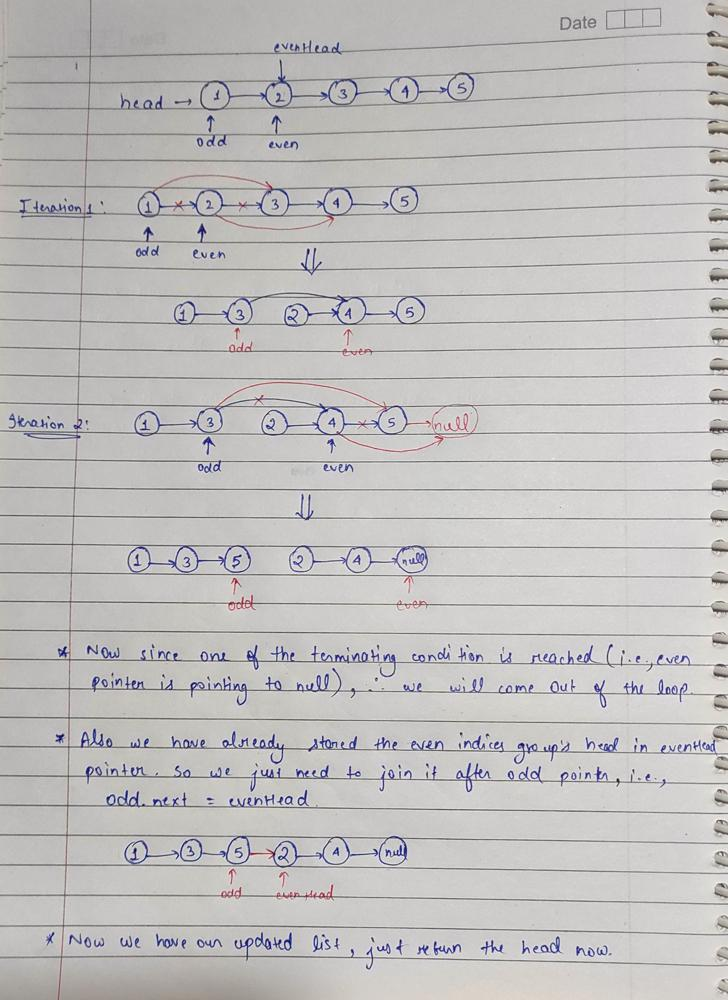

# JAVA | 2 Solutions | Explanation Using Image | Without Space

**Author:** Chaitanya1706
**Votes:** 135
**Link:** [https://leetcode.com/problems/odd-even-linked-list/solutions/1606975/](https://leetcode.com/problems/odd-even-linked-list/solutions/1606975/)

---

**Intution:** Basic idea is just group all the nodes onr for even indices and one for odd indices and then the even indices group will come after odd indices group.

**Approach 1:** Let Split our linked list into odd even index element list then concat even index element list head to odd index element list tail (It is still efficient...beats 100% submission)
Time Complexity : O(n)
Space Complexity : O(1)

```
class Solution {
    public ListNode oddEvenList(ListNode head) {
        if(head==null || head.next==null) return head;
        
        ListNode oddHead = null, oddTail = null;
        ListNode evenHead = null, evenTail = null;
        ListNode curr = head;
        int i = 1;
        while(curr!=null){
			// generate the odd indices list
            if(i%2==1){
                if(oddHead==null){
                    oddHead = curr;
                    oddTail = curr;
                }
                else{
                    oddTail.next = curr;
                    oddTail = oddTail.next;
                }
            }
			// generate the even indices list
            else{
                if(evenHead==null){
                    evenHead = curr;
                    evenTail = curr;
                }
                else{
                    evenTail.next = curr;
                    evenTail = evenTail.next;
                }
            }
            curr = curr.next;
            i++;
        }
        
        evenTail.next = null;     // there should not be any node after even tail
        oddTail.next  = evenHead;   // join even list after odd
        return oddHead;
    
    }
}
```

**Approach 2:** Two Pointer and Constant space by just updating the pointers
Time Complexity : O(n)
Space Complexity : O(1)

**Explanation:**


```
class Solution {
    public ListNode oddEvenList(ListNode head) {
        
		if(head==null) return head;
		
        ListNode odd = head;
        ListNode even = head.next;
        ListNode evenHead = even;
        
        while(even!=null && even.next!=null){
            odd.next = odd.next.next;
            even.next = even.next.next;
            odd = odd.next;
            even = even.next;
        }
        
        odd.next = evenHead;
        
        return head;
    }
}
```

** Well If you reached here....thanks for reading!!