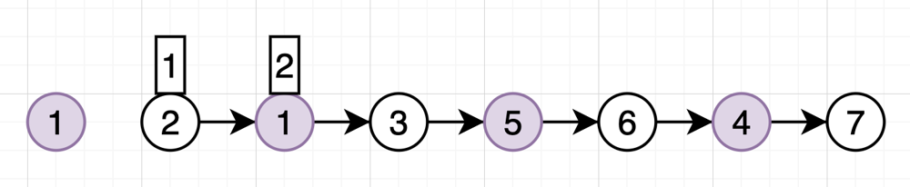
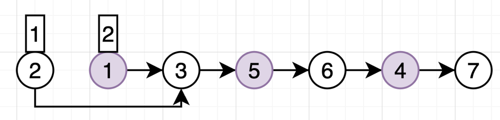
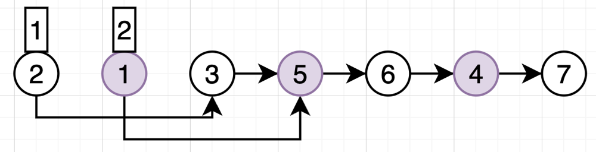
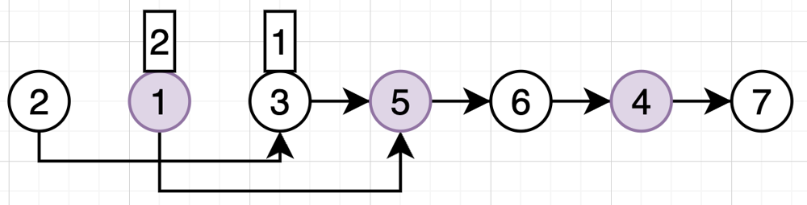
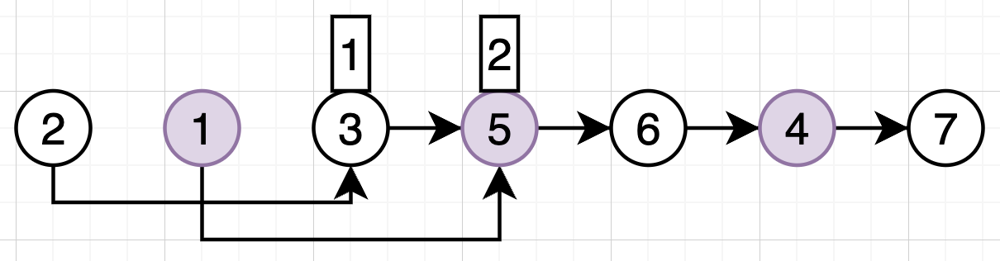
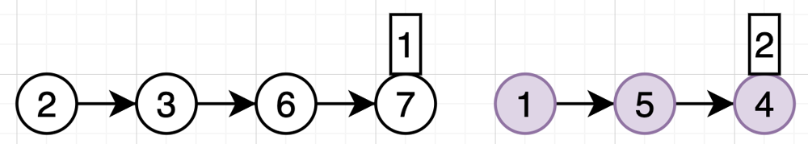
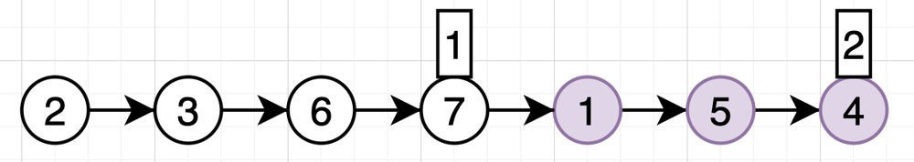

# ✅ O(n) || PHP || Visual explanation🔥🔥🔥

**Author:** shahovkit
**Votes:** 2
**Link:** [https://leetcode.com/problems/odd-even-linked-list/solutions/4693769/](https://leetcode.com/problems/odd-even-linked-list/solutions/4693769/)

---

# Algorithm

Set first pointer on first node, second pointer on second node. Save the value of  second node into a variable (left circle).


**---- Start loop ----**
Change link of first pointer to
link from next pointer (next = next->next)


Also change link of second pointer to
link from next pointer (next = next->next)


Move first pointer to next


Move second pointer to next


**---- End loop ----**

Result after loop:


Change link next of first pointer to saved in beginning. **DONE!**



# Code
```
/**
 * Definition for a singly-linked list.
 * class ListNode {
 *     public $val = 0;
 *     public $next = null;
 *     function __construct($val = 0, $next = null) {
 *         $this->val = $val;
 *         $this->next = $next;
 *     }
 * }
 */
class Solution {

    /**
     * @param ListNode $head
     * @return ListNode
     */
    function oddEvenList($head) {
        if($head === null){
            return $head;
        }
        $odd = $head;
        $even = $head->next;
        $evenHead = $even;
        while($even->next !== null) {
            $odd->next = $odd->next->next;
            $even->next = $even->next->next;
            $odd = $odd->next;
            $even = $even->next;
        }
        $odd->next = $evenHead;

        return $head;
    }
}
```