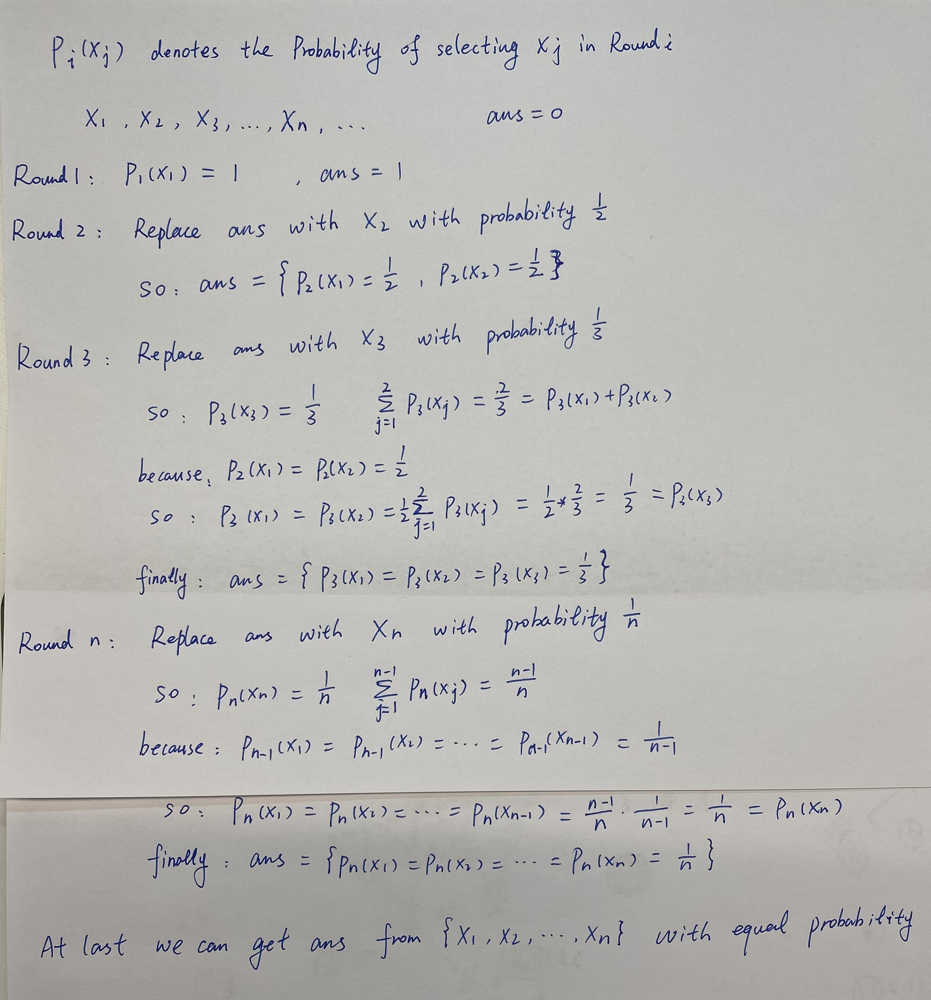

# ✅ [C++/Python/Java] Reservoir sampling || Prove step by step || Image

**Author:** linfq
**Votes:** 199
**Link:** [https://leetcode.com/problems/linked-list-random-node/solutions/1672358/](https://leetcode.com/problems/linked-list-random-node/solutions/1672358/)

---

**PLEASE UPVOTE if you like** \uD83D\uDE01 **If you have any question, feel free to ask.** 


**3 Solutions:**
* **convert linked list to an array, randomly choose a node from array**
* **Pre-Count the length of linked list, randomly generate an index i, traverse the linked list from head to tail to find out the value of i-th node**
* **Reservoir sampling and K == 1**


**Solution 3: Reservoir sampling and K == 1**
[**Reservoir sampling Wikipedia**](https://en.wikipedia.org/wiki/Reservoir_sampling)

this is a **conditional probability problem**.
* The key point is before we process the N-th element, the probability of each previous N-1 element is equal to each other. **This is very important.**
* so after processing N-th element, the probability of each previous N-1 element is **still equal to each other**.
* At this time, the probability of N-th element is 1/N with no doubt, and the rest `(1 -  1 / N) = (N - 1) / N` will be shared equally by previous `N - 1` elements, that is `(1 - 1 / N) / (N - 1) = K(N - 1) / N / (N - 1) = 1 / N`
* cost O(N) for getRandom every time
* You may wonder since the time complexity is still O(N), why do we have to spend so much. 
	* **In the case of streaming data, we cannot traverse all the data to obtain the length, and then traverse the data again**.




**Python**
```
class Solution(object):
    def __init__(self, head):
        self.head = head

    # Reservoir sampling and K == 1
    def getRandom(self):  # cost O(n) Time
        ans = 0
        p, i = self.head, 0
        while p:
            if random.randint(0, i) == 0: # capacity of the reservoir is 1, because we just need to return a single num
                ans = p.val  # replace ans with i-th node.val with probability 1/i
            p = p.next
			i += 1
        return ans
```

**C++**
```
class Solution {
public:
    ListNode *head = NULL;
    
    Solution(ListNode* head) {
        this->head = head;
    }
    
    int getRandom() {
        int ans = 0, i = 1;
        ListNode *p = this->head;
        while (p) {
            if (rand() % i == 0) ans = p->val; // replace ans with i-th node.val with probability 1/i
            i ++;
            p = p->next;
        }
        return ans;
    }
};
```

**Java**
```
class Solution {
    int N = 0;
    ListNode head = null;
    public Solution(ListNode head) {
        this.head = head;
    }
    
    public int getRandom() {
        ListNode p = this.head;
        int i = 1, ans = 0;
        while (p != null) {
            if (Math.random() * i < 1) ans = p.val; // replace ans with i-th node.val with probability 1/i
            p = p.next;
            i ++;
        }
        return ans;
    }
}
```

**Solution 1: convert linked list to a list**
* convert linked list to a list, cost O(N) Space and O(N) Time
* Randomly generate an index of list, cost O(1)
* return the value at the random index

**Python**
```
class Solution(object):
    def __init__(self, head):
        self.nodes = []  # convert linked list to a list, cost O(N) Space and O(N) Time
        while head:
            self.nodes.append(head.val)
            head = head.next

    def getRandom(self):  # cost O(1) Time
        return random.choice(self.nodes)
```
**C++**
```
class Solution {
public:
    vector<int> nodes;
    Solution(ListNode* head) {
        while (head != NULL) {
            nodes.push_back(head->val);
            head = head->next;
        }
    }
    
    int getRandom() {
        int i = rand() % this->nodes.size();
        return this->nodes[i];
    }
};
```
**Java**
```
class Solution {
    ArrayList<Integer> nodes = new ArrayList<Integer>();
    public Solution(ListNode head) {
        while (head != null) {
            nodes.add(head.val);
            head = head.next;
        }
    }
    
    public int getRandom() {
        int i = (int)(Math.random() * this.nodes.size());
        return this.nodes.get(i);
    }
}
```


**Solution 2: Pre-Count the length of linked list**
* Pre-Count the length of linked list, O(N)
* Randomly generate an index of list, O(N)
* traverse the linked list from head and find the value at the random index 

**Python**
```
class Solution(object):
    def __init__(self, head):
        self.N = 0  # find out the length of linked list, cost O(1) Space and O(N) Time
        self.head = head
        while head:
            self.N += 1
            head = head.next

    def getRandom(self):  # cost O(n) Time
        n = random.randint(0, self.N - 1)  # randomly choose an index of the list
        p = self.head
        while n > 0:
            p = p.next
            n -= 1
        return p.val
```
**C++**
```
class Solution {
public:
    int N = 0;
    ListNode *head = NULL;
    
    Solution(ListNode* head) {
        this->head = head;
        while (head != NULL) {
            this->N ++;
            head = head->next;
        }
    }
    
    int getRandom() {
        int i = rand() % this->N;
        ListNode *p = this->head;
        while (i) {
            p = p->next;
            i -= 1;
        }
        return p->val;
    }
};

```

**Java**
```
class Solution {
    int N = 0;
    ListNode head = null;
    public Solution(ListNode head) {
        this.head = head;
        while (head != null) {
            this.N ++;
            head = head.next;
        }
    }
    
    public int getRandom() {
        int i = (int)(Math.random() * this.N);
        ListNode p = this.head;
        while (i > 0) { 
            p = p.next;
            i -= 1;
        }
        return p.val;
    }
}
```


**PLEASE UPVOTE if you like** \uD83D\uDE01 **If you have any question, feel free to ask.**