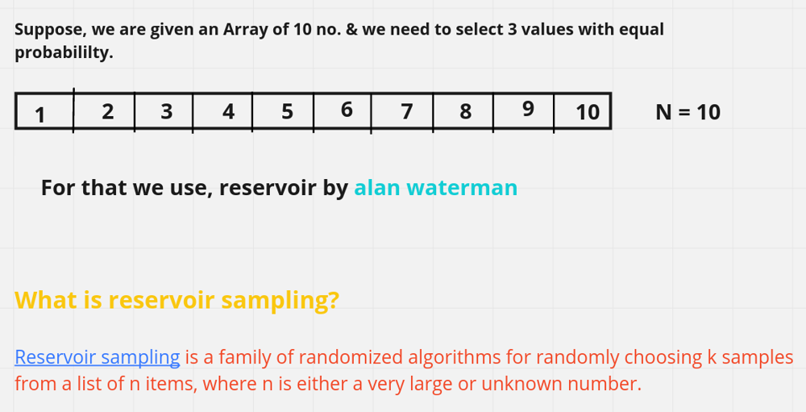
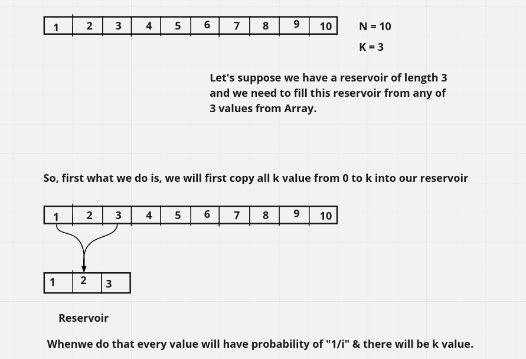
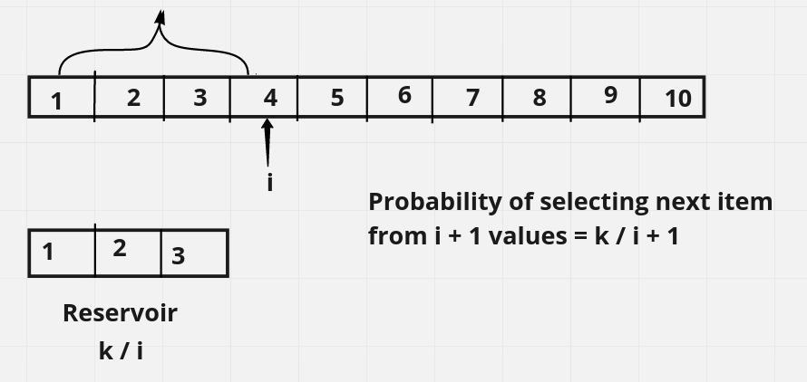

# ☕ 2 ways [Java/C++/Python/JavaScript] || Easy for mind to Accept it

**Author:** hi-malik
**Votes:** 45
**Link:** [https://leetcode.com/problems/linked-list-random-node/solutions/1671967/](https://leetcode.com/problems/linked-list-random-node/solutions/1671967/)

---

**First of all understand the problem:**
* Given a data stream, the data stream length N is very large, how to randomly select k data from it, and ensure that each data is extracted with the same probability.
Attention: Data stream length N is large, memory may not load all data


**Solution 1: Brute {Using Array}**

*`Remember this is a solution which uses extra space ** BUT ** it is easier to implement`*

**Explaination:**
So here we are doing something really simple,

In the constructor function we just add all the items in the Linked List to a public Array called **'res'**.
Now, within the getRandom() function, we just make use of this **'res'** array and use the **Math library.**

Here, **Math.random() generates random numbers between 0 and 1.**

For **further part**, read according to your **Specific Language**

* `Java Only` ***Different language user can even read as well. To get more better understanding***
We can restrict this to generating the random numbers between 0 and 3 (say for example the length of the arrayList is 4, the index in the array will be from 0 to 3 for 4 List elements stored inside it).
We just need to **multiply the length of the array(list) to Math.random() to generate random numbers between 0 and 3.**
But this multiplication between Math.random() and length of the list will ca**use decimal(floating point) numbers,** for which we use **typecasting of int** in the beginning to **remove this decimal and round off the number to the lower whole number.**

* `For C++`
Now take **modulo** of LinkedList size with Array size. So, the **range become 0 to n - 1**
Why we doing that as we have to **return array value**

* `For Python`
The choices() method returns a list with the randomly selected element from the **specified sequence**
As we want in **range of 0 to n - 1**

* `For JavaScript`
The multiplication between Math.random() and length of the list will **cause decimal(floating point) numbers**, for which we use **Math.floor()** in the end to remove this decimal and **round off the number to the lower whole number.**

**Java**
```
class Solution {
    ArrayList<Integer> res = new ArrayList<>(); 
    public Solution(ListNode head) { 
        while(head != null){ // Storing all the values by iterating over the LinkedList
            res.add(head.val);
            head = head.next;
        }
    }
    // 
    public int getRandom() { 
        //Math.random() will generate a random number b/w 0 & 1.
        //then multiply it with the array size, as i have all the value in the list, i know the size of the list
        //take only the integer part which is a random index.
        //return the element at that random index.
        return res.get((int)(Math.random() * res.size()));
    }
}
```
**C++**
```
class Solution {
public:
    vector<int> res; 
    Solution(ListNode* head) { 
        while(head){ // Storing all the values by iterating over the LinkedList
            res.push_back(head->val);
            head=head->next;
        }
    }
    
    int getRandom() { 
        //rand() will generate a random number b/w 0 & RAND_MAX
        //then take modulo of LinkedList size with Array size. So, the range become 0 to n - 1
        //why we doing that as we have to return array value
        return res[rand()%res.size()];
    }
};
```
**Python**
```
class Solution:

	def __init__(self, head: Optional[ListNode]): 
		self.list = head
		res = [] 
		node = self.list
		while (node): # Storing all the values by iterating over the LinkedList
			res.append(node.val)
			node = node.next  
		self.res = res

	def getRandom(self) -> int:
        # The choices() method returns a list with the randomly selected element from the specified sequence.
        # As we want in range of 0 to n - 1
		return random.choice(self.res)

```
**JavaScript**
```
var Solution = function(head) {
        this.res = []; 
        let curr = head;  
        
        while(curr !== null) {
            this.res.push(curr)
            curr = curr.next;
        }
        this.length = this.res.length; 
};

Solution.prototype.getRandom = function() {
    //Math.random() will generate a random number b/w 0 & 1.
    //then multiply it with the array size, as i have all the value in the list, i know the size of the list
    //take only the integer part which is a random index.
    //return the element at that random index.
    return this.res[Math.floor(Math.random() * this.length)].val
};
```
Overall Complexity Analysis :
* **Time Complexity :-** BigO(N) for `intialisation` ; BigO(1) for `getRandom`

* **Space Complexity :-** BigO(N)


```
But What if ! the linked list is extremely large and its length is unknown to you?
As, in that scenario the memory it consumes will be very great.
```

`*So, in order to remove extra space usage we will Use an Concept called*` **Reservoir Sampling**

**Solution 2 : Optimal {Reservoir Sampling}**

**Explaination:**





```
Probability of selecting k from i items = k / i
Once, we have calculated that probability we will keep it side & move to the next element i.e. 4
```


* `Thus, Probability of this item replacing value in reservoir = 1 / k`
* `Probability to selecting a value from i + 1 values and that replacing the value in reservoir = k / i + 1 * 1 / k = 1 / i + 1`
* `And the Probability to selecting a value from i + 1 values and that not replacing the value in reservoir = 1 - (1 / i + 1) = i / i + 1`
* `So, now all the values in reservoir are the values which were selected and not replaced. SO, k / i * i / i + 1 = k / i + 1`
* Which is an equal probability for all values to  be the part of reservoir.

* `The highest value in above example of i = 9, so i + 1 becomes 10 i.e. N & k = 3.`
* `So, probability of every value becomes 3 / 10.`
* The question we have can use reservoir sampling, because we can consider the reservoir to be 1 when the value of k is 1, the probability of each value selected is equal.

*Now, let's code it!*

**Java**
```
class Solution {
    ListNode head = null;
    public Solution(ListNode head) {
        this.head = head;
    }
    
    public int getRandom() {
        ListNode curr = head;
        int index = 1;
        int res = 0;
        while(curr != null){
            if(Math.random() < 1.0 / index){
                // take this value
                res = curr.val;
            }
            index++;
            curr = curr.next;
        }
        return res;
    }
}
```
**C++**
```
class Solution {
public:

    ListNode* u;
    Solution(ListNode* head) {
        u = head;
    }
    
    int getRandom() {
        int index = 1;
        int res = 0;
        ListNode* curr = u;
        while(curr){
            if(rand() % index == 0){
                res = curr->val;
            }
            index++;
            curr = curr->next;
        }
        return res;
    }
};
```
**Python**
```
import random
class Solution:

    def __init__(self, head: ListNode):
        
        # Note that the head is guaranteed to be not null, so it contains at least one node.

        self.head = head

    def getRandom(self) -> int:
       
        # Returns a random node's value.
        
        curr = self.head
        res = 0
        index = 1
        
        while curr:
            if random.random() < (1/index):
                res = curr.val
            
            index += 1
            curr = curr.next
        
        return res
```
Overall Complexity Analysis :
* **Time Complexity :-** BigO(1) for `initalisation` ; BigO(N) for `getRandom`

* **Space Complexity :-** BigO(1)
