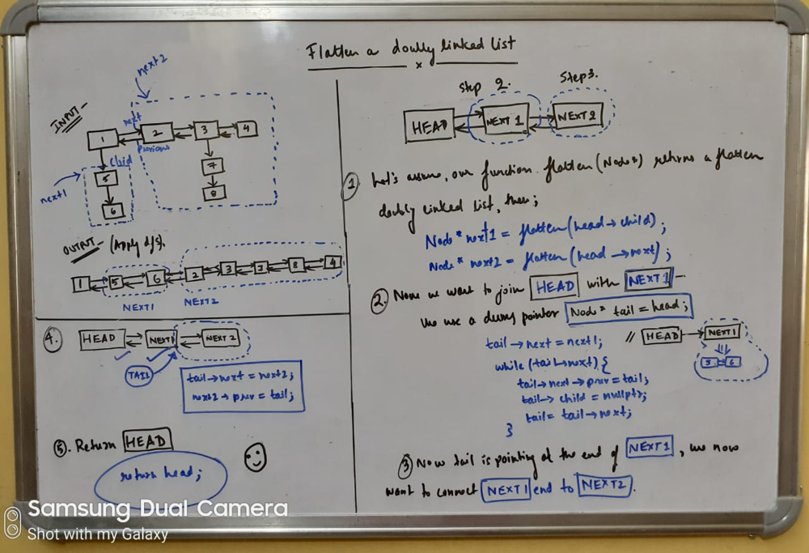

# [C++] Easy & Intuitive Recursive Solution | With Whiteboard Diagrams | No extra space

**Author:** abhisharma404
**Votes:** 22
**Link:** [https://leetcode.com/problems/flatten-a-multilevel-doubly-linked-list/solutions/792707/](https://leetcode.com/problems/flatten-a-multilevel-doubly-linked-list/solutions/792707/)

---

**Explanation:**



```
/*
// Definition for a Node.
class Node {
public:
    int val;
    Node* prev;
    Node* next;
    Node* child;
};
*/

class Solution {
public:
    Node* flatten(Node* head) {
        if (!head) return nullptr;
        Node* tail = head;
        
        Node* next1 = flatten(head->child);
        Node* next2 = flatten(head->next);

        if (next1) {
            tail->next = next1;
            while (tail->next) {
                tail->next->prev = tail;
                tail->child = nullptr;
                tail = tail->next;
            }
        }
        
        tail->next = next2;
        if (next2) {
            next2->prev = tail;
        }
        
        return head;
    }
};
```