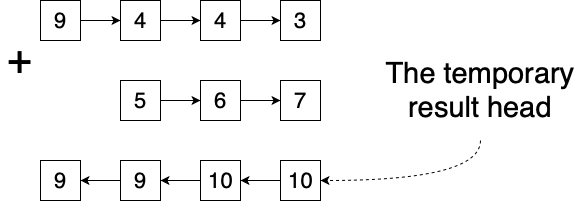
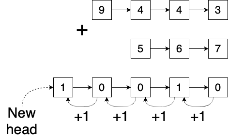

# Java O(N) solution with follow up question; no recursion, no stacks

**Author:** clad_amphora_5z
**Votes:** 255
**Link:** [https://leetcode.com/problems/add-two-numbers-ii/solutions/687339/](https://leetcode.com/problems/add-two-numbers-ii/solutions/687339/)

---

**The intuition**
1. Since input lists may have different size it make sense to determine the sizes. At this step we also could normalize lists by prepending zero-nodes to the smaller list. But this approach will require additional memory, so we are going to ignore the normalization.

2. Iterate over the lists, compute the sum of items and put it into the resulting list. But here are the couple tricks: we are going to build the resulting list in the reversed order and we don't keep the carry value. For example: 



3. Next we are going to normalize the resulting list. Starting form it's head (which contains the lowest order number) we will iterate over all nodes normalizing the value (`val % 10`), remembering the carry value and reversing the resulting list.

4. At the last step the carry value may be greater than 0. In that case we have to create a new node and make it a header of the result. 



.


**The implementation**

```
public ListNode addTwoNumbers(ListNode l1, ListNode l2) {
    // We will use sizes to understand which list's nodes should be frozen for a while.
    int s1 = size(l1);
    int s2 = size(l2);
    ListNode resHead = null;
    ListNode n = null;
    while (l1 != null || l2 != null) {
        int v1 = 0;
        int v2 = 0;
        if (s1 >= s2) {
            v1 = l1 != null ? l1.val : 0;
            l1 = l1.next;
            s1--;
        }
        // Comparing with s1 + 1 since s1 might be decremented previously
        if (s2 >= s1 + 1) {
            v2 = l2 != null ? l2.val : 0;
            l2 = l2.next;
            s2--;
        }
        // Creating the resulting list in the reversed order.
        n = new ListNode(v1 + v2);
        n.next = resHead;
        resHead = n;
    }
    int carry = 0;
    resHead = null;
    // Now, let's perform the normalization.
    while (n != null) {
        n.val += carry;
        if (n.val >= 10) {
            n.val = n.val % 10;
            carry = 1;
        } else {
            carry = 0;
        }
        ListNode buf = n.next;
        n.next = resHead;
        resHead = n;
        n = buf;
    }
    if (carry > 0) {
        n = new ListNode(1);
        n.next = resHead;
        resHead = n;
    }
    return resHead;
}

private int size(ListNode l) {
    int s = 0;
    while (l != null) {
        l = l.next;
        s++;
    }
    return s;
}

```