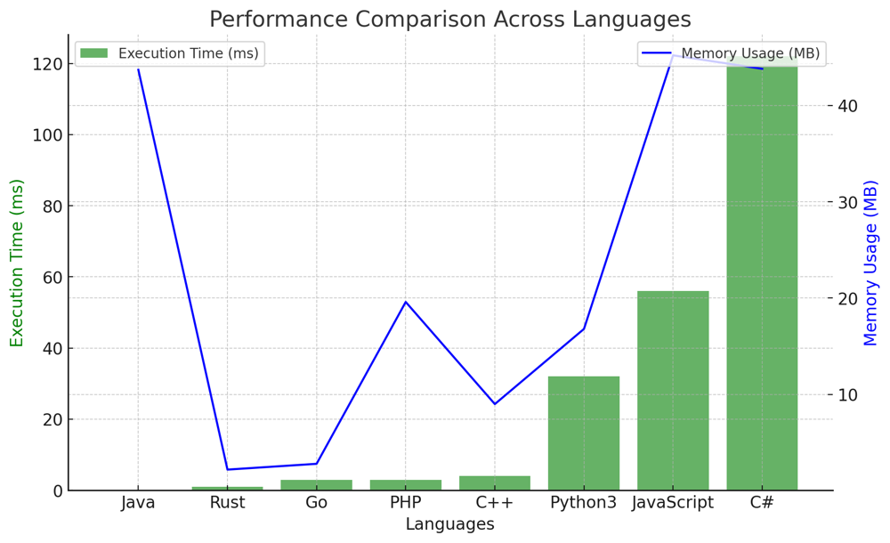

# ✅ 99.10% Easy Linked List

**Author:** vanAmsen
**Votes:** 57
**Link:** [https://leetcode.com/problems/split-linked-list-in-parts/solutions/4007605/](https://leetcode.com/problems/split-linked-list-in-parts/solutions/4007605/)

---

# Interview Guide - Splitting a Linked List into K Consecutive Parts: A Detailed Analysis

## Introduction & Problem Understanding

The problem requires us to split a singly-linked list into $$ k $$ consecutive parts. Each part should have nearly equal length, differing at most by 1. The parts should be in the same order as they appear in the original list, and parts occurring earlier should have a size greater than or equal to parts occurring later.

### Key Concepts and Constraints

1. **Node Anatomy**:  
   Each node in the list has an integer value and a `next` pointer pointing to the subsequent node.

2. **Equal Partition**:  
   The linked list should be partitioned into $$ k $$ parts such that the size of each part is nearly equal.

3. **Order Preservation**:  
   The relative order of the elements within each part should be the same as in the original list.

4. **Size Constraints**:  
   The number of nodes in the list is between [0, 1000], and $$ k $$ is between [1, 50].

## Live Codgin & More
https://youtu.be/hcHz4HVEpvQ?si=hZFjiJU7n-qRb3Aw

## Strategy to Tackle the Problem

### Intuition and Logic Behind the Solution

The core idea is to first calculate the length of the linked list to determine the base size of each part and the number of parts that should have an extra node. Then, we traverse the list to construct each part based on these calculations.

### Step-by-step Explanation

1. **Initialization**:
    - Initialize a variable `length` to store the length of the list.
    - Initialize an empty list `parts` to store the resulting parts.

2. **Calculate Length**:  
    - Traverse the linked list to find its length.

3. **Divide Length**:
    - Calculate `base_size` and `extra` using `divmod(length, k)`.

4. **Create Parts**:  
    - Traverse the linked list again.
    - For each part, construct a sublist with `base_size` nodes.
    - If `extra > 0`, add one more node to the current part and decrement `extra`.

5. **Append to Result**:  
    - Append each constructed part to the `parts` list.

### Complexity Analysis

- **Time Complexity**: $$ O(n) $$ \u2014 The list is traversed twice: once to calculate its length and once to create the parts.
- **Space Complexity**: $$ O(k) $$ \u2014 The `parts` list stores $$ k $$ heads of the resulting parts.

## Code Highlights

- The `divmod` function is used to calculate both `base_size` and `extra` in one line.
- A dummy node is used to easily construct each part without special handling for the first node.
- The `extra` variable is decremented directly in the loop where parts are constructed, avoiding the need for additional logic outside the loop.

This solution efficiently handles the constraints and requirements of the problem, offering a clean and effective way to split a linked list into $$ k $$ consecutive parts.

# Performance

| Language  | Execution Time (ms) | Memory Usage (MB) |
|-----------|---------------------|-------------------|
| **Java**  | **0**               | 43.7              |
| Rust      | 1                   | 2.2               |
| Go        | 3                   | 2.8               |
| PHP       | 3                   | 19.6              |
| C++       | 4                   | 9                 |
| Python3   | 32                  | 16.8              |
| JavaScript| 56                  | 45.2              |
| C#        | 122                 | 43.8              |




# Code
``` Python []
class Solution:
    def splitListToParts(self, head: Optional[ListNode], k: int) -> List[Optional[ListNode]]:
        length, current, parts = 0, head, []
        
        while current:
            length += 1
            current = current.next
        
        base_size, extra = divmod(length, k)
        current = head
        
        for _ in range(k):
            dummy = ListNode()
            part_head = dummy
            
            for _ in range(base_size + (extra > 0)):
                dummy.next, current, dummy = current, current.next, current
            
            if extra > 0:
                extra -= 1
  
            dummy.next = None
            parts.append(part_head.next)
        
        return parts
```
``` Go []
func splitListToParts(head *ListNode, k int) []*ListNode {
    length := 0
    current := head
    var parts []*ListNode

    for current != nil {
        length++
        current = current.Next
    }

    baseSize, extra := length/k, length%k
    current = head

    for i := 0; i < k; i++ {
        partSize := baseSize
        if extra > 0 {
            partSize++
            extra--
        }

        var partHead, partTail *ListNode

        for j := 0; j < partSize; j++ {
            if partHead == nil {
                partHead, partTail = current, current
            } else {
                partTail.Next = current
                partTail = partTail.Next
            }

            if current != nil {
                current = current.Next
            }
        }

        if partTail != nil {
            partTail.Next = nil
        }

        parts = append(parts, partHead)
    }

    return parts
}
```
``` Rust []
impl Solution {
    pub fn split_list_to_parts(head: Option<Box<ListNode>>, k: i32) -> Vec<Option<Box<ListNode>>> {
        let mut length = 0;
        let mut current = head.as_ref();
        let mut parts = Vec::new();
        
        while let Some(node) = current {
            length += 1;
            current = node.next.as_ref();
        }
        
        let (mut base_size, mut extra) = (length / k, length % k);
        let mut current = head;
        
        for _ in 0..k {
            let mut part_size = base_size + if extra > 0 { 1 } else { 0 };
            let mut dummy = Box::new(ListNode { val: 0, next: None });
            let mut tail = &mut dummy;
            
            while part_size > 0 {
                tail.next = current.take();
                tail = tail.next.as_mut().unwrap();
                current = tail.next.take();
                part_size -= 1;
            }
            
            parts.push(dummy.next.take());
            if extra > 0 {
                extra -= 1;
            }
        }
        
        parts
    }
}
```
``` C++ []
class Solution {
public:
    vector<ListNode*> splitListToParts(ListNode* head, int k) {
        int length = 0;
        ListNode* current = head;
        vector<ListNode*> parts;

        while (current) {
            length++;
            current = current->next;
        }

        int base_size = length / k, extra = length % k;
        current = head;

        for (int i = 0; i < k; ++i) {
            int part_size = base_size + (extra > 0);
            ListNode* part_head = nullptr, * part_tail = nullptr;

            for (int j = 0; j < part_size; ++j) {
                if (!part_head) {
                    part_head = part_tail = current;
                } else {
                    part_tail->next = current;
                    part_tail = part_tail->next;
                }

                if (current) {
                    current = current->next;
                }
            }

            if (part_tail) {
                part_tail->next = nullptr;
            }

            parts.push_back(part_head);
            extra = max(extra - 1, 0);
        }

        return parts;
    }
};
```
``` Java []
public class Solution {
    public ListNode[] splitListToParts(ListNode head, int k) {
        int length = 0;
        ListNode current = head;
        List<ListNode> parts = new ArrayList<>();

        while (current != null) {
            length++;
            current = current.next;
        }

        int base_size = length / k, extra = length % k;
        current = head;

        for (int i = 0; i < k; i++) {
            int part_size = base_size + (extra > 0 ? 1 : 0);
            ListNode part_head = null, part_tail = null;

            for (int j = 0; j < part_size; j++) {
                if (part_head == null) {
                    part_head = part_tail = current;
                } else {
                    part_tail.next = current;
                    part_tail = part_tail.next;
                }

                if (current != null) {
                    current = current.next;
                }
            }

            if (part_tail != null) {
                part_tail.next = null;
            }

            parts.add(part_head);
            extra = Math.max(extra - 1, 0);
        }

        return parts.toArray(new ListNode[0]);
    }
}
```
``` C# []
public class Solution {
    public ListNode[] SplitListToParts(ListNode head, int k) {
        int length = 0;
        ListNode current = head;
        List<ListNode> parts = new List<ListNode>();

        while (current != null) {
            length++;
            current = current.next;
        }

        int base_size = length / k, extra = length % k;
        current = head;

        for (int i = 0; i < k; i++) {
            int part_size = base_size + (extra > 0 ? 1 : 0);
            ListNode part_head = null, part_tail = null;

            for (int j = 0; j < part_size; j++) {
                if (part_head == null) {
                    part_head = part_tail = current;
                } else {
                    part_tail.next = current;
                    part_tail = part_tail.next;
                }

                if (current != null) {
                    current = current.next;
                }
            }

            if (part_tail != null) {
                part_tail.next = null;
            }

            parts.Add(part_head);
            extra = System.Math.Max(extra - 1, 0);
        }

        return parts.ToArray();
    }
}
```

``` JavaScript []
var splitListToParts = function(head, k) {
    let length = 0, current = head, parts = [];

    while (current) {
        length++;
        current = current.next;
    }

    let base_size = Math.floor(length / k), extra = length % k;
    current = head;

    for (let i = 0; i < k; i++) {
        let part_size = base_size + (extra > 0 ? 1 : 0);
        let part_head = null, part_tail = null;

        for (let j = 0; j < part_size; j++) {
            if (!part_head) {
                part_head = part_tail = current;
            } else {
                part_tail.next = current;
                part_tail = part_tail.next;
            }

            if (current) {
                current = current.next;
            }
        }

        if (part_tail) {
            part_tail.next = null;
        }

        parts.push(part_head);
        extra = Math.max(extra - 1, 0);
    }

    return parts;
};
```
``` PHP []
class Solution {
    function splitListToParts($head, $k) {
        $length = 0;
        $current = $head;
        $parts = [];

        while ($current) {
            $length++;
            $current = $current->next;
        }

        $base_size = intdiv($length, $k);
        $extra = $length % $k;
        $current = $head;

        for ($i = 0; $i < $k; $i++) {
            $part_size = $base_size + ($extra > 0 ? 1 : 0);
            $part_head = $part_tail = null;

            for ($j = 0; $j < $part_size; $j++) {
                if ($part_head === null) {
                    $part_head = $part_tail = $current;
                } else {
                    $part_tail->next = $current;
                    $part_tail = $part_tail->next;
                }

                if ($current) {
                    $current = $current->next;
                }
            }

            if ($part_tail) {
                $part_tail->next = null;
            }

            array_push($parts, $part_head);
            $extra = max($extra - 1, 0);
        }

        return $parts;
    }
}
```

This problem serves as a gentle reminder that sometimes, the most straightforward approach, when executed with precision, can be the most effective. Each node matters, each part matters, and how we traverse and split them, matters. Challenges like these don't just test our coding skills but enhance our problem-solving acumen. Code on, and let each node lead you to the solution! \uD83C\uDF1F\uD83D\uDE80