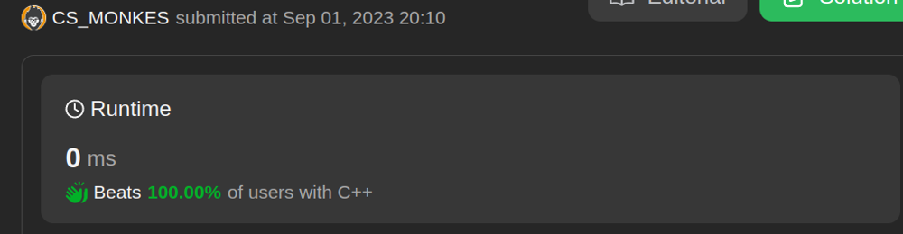
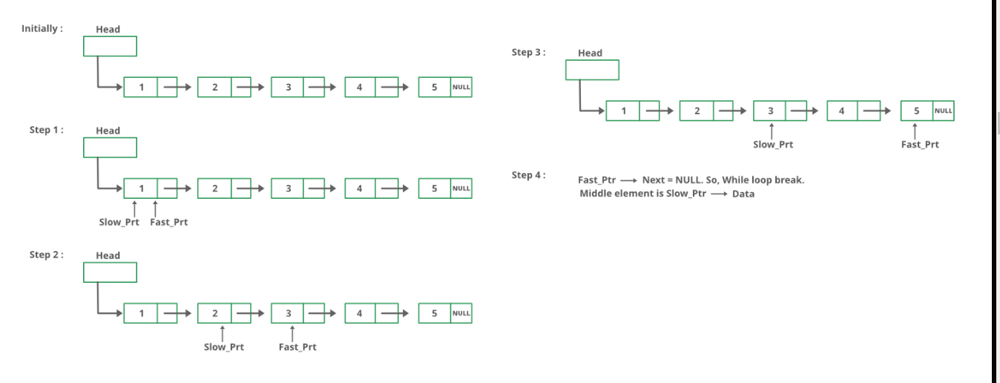

# ✅Best approach explained with GFG image

**Author:** CS_MONKS
**Votes:** 34
**Link:** [https://leetcode.com/problems/middle-of-the-linked-list/solutions/4834666/](https://leetcode.com/problems/middle-of-the-linked-list/solutions/4834666/)

---

If you are confuse with even and odd nodes you can dry run on images given below


# Intuition
<!-- Describe your first thoughts on how to solve this problem. -->
1. Just imagine you are climbing stairs with your friend
2. you both start together from bottom of stairs
3. you are taking one step at a time and your friend is taking two step at time
4. when he reach to top of stairs where will you be

# Approach
<!-- Describe your approach to solving the problem. -->
1. Initialization: Start with two pointers, fast and slow, both pointing to the head of the list.

2. Traversal: Move the fast pointer two steps at a time and the slow pointer one step at a time. This ensures that when the fast pointer reaches the end of the list, the slow pointer will be at the middle node.

3. Find the Middle Node: After traversal, the slow pointer will be at the middle node of the list.

4. Edge Case Handling: Check if the list is empty or contains only one node. In such cases, the middle node is the head itself.

5. Return: Return the node pointed to by the slow pointer as the middle node.

Example for odd nodes


if you want to check for even nodes imagine 5th node is NULL. dry run where will be slow pointer reach  fast pointer reach to 5th node

# Complexity
- Time complexity:O(n)
<!-- Add your time complexity here, e.g. $$O(n)$$ -->

- Space complexity:O(1)
<!-- Add your space complexity here, e.g. $$O(n)$$ -->

# Code
```c++ []
class Solution {
public:
    ListNode* middleNode(ListNode* head) {
       if(head == NULL || head->next == NULL)return head;
        ListNode* fast=head->next;
        ListNode* slow=head;

        while(fast != NULL){
            fast = fast->next;
            if(fast != NULL)fast = fast->next;

            slow = slow->next;
        }

        return slow;
    }
};
```
```java []
class Solution {
    public ListNode middleNode(ListNode head) {
        if (head == null || head.next == null)
            return head;

        ListNode fast = head;
        ListNode slow = head;

        while (fast != null) {
            fast = fast.next;
            if (fast != null) {
                fast = fast.next;
                slow = slow.next;
            }
        }

        return slow;
    }
}

```
```c []
ListNode* middleNode(ListNode* head) {
        
        ListNode* slow = head;
        ListNode* fast =  head;
		
        while(fast && fast->next){   
            slow = slow->next;
            fast = fast->next->next;
        }
        return slow;
    }
```
```python []
class ListNode(object):
    def __init__(self, val=0, next=None):
        self.val = val
        self.next = next

class Solution(object):
    def middleNode(self, head):
        if head is None or head.next is None:
            return head

        fast = head
        slow = head

        while fast is not None:
            fast = fast.next
            if fast is not None:
                fast = fast.next
                slow = slow.next

        return slow
```
``` python3 []
class Solution:
    def middleNode(self, head: Optional[ListNode]) -> Optional[ListNode]:
        start=head
        end=head
        while start and start.next:
            start,end=start.next.next,end.next
        return end
```
```javascript []
function ListNode(val, next) {
    this.val = (val === undefined ? 0 : val);
    this.next = (next === undefined ? null : next);
}

var middleNode = function(head) {
    if (head === null || head.next === null)
        return head;

    let fast = head;
    let slow = head;

    while (fast !== null) {
        fast = fast.next;
        if (fast !== null) {
            fast = fast.next;
            slow = slow.next;
        }
    }

    return slow;
};

```
```c# []
/**
 * Definition for singly-linked list.
 * public class ListNode {
 *     public int val;
 *     public ListNode next;
 *     public ListNode(int val=0, ListNode next=null) {
 *         this.val = val;
 *         this.next = next;
 *     }
 * }
 */
public class Solution {
    public ListNode MiddleNode(ListNode head) {
        ListNode[] nodes = new ListNode[100];
        int index = 0;

        while (head != null) {
            nodes[index++] = head;
            head = head.next;
        }

        return nodes[index / 2];
    }
}
```
```kotlin []
fun middleNode(head: ListNode?): ListNode? {
        var p1 = head
        var p2 = head
        while(p2 != null && p2.next != null) {
            p1 = p1?.next
            p2 = p2?.next?.next
        }
        return p1
    }
```

Hello guys can i use images of any website like this will it create any problem
if it is not allowed please leave a comment 
explaning with images make it easy