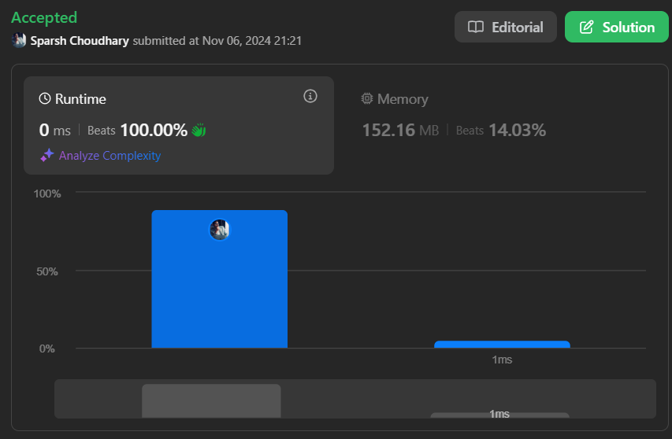

# 🔥BEATS 💯 % 🎯 |✨SUPER EASY BEGINNERS 👏

**Author:** CodeWithSparsh
**Votes:** 2
**Link:** [https://leetcode.com/problems/middle-of-the-linked-list/solutions/6015939/](https://leetcode.com/problems/middle-of-the-linked-list/solutions/6015939/)

---



---


### Intuition
The problem requires finding the middle node in a singly linked list. Since a singly linked list does not allow us to directly access the middle node (like an array), we need an approach that iteratively reaches the midpoint. By using two pointers (slow and fast), we can move the slow pointer one step at a time and the fast pointer two steps. When the fast pointer reaches the end, the slow pointer will be at the middle.

---

### Approach
1. **Initialize two pointers:** Set both `slow` and `fast` pointers to the head of the linked list.
2. **Traverse the list:** Move the `slow` pointer one step and the `fast` pointer two steps in each iteration.
3. **Stop Condition:** When the fast pointer reaches the end (either `null` or `fast.next` is `null`), the slow pointer will be at the middle of the linked list.
4. **Return the result:** If `fast` stops at the last element with no further steps, return `slow`. Otherwise, if `fast` reaches beyond the end, `slow` is the middle node.

---

### Complexity
- **Time Complexity:** \\(O(n)\\), where \\(n\\) is the length of the linked list, as we traverse the list only once.
- **Space Complexity:** \\(O(1)\\), as only two pointers are used regardless of the list size.

---

### Code Implementation
```dart []
/**
 * Definition for singly-linked list.
 * class ListNode {
 *   int val;
 *   ListNode? next;
 *   ListNode([this.val = 0, this.next]);
 * }
 */
class Solution {
  ListNode? middleNode(ListNode? head) {
    ListNode? slow = head;
    ListNode? fast = head;

    while (fast != null && fast.next != null) {
      slow = slow?.next;
      fast = fast.next?.next;
    }
    return slow;
  }
}
```
```java []
/**
 * Definition for singly-linked list.
 * public class ListNode {
 *     int val;
 *     ListNode next;
 *     ListNode() {}
 *     ListNode(int val) { this.val = val; }
 *     ListNode(int val, ListNode next) { this.val = val; this.next = next; }
 * }
 */
public class Solution {
    public ListNode middleNode(ListNode head) {
        ListNode slow = head;
        ListNode fast = head;

        while (fast != null && fast.next != null) {
            slow = slow.next;
            fast = fast.next.next;
        }
        return slow;
    }
}
```
```python []
# Definition for singly-linked list.
# class ListNode:
#     def __init__(self, val=0, next=None):
#         self.val = val
#         self.next = next

class Solution:
    def middleNode(self, head: ListNode) -> ListNode:
        slow = head
        fast = head

        while fast and fast.next:
            slow = slow.next
            fast = fast.next.next
        
        return slow
```


```cpp []
/**
 * Definition for singly-linked list.
 * struct ListNode {
 *     int val;
 *     ListNode *next;
 *     ListNode() : val(0), next(nullptr) {}
 *     ListNode(int x) : val(x), next(nullptr) {}
 *     ListNode(int x, ListNode *next) : val(x), next(next) {}
 * };
 */
class Solution {
public:
    ListNode* middleNode(ListNode* head) {
        ListNode* slow = head;
        ListNode* fast = head;

        while (fast != nullptr && fast->next != nullptr) {
            slow = slow->next;
            fast = fast->next->next;
        }
        return slow;
    }
};
```

```javascript []
/**
 * Definition for singly-linked list.
 * function ListNode(val, next) {
 *     this.val = (val===undefined ? 0 : val)
 *     this.next = (next===undefined ? null : next)
 * }
 */
var middleNode = function(head) {
    let slow = head;
    let fast = head;

    while (fast !== null && fast.next !== null) {
        slow = slow.next;
        fast = fast.next.next;
    }
    return slow;
};
```

```go []
type ListNode struct {
    Val  int
    Next *ListNode
}

func middleNode(head *ListNode) *ListNode {
    slow := head
    fast := head

    for fast != nil && fast.Next != nil {
        slow = slow.Next
        fast = fast.Next.Next
    }
    return slow
}
```

Each implementation uses a two-pointer technique to find the middle of the linked list efficiently.
---

 {:style='width:250px'}