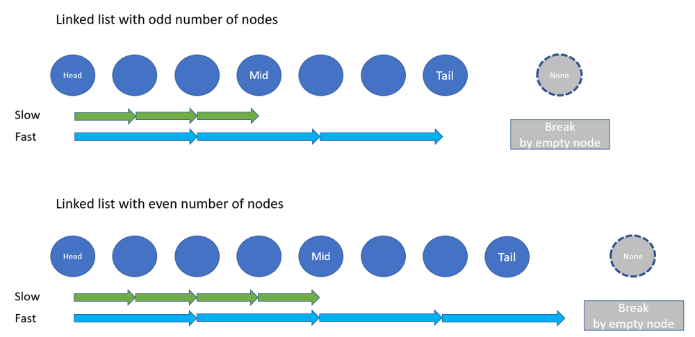

# Python/JS/Java/Go/C++ O(n) by two-pointers  [w/ Diagram] 有中文解題文章

**Author:** brianchiang_tw
**Votes:** 84
**Link:** [https://leetcode.com/problems/middle-of-the-linked-list/solutions/526372/](https://leetcode.com/problems/middle-of-the-linked-list/solutions/526372/)

---

O(n) by two-pointers

[\u4E2D\u6587\u89E3\u984C\u6587\u7AE0](https://vocus.cc/article/6588e890fd89780001c3f462)

---

**Hint**:

Think of **two pointers** technique with **slow runner** and **fast runner**.

Both slow runner and fast runner are initialized to head node.

Each iteration, **fast runner moves two steps forward** while the **slow one moves one steps only**.

When fast runner meets the empty node (i.e., NULL) on the tail, the slow one will be right on the node of midpoint.

---

**Abstract model**:



---

**Implementation**:

```Python []
class Solution:
    def middleNode(self, head: Optional[ListNode]) -> Optional[ListNode]:

        slow = fast = head

        while fast and fast.next:

            fast = fast.next.next
            slow = slow.next

        return slow
```
```Javascript []
var middleNode = function(head) {
    let [slow, fast] = [head, head];

    while( fast && fast.next){
        fast = fast.next.next;
        slow = slow.next;
    }
    return slow;
};
```
```Java []
class Solution {
    public ListNode middleNode(ListNode head) {
        ListNode slow=head, fast=head;

        while( fast != null && fast.next != null ){
            fast = fast.next.next;
            slow = slow.next;
        }
        return slow;
    }
}
```
```C++ []
class Solution {
public:
    ListNode* middleNode(ListNode* head) {
        ListNode *slow = head, *fast = head;

        while( fast != NULL && fast->next != NULL){
            fast = fast->next->next;
            slow = slow->next;
        }
        return slow;
    }
};
```
```Go []
func middleNode(head *ListNode) *ListNode {
    
    slow, fast := head, head

    for(  fast != nil && fast.Next != nil ) {
        fast = fast.Next.Next
        slow = slow.Next
    }
    return slow
}
```


---

Related leetcode challenge:

[Leetcode #141 Linked List Cycle](https://leetcode.com/problems/linked-list-cycle/)

[Leetcode #328 Odd Even Linked List](https://leetcode.com/problems/odd-even-linked-list/)