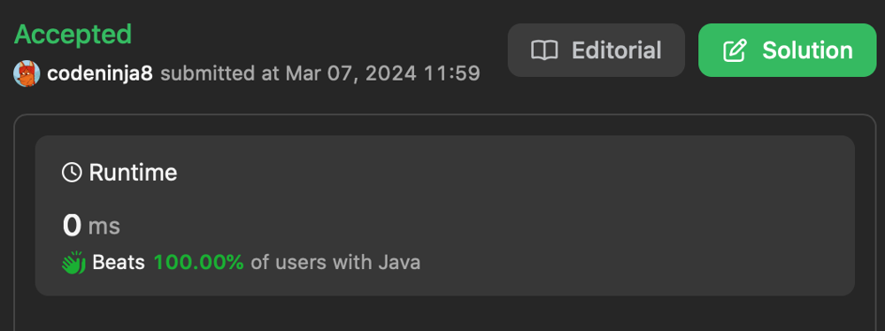

# ✅ 0 ms simple neat solution (5 line of code) in 9 languages 👍

**Author:** codeninja8
**Votes:** 0
**Link:** [https://leetcode.com/problems/middle-of-the-linked-list/solutions/4836827/](https://leetcode.com/problems/middle-of-the-linked-list/solutions/4836827/)

---

Use Floyd's tortoise and hare algorithm

# Code
``` java []
class Solution {
    public ListNode middleNode(ListNode head) {
        ListNode mid = head;

        while (head != null && head.next != null) {
            head = head.next.next;
            mid = mid.next;
        }

        return mid;
    }
}
```
``` c []
struct ListNode* middleNode(struct ListNode* head) {
    struct ListNode* mid = head;

    while (head != NULL && head->next != NULL) {
        head = head->next->next;
        mid = mid->next;
    }

    return mid;
}
```
``` csharp []
public class Solution {
    public ListNode MiddleNode(ListNode head) {
        ListNode mid = head;

        while (head != null && head.next != null) {
            head = head.next.next;
            mid = mid.next;
        }

        return mid;
    }
}
```
``` javascript []
var middleNode = function(head) {
    var mid = head;

    while (head != null && head.next != null) {
        head = head.next.next;
        mid = mid.next;
    }

    return mid;
};
```
``` python []
class Solution(object):
    def middleNode(self, head):
        mid = head

        while head and head.next:
            head = head.next.next
            mid = mid.next
        return mid
        
```
``` golang []
func middleNode(head *ListNode) *ListNode {
    mid := head

    for head != nil && head.Next != nil {
        head = head.Next.Next
        mid = mid.Next
    }

    return mid
}
```
``` ruby []
def middle_node(head)
    mid = head
    while head != nil and head.next != nil
        head = head.next.next
        mid = mid.next
    end

    mid
end
```
``` php []
class Solution {
    function middleNode($head) {
        $mid = $head;

        while ($head != null && $head->next != null) {
            $head = $head->next->next;
            $mid = $mid->next;
        }

        return $mid;
    }
}
```
``` racket []
(define (middle-node head)
  (let while ([mid head]
              [cur head])
    (cond [(not (and (list-node? cur) (list-node? (list-node-next cur)))) mid]
          [else (while (list-node-next mid) (list-node-next (list-node-next cur)))])))
```


