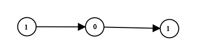

# [1290. Convert Binary Number in a Linked List to Integer](https://leetcode.com/problems/convert-binary-number-in-a-linked-list-to-integer/)

| Category | Difficulty | Likes | Dislikes |
| :------: | :--------: | :---: | :------: |
| Algorithms | Easy | 4650 | 177 |

**Tags:** [`linked-list`](https://leetcode.com/tag/linked-list), [`math`](https://leetcode.com/tag/math)

**Companies:** `google`, `nutanix`, `bloomberg`, `oracle`, `amazon`, `cisco`, `roblox`

## Description

Given `head` which is a reference node to a singly-linked list. The value of each node in the linked list is either `0` or `1`. The linked list holds the binary representation of a number.

Return the *decimal value* of the number in the linked list.

The **most significant bit** is at the head of the linked list.

 

**Example 1:**


```

Input: head = [1,0,1]
Output: 5
Explanation: (101) in base 2 = (5) in base 10

```

**Example 2:**

```

Input: head = [0]
Output: 0

```

 

**Constraints:**

	- The Linked List is not empty.

	- Number of nodes will not exceed `30`.

	- Each node's value is either `0` or `1`.

---

**Links:** [Submissions](https://leetcode.com/problems/convert-binary-number-in-a-linked-list-to-integer/) | [Solutions](https://leetcode.com/problems/convert-binary-number-in-a-linked-list-to-integer/)
