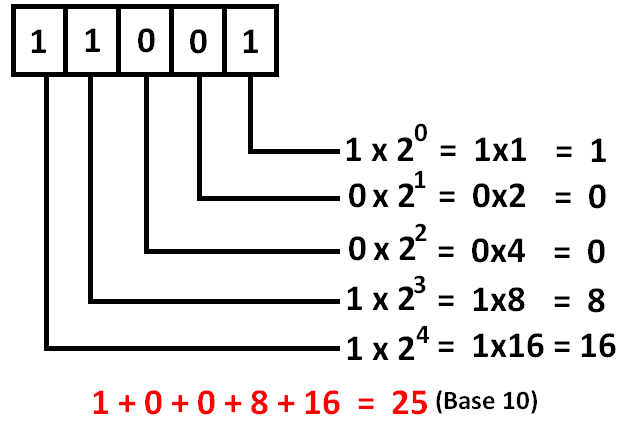
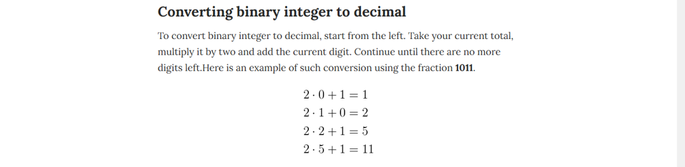

# C++ | All approaches Detailed explanation | Bit Manipulation

**Author:** priyam_vd
**Votes:** 125
**Link:** [https://leetcode.com/problems/convert-binary-number-in-a-linked-list-to-integer/solutions/1615821/](https://leetcode.com/problems/convert-binary-number-in-a-linked-list-to-integer/solutions/1615821/)

---

**Let's lool at how the Binary to Decimal conversion takes place !!**

As we can see here that to form the Decimal Number, we just need to multiply the binary digits at each node of Linked List with an appropriate power of 2 ... And this Power of 2 basically increases as we move in the backward direction !!

1. **Approach 1 ::**
It's very basic to observe that we don't know by what power of 2 we will be multipying the first Node of the List if we try to iterate in the forward direction , so we would just convert the the Linked_list into a string and then traverse over it in the backward direction... **Multiplying each index by increasing pow(2) and keep adding the result to form the desired Decimal answer...**

**Time Complexity :: O(n)** and **Space Complexity :: O(n)**
```
class Solution {
public:
    int getDecimalValue(ListNode* head) {
        string num;
        while(head!=NULL){
            num+=to_string(head->val);
            head=head->next;
        }
        int res=0,pv=1;
        for(int i=num.size()-1;i>=0;i--){
            res+=pv*(stoi(num.substr(i,1)));
            pv*=2;
        }
        return res;
    }
};
```

2. **Approach 2 ::**
To **optimize the space** and to make our solution **one-pass** we need to figure out a way to iterate in the forward direction and get the desired result ....

We are maintaining the answer till each node and at each node we are multiplying the answer by 2 adding the node->val !!

**Time Complexity :: O(n)** and **Space Complexity :: O(1)**
```
class Solution {
public:
    int getDecimalValue(ListNode* head) {
        int res=0;
        while(head!=NULL){
            res=res*2+head->val;
            head=head->next;
        }
        return res;
    }
};
```

3. **Approach 3 ::**
Approach is same actually , it's just we are gonna achieve it via bitwise operators, it is beneficial as they work faster than the arithmatic operators !!

**Time Complexity :: O(n)** and **Space Complexity :: O(1)**
```
class Solution {
public:
    int getDecimalValue(ListNode* head) {
        int res = 0;
        ListNode* iter = head;
        while (iter != NULL) {
            res <<= 1;
            res |= iter->val;
            iter = iter->next;
        }
        return res;
    }
};
```

**To visualize it -->**
our sum = 0
And we are gonna do 2 steps --->>>
1. sum * 2 = sum (left shift <<)
2. sum + 1 or 0 = sum 
And will run a loop over these 2 steps until head becomes NULL.....

    For example ---> Binary number --> 10110
    
* left shift 1 =>  ( 0 * 2 ) =  0
* After sum    =>  0 + 1 = 1

* left shift 1 =>  ( 1 * 2 ) =  2
* After sum    =>  2 + 0 = 2
* left shift 1 =>  ( 2 * 2 ) =  4
* After sum    =>  4 + 1 = 5
* left shift 1 =>  ( 5 * 2 ) =  10
* After sum    =>  10 + 1 = 11
* left shift 1 =>  ( 11 * 2 ) =  22
* After sum    =>  22 + 0 = 22

**And that's how we achieve the desired result!!**

4. **Approach 4 :: 1-liner**
How can we miss the recursive 1-liner !!
```
class Solution {
public:
    int getDecimalValue(ListNode* head, int res = 0) {
        return head ? getDecimalValue(head->next, res * 2 + head->val) : res;
    }
};
```
No explanation, 1-liners are for fun ... :)
**Thanks for reading it out !!**

