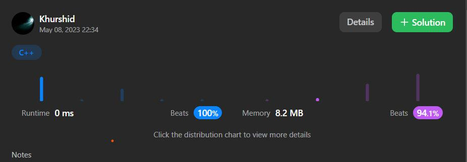

# ✅C++ ✅C# and ✅JavaScript..🔥Easy and Fast solutions.💯

**Author:** aloneguy
**Votes:** 12
**Link:** [https://leetcode.com/problems/convert-binary-number-in-a-linked-list-to-integer/solutions/3501821/](https://leetcode.com/problems/convert-binary-number-in-a-linked-list-to-integer/solutions/3501821/)

---


# Approach:WE have to follow the node and calculate the number.Everytime when we get the next node's value we have to multiplicate the previous sum.
<!-- Describe your approach to solving the problem. -->



```C++ []
class Solution {
public:
    int getDecimalValue(ListNode* head) {
        int total=0;
        while(head!=NULL){
            total=total*2+head->val;
            head=head->next;
        }
        return total;
    }
};
```
```C# []
public class Solution {
    public int GetDecimalValue(ListNode head) {
        int total=0;
       while(head is not null){
           total=total*2+head.val;
           head=head.next;
       }
        return total;
    }
}
```
```javascript []

var getDecimalValue = function(head) {
    let total=0;
    while(head!=null){
        total=total*2+head.val;
        head=head.next;
    }
    return total;
};
```


